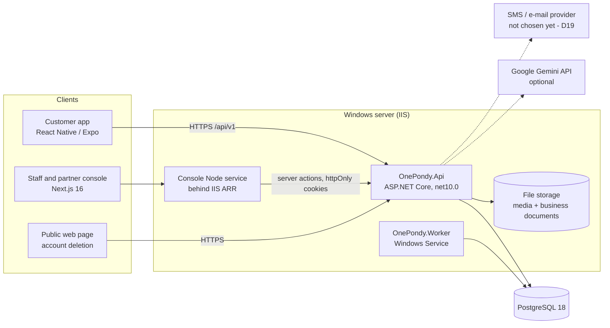
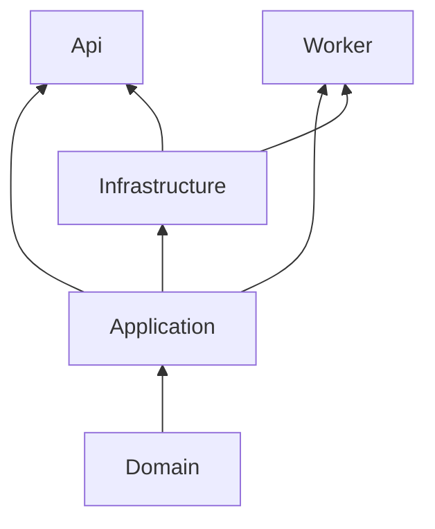

# OnePondy – Backend Architecture

Audience: developers and operations. Scope: everything built through Phase 6 (accounts,
tourism content, itineraries and AI planner, partner onboarding, listings, availability and the
booking engine). Phase 7+ (payments, notifications, reviews, food, rides) is **not built** and is
marked as such.

Related documents: [database-architecture.md](database-architecture.md),
[workflows.md](workflows.md), [data-retention.md](data-retention.md),
[../OnePondy_Functional_Specification.md](../OnePondy_Functional_Specification.md).

## 1. System context



- The mobile app talks to the API directly with a bearer access token.
- The console is a Next.js app; the browser never sees a token. Server actions call the API and
  keep tokens in `httpOnly` cookies. Staff and partner sessions use separate cookies.
- Hosting is Windows/IIS (no Docker). The API runs in IIS, the Worker as a Windows Service named
  "OnePondy Worker", the console as a Node service behind IIS ARR, PostgreSQL as a Windows service.
- Dotted lines are integrations that are optional or not finished: without a Gemini key the AI
  planner reports itself unavailable; without a real OTP provider, sign-in codes cannot be
  delivered outside Development/Testing.

## 2. Solution layout

Repository: `backend/OnePondy.sln`, SDK pinned by `global.json` (10.0.403). `Directory.Build.props`
turns on `Nullable`, `ImplicitUsings` and `TreatWarningsAsErrors` for every project.

| Project | Role | References |
|---|---|---|
| `OnePondy.Domain` | Entities, value objects, enums, state machines, invariants. No framework dependencies. | – |
| `OnePondy.Application` | Use-case services, validation, abstractions (`IOnePondyDbContext`, `IOtpSender`, `IMediaStorage`, `IItineraryPlanner`…), `Result<T>`/`AppError`. | Domain |
| `OnePondy.Infrastructure` | EF Core/PostgreSQL, Identity, JWT, hashing, file storage, SkiaSharp image pipeline, Gemini client, OTP delivery. | Application, Domain |
| `OnePondy.Api` | HTTP host: minimal-API endpoint groups, auth, rate limiting, health checks. | Application, Infrastructure |
| `OnePondy.Worker` | Background jobs host. | Application, Infrastructure |
| `OnePondy.UnitTests` | Domain and service tests on the EF in-memory provider with fakes. | – |
| `OnePondy.IntegrationTests` | HTTP-level tests against real PostgreSQL. | – |
| `OnePondy.ArchitectureTests` | NetArchTest rules that fail the build when layering is broken. | – |



### 2.1 Layer rules (enforced by `OnePondy.ArchitectureTests`)

1. Project references only point inward (Domain ← Application ← Infrastructure; Api and Worker sit
   outside).
2. No type may depend on a layer outside its own.
3. `OnePondy.Domain` has no framework dependencies (no EF Core, no ASP.NET).

A change that breaks one of these fails the test suite, so the rules cannot drift quietly.

### 2.2 Key packages

Npgsql.EntityFrameworkCore.PostgreSQL 10.0.3 · EFCore.NamingConventions (snake_case) · ASP.NET
Core Identity (core + roles, GUID keys) · Microsoft.AspNetCore.Authentication.JwtBearer 10.0.14 ·
Microsoft.IdentityModel.JsonWebTokens · SkiaSharp 4.153.1 · AspNetCore.HealthChecks (EF Core) ·
Microsoft.Extensions.Hosting.WindowsServices (Worker).

## 3. Request pipeline (`OnePondy.Api/Program.cs`)

Order of middleware, top to bottom:

1. OpenAPI document (Development only).
2. Problem Details and the global exception handler (unhandled errors become `500` problem JSON,
   never a stack trace).
3. Static files: the public account-deletion page at `/account/delete/`, and the media folder at
   `/media` with a one-year `immutable` cache (file names are content-addressed, so they never change).
4. Rate limiter (§5.4).
5. Authentication, then authorization.
6. Health checks: `/health/live` (process is up) and `/health/ready` (database reachable).
7. Endpoint groups, all under `/api/v1`: Auth, Account, PublicContent, StaffAuth, AdminPlace,
   AdminSettings, SavedPlace, Itinerary, TripPlanner, Business, Listing, SavedListing, Booking.

JSON uses camelCase property names and string enums.

### 3.1 Endpoint pattern

Endpoints are thin. Each one binds the request, reads the caller's id from the token, calls one
application service and converts the `Result<T>` into HTTP. No business rule lives in an endpoint.

```csharp
var result = await service.DoThingAsync(userId, input, ct);
return result.IsSuccess ? Results.Ok(result.Value) : ProblemResults.From(result.Error, httpContext);
```

## 4. Application layer

Services are plain classes registered in `Application/DependencyInjection.cs`. They depend on
abstractions only, so they run unchanged against the in-memory provider in unit tests.

| Area | Services |
|---|---|
| Identity | `AuthService`, `OtpChallengeService`, `StaffSignInService`, `StaffService`, `AccountService`, `AuthDataRetention`, `ISecretHasher` |
| Places | `PlaceAdminService`, `PlaceCatalogService`, `MediaService` |
| Configuration and audit | `ConfigService` (module flags, minimum app version), `AuditTrail` (writer), `AuditQueryService` (console reader) |
| Planning | `ItineraryService`, `SavedPlacesService`, `TripPlannerService` |
| Partners | `BusinessService`, `ListingService`, `SavedListingsService` |
| Bookings | `BookingService`, `BookingHoldExpiry`, `BookingsDeletionGuard` |

### 4.1 Result and error model

Services never throw for expected failures. They return `Result<T>` carrying an `AppError`
(`ErrorKind`, a stable machine `Code`, a message and optional field errors). The API maps it once:

| `ErrorKind` | HTTP | Typical use |
|---|---|---|
| `Validation` | 400 | Bad input; `errors` holds per-field messages. |
| `Unauthorized` | 401 | Missing/expired token, wrong or expired code. |
| `Forbidden` | 403 | Signed in but role not allowed. |
| `NotFound` | 404 | Missing, or owned by someone else (see §5.5). |
| `Conflict` | 409 | State conflict or stale `version`. |
| `TooManyRequests` | 429 | Rate/cost limits; includes `retryAfterSeconds`. |
| `Unavailable` | 503 | Dependency not configured or timed out (AI planner, OTP delivery). |

The body is RFC 9457 problem JSON with extra members: `code`, `errors`, `reasons`,
`retryAfterSeconds`. Clients branch on `code`, never on message text.

Helpers: `FieldErrors` (builds validation maps), `PagedResult<T>` and `Paging.Normalize` (page and
page-size clamping).

### 4.2 Persistence abstraction

Application code uses `IOnePondyDbContext` (DbSets plus `SaveChangesAsync`) instead of the concrete
context. Notable members:

- `ExpectVersion(entity, version)` – sets the original `xmin` value so a stale client write fails.
- `MarkAdded(entity)` – required when adding a child to an owned collection of an already-tracked
  parent, otherwise EF treats it as modified.
- `BeginTransactionAsync` – used where several rows must change together (booking creation).

## 5. Security architecture

### 5.1 Authentication: passwordless one-time codes

There are no passwords. A user proves control of a phone (+91 SMS) or e-mail address.

| Setting | Value |
|---|---|
| Code | 6 digits, valid 5 minutes, 5 attempts |
| Resend interval | 30 s per destination (across all purposes) |
| Send limits | 3 per destination per 10 minutes; 1000 per day overall |
| Storage | `otp_challenges.code_hash` – keyed hash only, never the code |
| Purposes | `SignIn`, `AccountDeletion`, `StaffSignIn` |
| Delivery | `LoggingOtpSender` only when `Auth:Otp:Delivery=Log` in Development/Testing; otherwise `UnavailableOtpSender` returns `503` until a provider is chosen (open decision D19) |

### 5.2 Tokens and sessions

- **Access token:** JWT, HS256, issuer `onepondy-api`, audience `onepondy-app`, 15-minute lifetime,
  30 s clock skew. Carries user id, roles and the session id.
- **Session check:** `OnTokenValidated` loads the session; if it is revoked the request is rejected
  even though the JWT is still within its lifetime. Sign-out, account deletion and role changes
  therefore take effect immediately.
- **Refresh token:** opaque, 30 days, stored as a keyed hash (`ISecretHasher`, HMAC). Each use
  rotates it (the old row gets `consumed_at` and `replaced_by_token_id`).
- **Reuse detection:** presenting an already-consumed refresh token revokes the whole session with
  reason `refresh_token_reuse`.
- Revocation reasons: `signed_out`, `refresh_token_reuse`, `account_deleted`, `role_changed`.

### 5.3 Authorization

| Caller | Mechanism |
|---|---|
| Public | No token: config, places, public listings and availability, shared itineraries, health. |
| Customer | Any valid token. Data is always filtered by the token's user id, never by an id in the request. |
| Partner | Any valid token **plus ownership** of the business in the route (§5.5). There is no partner role. |
| Staff | Policies built on roles: `ContentRead` (administrator, content_editor, support_agent), `ContentWrite` (administrator, content_editor), `Administration` (administrator). |

Roles are `customer`, `administrator`, `content_editor`, `support_agent`.

Staff sign-in is a separate flow (`StaffSignInService`): a code is e-mailed only if the address
belongs to a staff user, but the API gives the same response either way so it cannot be used to
discover staff accounts. `Console:BootstrapAdministrators` creates the first administrator, and
only while no administrator exists.

### 5.4 Rate limiting

A fixed-window limiter, policy `auth`, partitioned per client IP (default 30 per minute,
configurable under `RateLimiting:Auth`). Rejections return `429` problem JSON with
`code: "rate_limited"`. OTP-specific limits (§5.1) apply on top.

### 5.5 Ownership checks

Partner services load by id **and** owner. A business that belongs to someone else returns
`NotFound`, not `Forbidden`, so ids cannot be probed. The same applies to bookings: a customer
only reaches their own booking, and a partner only reaches bookings of their own business
(verified by unit and integration tests).

### 5.6 Files

- Place images: JPEG/PNG/WebP, max 10 MB, at least 800×450, max 50 M pixels, 20 per place.
  SkiaSharp decodes, strips EXIF/GPS, and writes WebP at 1600, 800 and 400 px into
  `Media:RootPath`, served publicly from `/media`.
- Business documents (GSTIN, FSSAI, other) go to `BusinessDocuments:RootPath`, a **private**
  folder that is not served statically. They are streamed back only through authorised endpoints
  (owner or administrator).
- The database stores only storage keys, never file bytes.

### 5.7 Known security gaps

- No real OTP provider yet (D19) – a launch blocker.
- JWT signing key and hashing key come from configuration; production values must be supplied as
  secrets and rotated per the ops runbook. Never commit them.
- HS256 with a shared key is adequate for a single API; revisit if tokens must be verified by
  another service.

## 6. Concurrency and data integrity

| Mechanism | Used for |
|---|---|
| `xmin` row version (`Version`) | `Place`, `Business`, `Listing`, `AvailabilitySlot`, `Booking`, `RefreshToken`. Clients send the `version` they loaded; a mismatch becomes `409 Conflict`. |
| `CHECK` constraints | Last line of defence for rules such as `reserved_count <= capacity` (see database doc). |
| Unique indexes | Idempotency (`customer_user_id`, `idempotency_key`), one stop per position, one account per phone/e-mail. |
| Deferrable unique constraint | Itinerary stop reorder inside one transaction. |
| Transactions | Booking creation reserves slots and writes history atomically. |
| Append-only triggers | `audit_log` and `booking_status_history`. |

Testing consequence: the EF in-memory provider cannot reproduce races, `xmin`, deferrable
constraints or `ExecuteUpdate`/`ExecuteDelete`. Domain and booking/listing code therefore avoids
bulk-execute methods (account deletion loads and removes rows for the same reason), and race
behaviour is covered by PostgreSQL integration tests. The one exception is `AuthDataRetention`,
which uses `ExecuteDeleteAsync` for the hourly purge and so only works against a real database.

## 7. Module catalogue

### 7.1 Accounts (`Identity`)

Sign-in, refresh, sign-out, profile (display name, language `en`/`ta`/`fr`), account deletion by
re-authentication with a code, and a public web deletion flow for people without the app. See
[workflows.md](workflows.md) §2–§4.

### 7.2 Tourism content (`Places`)

Staff-curated places with translations (Tamil, French), entry fees, opening hours, media and a
verification workflow. Public catalogue only exposes places that are **published and verified**.
Distance sorting uses `lat`/`lng` in memory (no PostGIS yet).

### 7.3 Configuration (`Configuration`)

`module_flags` (`available`/`coming_soon`/`hidden`) and `min_app_version` are returned by
`GET /api/v1/config` (cached 60 s) so features can be switched on without an app release. Changes
are administrator-only and audited.

### 7.4 Planning

Saved places, itineraries (draft/saved/archived, max 100 stops, shareable read-only link) and the
AI trip planner (§8).

### 7.5 Partners, listings and bookings

Business onboarding with document review, listings with moderation, dated capacity slots, and the
booking engine with a 30-minute hold. Money and hold behaviour are in [workflows.md](workflows.md)
§11–§16.

## 8. AI trip planner

`TripPlannerService` is deliberately defensive; the model only ranks and arranges places the
platform already trusts.

1. Validate dates (at most 14 days) and the `tripPlanner` module flag (must be `available`).
2. Enforce the per-user daily limit (5) and the daily cost cap ($5 at an estimated $0.02/request),
   both computed from `trip_planner_request_logs`.
3. Pick up to 40 candidates from verified, published places (nearest first when a point is given).
4. Call `IItineraryPlanner`: `GeminiItineraryPlanner` (`gemini-2.5-flash`, 20 s timeout) when
   `Ai:Gemini:ApiKey` is set, otherwise `UnavailableItineraryPlanner` (503).
5. Filter the model output to candidate ids and the requested day range – anything invented is
   dropped.
6. Log the request and outcome, then create an `ai_assisted` draft itinerary owned by the user.

The provider is behind an interface, so it can be replaced without touching the service.

## 9. Worker (`OnePondy.Worker`)

A generic host that registers hosted services; installed as the Windows Service "OnePondy Worker"
and runnable as a console app in development. It shares Application and Infrastructure with the API.

| Job | Schedule | Behaviour |
|---|---|---|
| `AuthDataRetentionJob` | hourly (and once at start-up) | Calls `AuthDataRetention`: deletes OTP challenges created more than 1 day ago, refresh tokens expired or consumed more than 30 days ago, and sessions revoked or expired more than 90 days ago (their remaining tokens cascade). |
| `BookingHoldExpiryJob` | every minute (and once at start-up) | Calls `BookingHoldExpiry`: takes up to 100 open holds past `expires_at`, oldest first, and runs `TryExpireAsync` on each. Each booking is saved separately, so a lost race (for example a second worker instance, or the partner accepting at that instant) never blocks the rest of the batch. |

Both jobs catch and log exceptions so a bad run never stops the service; the next interval retries.

If the Worker is stopped, nothing breaks immediately, but unconfirmed bookings keep their slots
until it runs again. Keep it running in production. Planned additions (outbox dispatch, payment
reconciliation) arrive with Phase 7.

## 10. Configuration reference

Bound from `appsettings*.json`, environment variables and (in production) secrets.

| Section | Keys |
|---|---|
| `ConnectionStrings:OnePondy` | PostgreSQL connection string |
| `Auth:Jwt` | `Issuer`, `Audience`, `SigningKey`, `AccessTokenLifetime` |
| `Auth:HashingKey` | Key for the HMAC `ISecretHasher` |
| `Auth:Otp` | Code length, lifetime, attempts, resend interval, per-destination and daily limits, allowed calling codes (`["91"]`), `Delivery` |
| `Auth:Sessions` | `RefreshTokenLifetime` |
| `RateLimiting:Auth` | `PermitLimit`, `Window` |
| `Content` | `ReviewInterval` (default 180 days) |
| `Media` | `RootPath`, `MaxUploadBytes`, `MinLongEdge`, `MinShortEdge`, `MaxPixels`, `MaxPerPlace` |
| `BusinessDocuments` | `RootPath` (private) |
| `Console` | `BootstrapAdministrators` |
| `TripPlanner` | Daily limit, cost cap, cost per request, candidate limit |
| `Ai:Gemini` | `ApiKey`, `Model`, `BaseUrl`, `Timeout` |

Production notes: the app pool identity needs write access to both storage folders; the
business-documents folder must sit outside the web root.

## 11. Testing strategy

| Suite | What it proves | Runs |
|---|---|---|
| Unit | Domain state machines, services (OTP, auth, places, itineraries, planner, businesses, listings, bookings) using in-memory EF and a controllable clock | Always |
| Architecture | Layering rules (§2.1) | Always |
| Integration | Real HTTP requests against PostgreSQL: auth flows, content, tourism, businesses, bookings, concurrency, health | Only when `ONEPONDY_TEST_DATABASE` is set (tests skip themselves otherwise) |

Important: the CI workflow builds and runs the suite on Windows but does not currently provide a
database, so the PostgreSQL integration tests are skipped in CI. Run them locally before merging
changes that touch persistence, concurrency or the booking engine. The integration run also applies
every migration to a fresh database and fails on pending model changes.

## 12. Endpoint catalogue

All routes are prefixed `/api/v1`. Auth column: **P** public, **U** any signed-in user, **O**
signed-in owner of the business, **S-R** staff content-read, **S-W** staff content-write, **S-A**
administrator.

### Accounts and sessions
| Method and path | Auth | Purpose |
|---|---|---|
| POST `/auth/otp/request`, `/auth/otp/verify` | P | Request and verify a sign-in code. |
| POST `/auth/refresh` | P | Rotate refresh token. |
| POST `/auth/logout` | U | Revoke current session. |
| GET, PATCH `/profile` | U | Read/update profile. |
| POST `/account/deletion/code`, `/account/deletion/confirm` | U | Delete account after re-authentication. |
| POST `/account/deletion-requests`, `/account/deletion-requests/confirm` | P | Public web deletion flow. |

### Public content and configuration
| Method and path | Auth | Purpose |
|---|---|---|
| GET `/config` | P | Module flags and minimum app version (cached 60 s). |
| GET `/places`, `/places/{idOrSlug}` | P | Published, verified places; filters `category`, `q`, `lang`, `lat`+`lng`, paging. |
| GET `/listings`, `/listings/{id}`, `/listings/{id}/availability` | P | Published listings and open slots. |
| GET `/itineraries/shared/{token}` | P | Read a shared itinerary. |

### Staff console
| Method and path | Auth | Purpose |
|---|---|---|
| POST `/admin/auth/otp/request`, `/admin/auth/otp/verify`, GET `/admin/me` | P / P / S-R | Staff sign-in by e-mailed code; current staff user. |
| `/admin/places` list, counts, categories, get, history | S-R | Browse content and its history. |
| `/admin/places` create, update, submit, verify, reject, publish, unpublish, confirm-review, media upload/order/update/delete | S-W | Edit and moderate places. |
| `/admin/config`, `/admin/config/modules/{key}`, `/admin/config/min-app-version` | S-R read, S-A write | Module flags and version gate. |
| `/admin/staff` list, add, change role, remove; GET `/admin/audit` | S-A | Staff management and audit log. |
| `/admin/businesses` list, get, documents, approve, reject, suspend, reinstate | S-A | Partner review. |
| `/admin/listings` list, get, publish, send-back, suspend, reinstate | S-A | Listing moderation. |

### Customer features
| Method and path | Auth | Purpose |
|---|---|---|
| `/saved-places`, `/saved-listings` | U | Bookmarks. |
| `/itineraries` CRUD, save, archive, unarchive, stops, stops/order, share | U | Trip plans. |
| POST `/trip-planner/plan` | U | AI draft itinerary. |
| POST/GET `/bookings`, GET `/bookings/{id}`, POST `/bookings/{id}/cancel` | U | Create, list, view, cancel own bookings. |

### Partner features
| Method and path | Auth | Purpose |
|---|---|---|
| `/partner/businesses` list, apply, get, update; documents upload, download, remove | O (list and apply: U) | Onboarding and profile. |
| `/partner/businesses/{id}/listings` CRUD, submit, slots CRUD | O | Listings and availability. |
| `/partner/businesses/{id}/bookings` list, get, accept, reject, cancel, complete | O | Handle incoming bookings. |

Update calls take the entity's `version`; a mismatch returns `409`.

## 13. Hosting and deployment

1. Publish the API to IIS and set the environment/secret configuration (§10).
2. Apply migrations **before** starting the new API build (the integration suite proves they apply
   to an empty database; production applies them to existing data).
3. Install or update the Worker service and confirm it is running.
4. Grant the app pool write access to the media and business-documents folders.
5. Publish the console and restart its Node service.
6. Verify `/health/ready`, then sign in and run a smoke booking.

`database/scripts` holds `create-dev-database.sql` and `enable-postgis.sql` (PostGIS is not used
yet).

## 14. Not built yet

- Payments, refunds and the states `awaiting_payment`, `failed`, `refund_pending`, `refunded` –
  modelled in the schema and state machine but unreachable until Phase 7.
- Push notifications, reviews and ratings, food ordering, rides.
- A real SMS/e-mail provider (D19), an all-bookings admin view, listing photos, PostGIS.
