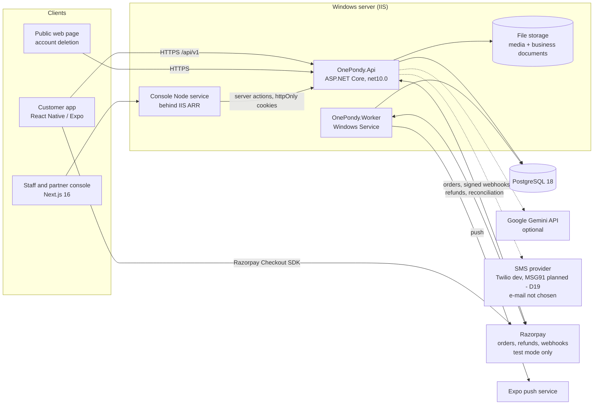
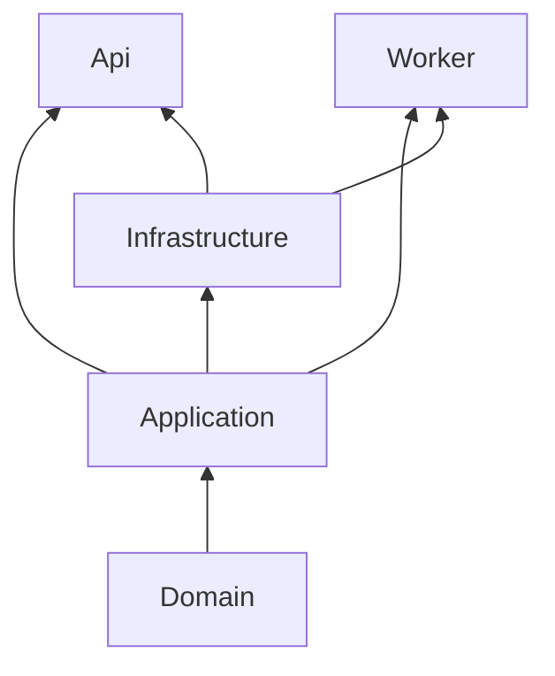

# OnePondy – Backend Architecture

Audience: developers and operations. Scope: everything built through Phase 8 (accounts,
tourism content, itineraries and AI planner, partner onboarding, listings, availability, the
booking engine, Phase 7: online payment in **sandbox**, refunds, the ledger, reconciliation,
push notifications and partner statements, and Phase 8: restaurants, food orders and their payment,
delivery drivers, deliveries, cash on delivery and administrators' order monitoring) and, from Phase 10, reviews and support requests (the server, the customer app's screens and the
console's; the rest of the phase comes later). Rides are **not built** and are marked as such. Live payments are switched off by design until the go-live gate in
[phase-7-plan.md](phase-7-plan.md) §9 is met.

Related documents: [database-architecture.md](database-architecture.md),
[workflows.md](workflows.md), [data-retention.md](data-retention.md),
[../OnePondy_Functional_Specification.md](../OnePondy_Functional_Specification.md).

## 1. System context



- The mobile app talks to the API directly with a bearer access token.
- The console is a Next.js app; the browser never sees a token. Server actions call the API and
  keep tokens in `httpOnly` cookies. Staff and partner sessions use separate cookies.
- Hosting is Windows/IIS (no Docker). The API runs in IIS, the Worker as a Windows Service named
  "OnePondy Worker", the console as a Node service behind IIS ARR, PostgreSQL as a Windows service.
- Dotted lines are integrations that are optional or not finished: without a Gemini key the AI
  planner reports itself unavailable; without a real OTP provider, sign-in codes cannot be
  delivered outside Development/Testing.

## 2. Solution layout

Repository: `backend/OnePondy.sln`, SDK pinned by `global.json` (10.0.403). `Directory.Build.props`
turns on `Nullable`, `ImplicitUsings` and `TreatWarningsAsErrors` for every project.

| Project | Role | References |
|---|---|---|
| `OnePondy.Domain` | Entities, value objects, enums, state machines, invariants. No framework dependencies. | – |
| `OnePondy.Application` | Use-case services, validation, abstractions (`IOnePondyDbContext`, `IOtpSender`, `IMediaStorage`, `IItineraryPlanner`…), `Result<T>`/`AppError`. | Domain |
| `OnePondy.Infrastructure` | EF Core/PostgreSQL, Identity, JWT, hashing, file storage, SkiaSharp image pipeline, Gemini client, OTP delivery. | Application, Domain |
| `OnePondy.Api` | HTTP host: minimal-API endpoint groups, auth, rate limiting, health checks. | Application, Infrastructure |
| `OnePondy.Worker` | Background jobs host. | Application, Infrastructure |
| `OnePondy.UnitTests` | Domain and service tests on the EF in-memory provider with fakes. | – |
| `OnePondy.IntegrationTests` | HTTP-level tests against real PostgreSQL. | – |
| `OnePondy.ArchitectureTests` | NetArchTest rules that fail the build when layering is broken. | – |



### 2.1 Layer rules (enforced by `OnePondy.ArchitectureTests`)

1. Project references only point inward (Domain ← Application ← Infrastructure; Api and Worker sit
   outside).
2. No type may depend on a layer outside its own.
3. `OnePondy.Domain` has no framework dependencies (no EF Core, no ASP.NET).

A change that breaks one of these fails the test suite, so the rules cannot drift quietly.

### 2.2 Key packages

Npgsql.EntityFrameworkCore.PostgreSQL 10.0.3 · EFCore.NamingConventions (snake_case) · ASP.NET
Core Identity (core + roles, GUID keys) · Microsoft.AspNetCore.Authentication.JwtBearer 10.0.14 ·
Microsoft.IdentityModel.JsonWebTokens · SkiaSharp 4.153.1 · AspNetCore.HealthChecks (EF Core) ·
Microsoft.Extensions.Hosting.WindowsServices (Worker).

## 3. Request pipeline (`OnePondy.Api/Program.cs`)

Order of middleware, top to bottom:

1. OpenAPI document (Development only).
2. Problem Details and the global exception handler (unhandled errors become `500` problem JSON,
   never a stack trace).
3. Static files: the public account-deletion page at `/account/delete/`, and the media folder at
   `/media` with a one-year `immutable` cache (file names are content-addressed, so they never change).
4. Rate limiter (§5.4).
5. Authentication, then authorization.
6. Health checks: `/health/live` (process is up) and `/health/ready` (database reachable).
7. Endpoint groups, all under `/api/v1`: Auth, Account, PublicContent, StaffAuth, AdminPlace,
   AdminSettings, SavedPlace, Itinerary, TripPlanner, Business, Listing, SavedListing, Booking.

JSON uses camelCase property names and string enums.

### 3.1 Endpoint pattern

Endpoints are thin. Each one binds the request, reads the caller's id from the token, calls one
application service and converts the `Result<T>` into HTTP. No business rule lives in an endpoint.

```csharp
var result = await service.DoThingAsync(userId, input, ct);
return result.IsSuccess ? Results.Ok(result.Value) : ProblemResults.From(result.Error, httpContext);
```

## 4. Application layer

Services are plain classes registered in `Application/DependencyInjection.cs`. They depend on
abstractions only, so they run unchanged against the in-memory provider in unit tests.

| Area | Services |
|---|---|
| Identity | `AuthService`, `OtpChallengeService`, `StaffSignInService`, `StaffService`, `AccountService`, `AuthDataRetention`, `ISecretHasher` |
| Places | `PlaceAdminService`, `PlaceCatalogService`, `MediaService` |
| Configuration and audit | `ConfigService` (module flags, minimum app version), `AuditTrail` (writer), `AuditQueryService` (console reader) |
| Planning | `ItineraryService`, `SavedPlacesService`, `TripPlannerService` |
| Partners | `BusinessService`, `ListingService`, `SavedListingsService` |
| Bookings | `BookingService`, `BookingHoldExpiry`, `BookingsDeletionGuard` |
| Reviews | `ReviewService` (customer, public, business and moderator sides), `ReviewChecks` (the automatic text check), `ReviewRatings` (displayed averages), `ReviewOptions` |
| Support | `SupportService` (requests, the agents' queue, audited access), `SupportEscalation` (the Worker's check), `SupportOptions` |
| Rides | `RideSafetyService` (SOS, incident reports, trip sharing, the staff queue), `RideHub` and `SignalRRideNotifier` (live updates), `RideDriverService` (apply, shifts, position, administrators' review, eligibility), `RideService` (fare quotes, requests, dispatch, the trip), `RideFare` (the arithmetic), `RideExpiry` (the Worker's check), `RideOptions`, `IRideNotifier` |
| Operations | `OperationsService` (the administrators' snapshot and its alert rules), `OperationsOptions`, `IRateLimitStatistics` (the limiter's counts, supplied by the API) |
| Delivery | `DriverService` (apply, edit, shifts, administrators' review), `DeliveryService` (open jobs, accept, release, pickup, deliver, position), `DeliveryProgress` (how a delivery is going, for the order screens), `FoodOrderAdminService` (administrators' list, detail, cancel, re-offer) with `OrderAttentionRules`, `CashService` (the cash a driver holds and recording what they hand in) |
| Payments | `PaymentService` (start, record capture, "check now", check-before-expiry), `PaymentWebhookService`, `RazorpaySignature`, `RefundService`, `LedgerService` (the only writer of `ledger_entries`), `ReconciliationService`, `ReconciliationExceptionService`, `PaymentAdminService`, `IPaymentGateway` |
| Statements | `SettlementService` (draft, approve, pay, discard, partner statements, CSV) |
| Notifications | `NotificationOutbox` (queues in the caller's transaction), `OutboxDispatcher`, `BookingReminders`, `NotificationRetention`, `DeviceService`, `IPushSender` |

### 4.1 Result and error model

Services never throw for expected failures. They return `Result<T>` carrying an `AppError`
(`ErrorKind`, a stable machine `Code`, a message and optional field errors). The API maps it once:

| `ErrorKind` | HTTP | Typical use |
|---|---|---|
| `Validation` | 400 | Bad input; `errors` holds per-field messages. |
| `Unauthorized` | 401 | Missing/expired token, wrong or expired code. |
| `Forbidden` | 403 | Signed in but role not allowed. |
| `NotFound` | 404 | Missing, or owned by someone else (see §5.5). |
| `Conflict` | 409 | State conflict or stale `version`. |
| `TooManyRequests` | 429 | Rate/cost limits; includes `retryAfterSeconds`. |
| `Unavailable` | 503 | Dependency not configured or timed out (AI planner, OTP delivery). |

The body is RFC 9457 problem JSON with extra members: `code`, `errors`, `reasons`,
`retryAfterSeconds`. Clients branch on `code`, never on message text.

Helpers: `FieldErrors` (builds validation maps), `PagedResult<T>` and `Paging.Normalize` (page and
page-size clamping).

### 4.2 Persistence abstraction

Application code uses `IOnePondyDbContext` (DbSets plus `SaveChangesAsync`) instead of the concrete
context. Notable members:

- `ExpectVersion(entity, version)` – sets the original `xmin` value so a stale client write fails.
- `MarkAdded(entity)` – required when adding a child to an owned collection of an already-tracked
  parent, otherwise EF treats it as modified.
- `BeginTransactionAsync` – used where several rows must change together (booking creation).

## 5. Security architecture

### 5.1 Authentication: passwordless one-time codes

There are no passwords. A user proves control of a phone (+91 SMS) or e-mail address.

| Setting | Value |
|---|---|
| Code | 6 digits, valid 5 minutes, 5 attempts |
| Resend interval | 30 s per destination (across all purposes) |
| Send limits | 3 per destination per 10 minutes; 1000 per day overall |
| Storage | `otp_challenges.code_hash` – keyed hash only, never the code |
| Purposes | `SignIn`, `AccountDeletion`, `StaffSignIn` |
| Delivery | `LoggingOtpSender` only when `Auth:Otp:Delivery=Log` in Development/Testing; otherwise `UnavailableOtpSender` returns `503` until a provider is chosen (open decision D19) |

### 5.2 Tokens and sessions

- **Access token:** JWT, HS256, issuer `onepondy-api`, audience `onepondy-app`, 15-minute lifetime,
  30 s clock skew. Carries user id, roles and the session id.
- **Session check:** `OnTokenValidated` loads the session; if it is revoked the request is rejected
  even though the JWT is still within its lifetime. Sign-out, account deletion and role changes
  therefore take effect immediately.
- **Refresh token:** opaque, 30 days, stored as a keyed hash (`ISecretHasher`, HMAC). Each use
  rotates it (the old row gets `consumed_at` and `replaced_by_token_id`).
- **Reuse detection:** presenting an already-consumed refresh token revokes the whole session with
  reason `refresh_token_reuse`.
- Revocation reasons: `signed_out`, `refresh_token_reuse`, `account_deleted`, `role_changed`.

### 5.3 Authorization

| Caller | Mechanism |
|---|---|
| Public | No token: config, places, public listings and availability, shared itineraries, health. |
| Customer | Any valid token. Data is always filtered by the token's user id, never by an id in the request. |
| Partner | Any valid token **plus ownership** of the business in the route (§5.5). There is no partner role. |
| Staff | Policies built on roles: `ContentRead` (administrator, content_editor, support_agent), `ContentWrite` (administrator, content_editor), `Administration` (administrator). |

Roles are `customer`, `administrator`, `content_editor`, `support_agent`.

Staff sign-in is a separate flow (`StaffSignInService`): a code is e-mailed only if the address
belongs to a staff user, but the API gives the same response either way so it cannot be used to
discover staff accounts. `Console:BootstrapAdministrators` creates the first administrator, and
only while no administrator exists.

### 5.4 Rate limiting

Two layers, both fixed-window limiters that answer `429` problem JSON with `code: "rate_limited"` and a `Retry-After` header.

- **Sign-in and account endpoints** (`/auth`, `/account`, `/admin/auth`) keep the named policy `auth`, counted per client address (default 30 per minute, `RateLimiting:Auth`). OTP-specific limits (§5.1) apply on top.
- **Everything else under `/api/`** is put in a class by `RateLimitClassifier` and counted **per signed-in person**, or per address for someone who is not signed in, so one person hammering the API cannot slow
  it for others, and people signed in behind one shared address do not lock each other out. Authentication runs before the limiter for that reason; a forged or expired token does not count as a person.

| Class | What it covers | Default |
|---|---|---|
| `browse` | public reads: places, listings, restaurants, reviews, configuration, the grievance officer | 120 a minute |
| `read` | reads by a signed-in person | 240 a minute |
| `write` | changes by a person: saving, cancelling, accepting, updating | 90 a minute |
| `create` | starting something a person must then read, moderate or answer: a review, a support request or message, a booking, an order, a trip plan, a business application, registering a device | 12 a minute |
| `upload` | photos and documents | 20 a minute |
| `staff` | everything under `/admin` | 600 a minute |

Health checks, static files, the API description and the payment gateway's callbacks (verified by signature, and never to be refused for arriving together) are not limited. Each limit is a setting
(`RateLimiting:Browse`, `Read`, `Write`, `Create`, `Upload`, `Staff`: `PermitLimit` and `Window`). `RateLimitStats` counts, per class, the requests that arrived and the ones refused, and when the last refusal was
(counts only, no addresses and no accounts, in the API's memory since it last started); the operations page reads it. Behind a reverse proxy, the address is what the host reports: IIS in-process hosting reports the real client.

### 5.5 Ownership checks

Partner services load by id **and** owner. A business that belongs to someone else returns
`NotFound`, not `Forbidden`, so ids cannot be probed. The same applies to bookings: a customer
only reaches their own booking, and a partner only reaches bookings of their own business
(verified by unit and integration tests).

### 5.6 Files

- Place images: JPEG/PNG/WebP, max 10 MB, at least 800×450, max 50 M pixels, 20 per place.
  SkiaSharp decodes, strips EXIF/GPS, and writes WebP at 1600, 800 and 400 px into
  `Media:RootPath`, served publicly from `/media`.
- Business documents (GSTIN, FSSAI, other) go to `BusinessDocuments:RootPath`, a **private**
  folder that is not served statically. They are streamed back only through authorised endpoints
  (owner or administrator).
- The database stores only storage keys, never file bytes.

### 5.7 Known security gaps

- No production OTP provider yet (D19): Twilio works for development, MSG91 needs DLT registration and e-mail has no provider. A launch blocker.
- JWT signing key and hashing key come from configuration; production values must be supplied as
  secrets and rotated per the ops runbook. Never commit them.
- HS256 with a shared key is adequate for a single API; revisit if tokens must be verified by
  another service.

## 6. Concurrency and data integrity

| Mechanism | Used for |
|---|---|
| `xmin` row version (`Version`) | `Place`, `Business`, `Listing`, `AvailabilitySlot`, `Booking`, `RefreshToken`, `PaymentAttempt`, `OutboxMessage`, `Settlement`. Clients send the `version` they loaded; a mismatch becomes `409 Conflict`. |
| `CHECK` constraints | Last line of defence for rules such as `reserved_count <= capacity` (see database doc). |
| Unique indexes | Idempotency (`customer_user_id`, `idempotency_key`), one stop per position, one account per phone/e-mail. |
| Deferrable unique constraint | Itinerary stop reorder inside one transaction. |
| Transactions | Booking creation reserves slots and writes history atomically. |
| Append-only triggers | `audit_log`, `booking_status_history` and `ledger_entries`. |
| Deferred constraint trigger | Every ledger transaction must sum to zero when it commits. |
| Row-lock trigger | `refunds` of one payment can never exceed what was captured, even when requested simultaneously. |
| Idempotent events | Webhook events are unique by provider event id; ledger transactions are derived from the event, so a repeat is refused; a booking has one open payment order. |
| `WriteConflicts.Is` | A save that lost a race is either a `DbUpdateException` or, for a deadlock victim, an `InvalidOperationException` wrapping one. Every service that treats a lost race as benign (bookings, payments, webhooks, reconciliation, statements, notifications) uses this one check, answers `409` where there is a caller, and clears its half-applied changes. A genuine fault is still thrown. Stale-row-version conflicts (`DbUpdateConcurrencyException`) are handled separately, as before. |

Testing consequence: the EF in-memory provider cannot reproduce races, `xmin`, deferrable
constraints or `ExecuteUpdate`/`ExecuteDelete`. Domain and booking/listing code therefore avoids
bulk-execute methods (account deletion loads and removes rows for the same reason), and race
behaviour is covered by PostgreSQL integration tests. The one exception is `AuthDataRetention`,
which uses `ExecuteDeleteAsync` for the hourly purge and so only works against a real database.

## 7. Module catalogue

### 7.1 Accounts (`Identity`)

Sign-in, refresh, sign-out, profile (display name, language `en`/`ta`/`fr`), account deletion by
re-authentication with a code, and a public web deletion flow for people without the app. See
[workflows.md](workflows.md) §2–§4.

### 7.2 Tourism content (`Places`)

Staff-curated places with translations (Tamil, French), entry fees, opening hours, media and a
verification workflow. Public catalogue only exposes places that are **published and verified**.
Distance sorting uses `lat`/`lng` in memory (no PostGIS yet).

### 7.3 Configuration (`Configuration`)

`module_flags` (`available`/`coming_soon`/`hidden`) and `min_app_version` are returned by
`GET /api/v1/config` (cached 60 s) so features can be switched on without an app release. Changes
are administrator-only and audited.

### 7.4 Planning

Saved places, itineraries (draft/saved/archived, max 100 stops, shareable read-only link) and the
AI trip planner (§8).

### 7.5 Partners, listings and bookings

Business onboarding with document review, listings with moderation, dated capacity slots, and the
booking engine with a 30-minute hold. Money and hold behaviour are in [workflows.md](workflows.md)
§11–§16.

### 7.6 Payments (Phase 7, sandbox only)

Razorpay is the gateway (D3), behind `IPaymentGateway`; `UnavailablePaymentGateway` is used when keys are missing, like the AI planner and OTP senders. A priced booking the partner accepts waits in `awaiting_payment` for a configurable window (30 minutes), the customer pays with Razorpay Checkout, and a **signed webhook** (or the app's "is it paid yet?" call, which asks Razorpay itself) confirms it. The app never decides a payment succeeded. A guard (`PaymentsGuard`) refuses to start with a configuration that could move real money by accident. Flow and rules: [workflows.md](workflows.md) §20.

### 7.7 Refunds and the ledger

`RefundService` applies the provisional refund rule (D22) and is off by default (`Payments:RefundsEnabled`). `LedgerService` records every movement as balanced double-entry lines, enforced by the database. Flow: [workflows.md](workflows.md) §21.

### 7.8 Reconciliation

The Worker compares our records with Razorpay's every five minutes and daily, applies what a lost webhook missed through the same safe path, and lists everything else for a person in the console. Flow: [workflows.md](workflows.md) §22.

### 7.9 Notifications

The transactional outbox plus the Expo push service (D7). Messages are written with the change that causes them, sent by the Worker, privacy-checked at send time, retried with back-off, and carry only a type and a booking id. Flow: [workflows.md](workflows.md) §23.

### 7.10 Partner statements

A statement is built from the ledger per business and period, approved by an administrator, and marked paid with the bank reference, which books the payout. Partners read their own and download CSV. Flow: [workflows.md](workflows.md) §24.

### 7.11 Food (Phase 8, steps 8.1 to 8.3)

A restaurant is a business of type restaurant plus a profile, delivery areas and a menu (`RestaurantService`, `MenuService`); customers browse only restaurants that are open, approved, active and serving their area. `OrderService` prices a cart from the menu, places an order (idempotent per customer, price revalidated against the total the customer was shown, snapshots of every dish), and moves it through the state table in `FoodOrder`: the restaurant accepts, rejects, starts and finishes cooking; the customer may cancel until cooking starts; `FoodOrderExpiry` (Worker) expires orders nobody answered or paid for. The restaurant never sees the customer's address or phone (OnePondy's own drivers deliver, F1).

**Paying (step 8.3)** reuses the Phase 7 services rather than copying them: a `PaymentAttempt`, `Refund`, `LedgerEntry`, `SettlementItem` and `ReconciliationException` belongs to a booking or a food order, and `PaymentService` branches on which once it has the attempt (start, capture, the check before expiry, "is it paid yet?", refund completion). Webhooks, the refund sweep and reconciliation are unchanged: they work from the gateway's ids and find the order through the attempt. `LedgerService.PostFoodCaptureAsync` books the provisional split (commission on the dishes; dishes and packaging to the restaurant; delivery fee to `delivery_fees`; GST to `tax_payable`); `PostFoodRefundAsync` reverses it exactly, since a food refund is always in full (F8). Cancelling a paid order plans its refund first (`RefundService.PlanFoodCancellationAsync`, refused while `Payments:RefundsEnabled` is off), saves the cancellation, refund and closed payment together, then sends the refund. `SettlementService` puts a delivered order on the restaurant's statement (its side only: dishes and packaging, less commission). Food orders send no push notifications yet. Flow: [workflows.md](workflows.md) §25; plan: [phase-8-plan.md](phase-8-plan.md).

### 7.12 Reviews (Phase 10, step 10.1)

A customer reviews a booking that reached `completed` or a food order that was `delivered` (`ReviewService`), once, within the review window; the
transaction must be theirs, and a unique index in the database makes "once" true even for simultaneous requests. A review is checked automatically
(`ReviewChecks`: phone numbers, e-mail addresses, links and an operator-written word list) only to give the moderator flags, and always waits in the
moderators' queue (administrators and content editors) until published. A published review can be answered once by the business and taken down by a
moderator; the author may change it once and delete it while it is waiting or published. Ratings (`ReviewRatings`) come only from published reviews and
appear on the public listing and restaurant views once there are enough. Account deletion removes the person's reviews. Workflow: [workflows.md](workflows.md) §26;
decisions and as-built notes: [phase-10-plan.md](phase-10-plan.md).

### 7.13 Support requests (Phase 10, step 10.3)

A customer, or a business owner about their business, writes to support and follows the conversation (`SupportService`); starting a request needs the `support` module, and each person has at most five
unresolved ones. Support agents and administrators (the `support` policy; content editors are excluded) work a queue of lists. An agent sees the request, the first name on the account and a short summary
of the one booking or order it is about, never the person's other history or phone number; opening a request is audited each time, the person's contact details are a separate audited step, and taking,
releasing, resolving and escalating are audited. Every agent change carries the request's version. A request that misses the first-reply or the resolution target is flagged in the queue and escalated once by
`SupportEscalation` (run by the Worker's `SupportEscalationJob`). `GET /support/grievance` is public and names the grievance officer from settings. Account deletion removes the person's requests.
Workflow: [workflows.md](workflows.md) §27; decisions and as-built notes: [phase-10-plan.md](phase-10-plan.md) §8.

### 7.14 Operations page (Phase 10, step 10.5)

`OperationsService.SnapshotAsync` gathers, in one read, what an administrator should look at: reviews waiting, the support counts, orders that look stuck, open payment differences, notifications not yet sent, sign-in
codes in the last hour and day, and the limiter's counts. `OperationsService.Alerts` is a pure function that turns those numbers and the `Operations` settings into alerts, most serious first (payment differences and
escalated support requests are critical). Nothing is stored and nothing is sent: the console shows the snapshot when an administrator loads the page. Administrators only.
Decisions and as-built notes: [phase-10-plan.md](phase-10-plan.md) §10.

### 7.15 Rides (Phase 9, steps 9.1 and 9.2)

A ride driver (`RideDriverService`) is a separate approval from delivering food: vehicle class, registration, licence, permit and insurance with its end date, reviewed by an administrator. `RideDriverProfile.IsEligible`
is approved and insured on the day, and is the one rule dispatch and accepting use. A rider asks for fares (`RideService.QuoteAsync` stores one quote per offered class, valid five minutes), requests a ride with a quote,
and the request is offered to eligible drivers on duty with a fresh position near the pickup. The first to accept gets it: the request is a row with a version, a database trigger refuses a second driver, and an index allows
one active ride per driver and one open ride per rider. The trip moves `requested → accepted → arrived → in_progress → completed` (or is cancelled or expires: `RideExpiryJob` in the Worker). The apps are told a ride changed
through `IRideNotifier` (no personal data; the apps refetch); the API pushes them over the SignalR hub `/hubs/rides` (a ride id only). Everything that starts a ride needs the `rides` module, which is off.
Decisions and as-built notes: [phase-9-plan.md](phase-9-plan.md).

## 8. AI trip planner

`TripPlannerService` is deliberately defensive; the model only ranks and arranges places the
platform already trusts.

1. Validate dates (at most 14 days) and the `tripPlanner` module flag (must be `available`).
2. Enforce the per-user daily limit (5) and the daily cost cap ($5 at an estimated $0.02/request),
   both computed from `trip_planner_request_logs`.
3. Pick up to 40 candidates from verified, published places (nearest first when a point is given).
4. Call `IItineraryPlanner`: `GeminiItineraryPlanner` (`gemini-2.5-flash`, 20 s timeout) when
   `Ai:Gemini:ApiKey` is set, otherwise `UnavailableItineraryPlanner` (503).
5. Filter the model output to candidate ids and the requested day range – anything invented is
   dropped.
6. Log the request and outcome, then create an `ai_assisted` draft itinerary owned by the user.

The provider is behind an interface, so it can be replaced without touching the service.

## 9. Worker (`OnePondy.Worker`)

A generic host that registers hosted services; installed as the Windows Service "OnePondy Worker"
and runnable as a console app in development. It shares Application and Infrastructure with the API.

| Job | Schedule | Behaviour |
|---|---|---|
| `AuthDataRetentionJob` | hourly (and once at start-up) | Calls `AuthDataRetention`: deletes OTP challenges created more than 1 day ago, refresh tokens expired or consumed more than 30 days ago, and sessions revoked or expired more than 90 days ago (their remaining tokens cascade). |
| `BookingHoldExpiryJob` | every minute (and once at start-up) | Calls `BookingHoldExpiry`: takes up to 100 open holds past `expires_at`, oldest first, and runs `TryExpireAsync` on each. Each booking is saved separately, so a lost race (for example a second worker instance, or the partner accepting at that instant) never blocks the rest of the batch. |
| `FoodOrderExpiryJob` | every minute (and once at start-up) | Calls `FoodOrderExpiry`: takes up to 100 food orders past `expires_at` that are still `placed` (the restaurant never answered) or `awaiting_payment`. An unpaid one is first checked with Razorpay, as a booking is: a payment found there confirms the order; if Razorpay cannot be asked the order waits up to `Food:GatewayCheckGrace` (5 minutes) before it expires anyway. Expiring closes the order's open payment in the same save. Each order is saved on its own, so a lost race never blocks the rest. |
| `PendingRefundJob` | every minute | Sends pending refunds to Razorpay (the refund's own id is the idempotency key) and retries ones that never left. |
| `PaymentReconciliationJob` | every 5 minutes | Checks open orders, stuck refunds and unprocessed webhooks, applies what a lost webhook missed, raises exceptions; once a day compares the previous day's payments with Razorpay's. |
| `OutboxDispatchJob` | every 20 seconds | Sends due notifications through Expo, reads delivery receipts about 15 minutes later, deletes dead phones, and (hourly) removes old log and outbox rows. |
| `BookingReminderJob` | every 30 minutes | Queues the "booking tomorrow" reminder, once per booking. |
| `RideExpiryJob` | every 30 seconds | Calls `RideExpiry`: expires ride requests no driver took within the search window, and deletes unused fare quotes a day after they expire. |
| `SupportEscalationJob` | every 5 minutes (and once at start-up) | Calls `SupportEscalation`: escalates, once, each unresolved support request with no first answer within the first-reply target or still unresolved after the resolution target, recording the reason in the audit log. |

All jobs catch and log exceptions so a bad run never stops the service; the next interval retries.

If the Worker is stopped, nothing breaks immediately, but unconfirmed bookings keep their slots,
refunds wait, notifications queue and webhook gaps go unnoticed until it runs again. Keep it
running in production and alert on its error log lines and on the open reconciliation count.

## 10. Configuration reference

Bound from `appsettings*.json`, environment variables and (in production) secrets.

| Section | Keys |
|---|---|
| `ConnectionStrings:OnePondy` | PostgreSQL connection string |
| `Auth:Jwt` | `Issuer`, `Audience`, `SigningKey`, `AccessTokenLifetime` |
| `Auth:HashingKey` | Key for the HMAC `ISecretHasher` |
| `Auth:Otp` | Code length, lifetime, attempts, resend interval, per-destination and daily limits, allowed calling codes (`["91"]`), `Delivery` |
| `Auth:Sessions` | `RefreshTokenLifetime` |
| `RateLimiting:Auth` | `PermitLimit`, `Window` (sign-in and account endpoints, per address) |
| `RateLimiting:Browse`, `Read`, `Write`, `Create`, `Upload`, `Staff` | `PermitLimit`, `Window` (per signed-in person, or per address; see §5.4 for the defaults) |
| `Rides` | `EnabledClasses` (auto, cab), `Tariffs` per class (`BaseFare`, `PerKm`, `MinimumFare`), `RoadFactor`, `QuoteValidFor`, `SearchWindow`, `OfferRadiusKm`, `MinTripKm`, `MaxTripKm`, the service centre and radius, `CancellationTerms`, `MaxOffers`, `EmergencyNumber`, `MaxOpenIncidentsPerPerson` |
| `Operations` | `ReviewBacklogWarnAfter` (2 days), `NotificationBacklogWarnAfter` (15 minutes), `SignInCodesPerHourWarn` (200), `RateLimitRefusalsWarn` (50) |
| `Content` | `ReviewInterval` (default 180 days) |
| `Media` | `RootPath`, `MaxUploadBytes`, `MinLongEdge`, `MinShortEdge`, `MaxPixels`, `MaxPerPlace` |
| `BusinessDocuments` | `RootPath` (private) |
| `ApiDocs` | `Enabled` (false): serves the API reference page `/scalar` and the description `/openapi/v1.json` on a non-Development site, for a shared test site only. Always on in Development; **ignored in Production**, where neither page is ever served, because they list every endpoint including the staff ones. The page loads nothing from outside (no fonts, usage reporting or Scalar cloud features). |
| `Console` | `BootstrapAdministrators` |
| `TripPlanner` | Daily limit, cost cap, cost per request, candidate limit |
| `Ai:Gemini` | `ApiKey`, `Model`, `BaseUrl`, `Timeout` |
| `Twilio` | `AccountSid`, `AuthToken`, and either `From` (`Auth:Otp:Delivery` = `Twilio`) or `VerifyServiceSid` (`TwilioVerify`). Development only; secrets, never committed. |
| `Payments` | `Mode` (`Sandbox` default), `AllowLive` (false), `PaymentWindow` (30 min), `GatewayCheckGrace` (15 min), `CommissionPercent` (10, provisional), `RefundsEnabled` (false) |
| `Food` | `CashOnDelivery` (`MaxOrderAmount` 2000: the largest order payable in cash; `MaxDriverCashHeld` 5000: a driver holding this much is given no more cash orders until they hand some in; cash is offered only while the `cashOnDelivery` module is on and the restaurant opts in), `RequireOnlinePayment` (default true: food can be priced, ordered and accepted only while the `payments` module is available; `false` allows the unpaid path for development), `Attention` (`NoDriverAfter` 10 min, `PickupOverdueAfter` 30, `DeliveryOverdueAfter` 60, `KitchenOverdueAfter` 20, `RefundOverdueAfter` 1 h: when the console flags an order), `AcceptWindow` (5 min: how long a restaurant has to answer), `PaymentWindow` (10 min), `DeliveryFee` (30), `PackagingFee` (10), `GatewayCheckGrace` (5 min: how long an unpaid order waits past its window when Razorpay cannot be asked); checked at start-up (`FoodOptionsGuard`). Placing an order also needs the `food` module flag to be available; paying for one uses the `Payments` settings (and is offered only while the `payments` module is available). |
| `Reviews` | `WindowDays` (30: how long after completion a review may be written), `EditWindow` (24 h: the author's one change), `MinCountToShow` (3: published reviews needed before an average is shown), `BlockedWords` (empty: words the automatic check flags) |
| `Support` | `FirstReplyTarget` (24 h), `ResolutionTarget` (5 days), `ReopenWindow` (14 days), `MaxOpenTicketsPerUser` (5), `MaxMessagesPerTicket` (100), `GrievanceOfficer` (`Name`, `Email`, `Phone`, `Address`, `AcknowledgeWithinHours` 48, `ResolveWithinDays` 30: empty until one is appointed) |
| `Payments:Razorpay` | `KeyId`, `KeySecret`, `WebhookSecret` (all secrets), `BaseUrl` |
| `Notifications` | `Enabled` (false), `MessageLifetime` (24 h), `ReceiptDelay` (15 min) |
| `Notifications:Expo` | `AccessToken` (secret, only if Expo enhanced push security is on), `BaseUrl` |

Production notes: the app pool identity needs write access to both storage folders; the
business-documents folder must sit outside the web root.

## 11. Testing strategy

| Suite | What it proves | Runs |
|---|---|---|
| Unit | Domain state machines, services (OTP, auth, places, itineraries, planner, businesses, listings, bookings) using in-memory EF and a controllable clock | Always |
| Architecture | Layering rules (§2.1) | Always |
| Integration | Real HTTP requests against PostgreSQL: auth flows, content, tourism, businesses, bookings, payments, refunds, the ledger triggers, statements, simultaneous payouts, concurrency, health. A fake payment gateway and push sender keep them offline | Only when `ONEPONDY_TEST_DATABASE` is set (tests skip themselves otherwise) |
| Live (optional) | One call to Razorpay's real test API (set the key pair) and one to Expo's real service with a made-up token (`ONEPONDY_EXPO_LIVE_CHECK=1`) | Only when enabled; skipped otherwise |

Important: the CI workflow builds and runs the suite on Windows but does not currently provide a
database, so the PostgreSQL integration tests are skipped in CI. Run them locally before merging
changes that touch persistence, concurrency or the booking engine. The integration run also applies
every migration to a fresh database and fails on pending model changes.

## 12. Endpoint catalogue

All routes are prefixed `/api/v1`. Auth column: **P** public, **U** any signed-in user, **O**
signed-in owner of the business, **S-R** staff content-read, **S-W** staff content-write, **S-A**
administrator, **S-P** administrator or support agent.

### Accounts and sessions
| Method and path | Auth | Purpose |
|---|---|---|
| POST `/auth/otp/request`, `/auth/otp/verify` | P | Request and verify a sign-in code. |
| POST `/auth/refresh` | P | Rotate refresh token. |
| POST `/auth/logout` | U | Revoke current session. |
| GET, PATCH `/profile` | U | Read/update profile. |
| POST `/account/deletion/code`, `/account/deletion/confirm` | U | Delete account after re-authentication. |
| POST `/account/deletion-requests`, `/account/deletion-requests/confirm` | P | Public web deletion flow. |

### Public content and configuration
| Method and path | Auth | Purpose |
|---|---|---|
| GET `/config` | P | Module flags and minimum app version (cached 60 s). |
| GET `/places`, `/places/{idOrSlug}` | P | Published, verified places; filters `category`, `q`, `lang`, `lat`+`lng`, paging. |
| GET `/listings`, `/listings/{id}`, `/listings/{id}/availability` | P | Published listings and open slots. |
| GET `/itineraries/shared/{token}` | P | Read a shared itinerary. |
| GET `/reviews?listingId=` or `?restaurantId=` | P | Published reviews of a listing or restaurant, newest first, with the rating once there are enough (Phase 10). |
| GET `/support/grievance` | P | Who the grievance officer is (names no one until one is appointed). |

### Staff console
| Method and path | Auth | Purpose |
|---|---|---|
| POST `/admin/auth/otp/request`, `/admin/auth/otp/verify`, GET `/admin/me` | P / P / S-R | Staff sign-in by e-mailed code; current staff user. |
| `/admin/places` list, counts, categories, get, history | S-R | Browse content and its history. |
| `/admin/places` create, update, submit, verify, reject, publish, unpublish, confirm-review, media upload/order/update/delete | S-W | Edit and moderate places. |
| `/admin/config`, `/admin/config/modules/{key}`, `/admin/config/min-app-version` | S-R read, S-A write | Module flags and version gate. |
| `/admin/staff` list, add, change role, remove; GET `/admin/audit` | S-A | Staff management and audit log. |
| `/admin/businesses` list, get, documents, approve, reject, suspend, reinstate | S-A | Partner review. |
| `/admin/food-orders` list (`?status=`, `?needsAttention=true`), `/attention-count`, get, `/{id}/cancel`, `/{id}/release-delivery` | S-A | Order monitoring (step 8.9). Get returns the customer's address and phone and, while a delivery is under way, the driver's last position (each look is audited); cancel needs a reason and refunds a paid order in full when refunds are on; release only before the food is collected. |
| `/admin/support/tickets` list (`?view=`), get, `/{id}/contact`, POST `/{id}/messages`, `/assign`, `/release`, `/resolve`, `/escalate`; GET `/admin/support/counts` | S-P | The support queue. Opening a request, and separately asking for the person's contact details, are audited. |
| `/rides/quotes` (POST), `/rides` (POST, GET), `/rides/current`, `/rides/{id}`, POST `/rides/{id}/cancel` | U | A rider's fares, request, current ride, history and cancelling (Phase 9; needs the `rides` module to ask). |
| `/ride-driver/me` (GET, PUT), POST `/duty`, `/location`; GET `/rides`; POST `/rides/{id}/accept`, `/give-up`, `/arrive`, `/start`, `/complete`, `/cancel`, `/location` | U | A driver in ride mode: application, shifts, position, offers and the trip. What a driver may do depends on their own profile and ride. |
| `/rides/{id}/sos`, `/incidents`, `/share` (POST, DELETE); `/ride-driver/rides/{id}/sos`, `/incidents` | U | Safety (step 9.3): an SOS, an incident report, and a trip-sharing link. |
| `/shared-rides/{token}` (GET) | P | What someone following a shared trip sees. The secret in the link is the credential; `no-store`. |
| `/admin/ride-safety` list (`?view=`), `/counts`, get, POST `/{id}/acknowledge`, `/resolve` | S-P | The safety queue. Opening a report is audited. |
| `/admin/ride-drivers` list (`?status=`), get, POST `/{userId}/approve`, `/reject`, `/suspend`, `/reinstate` | S-A | Review of ride drivers' documents and insurance (Phase 9). |
| `/admin/operations` | S-A | What needs attention (step 10.5): counts, alerts and the limiter's numbers. Read only. |
| `/admin/reviews` list (`?status=`, default `pending`), POST `/{id}/publish`, `/reject`, `/remove` | S-W | The moderators' queue for reviews (Phase 10). Reject and remove need a reason. |
| `/admin/cash/drivers` list (`?onlyHolding=`), POST `/{driverUserId}/deposits` | S-A | The cash drivers hold (step 8.8) and recording cash handed in (never more than held; audited). |
| `/admin/drivers` list (`?status=`), get, `/{userId}/approve`, `/reject`, `/suspend`, `/reinstate` | S-A | Driver review (step 8.6). Reject and suspend need a reason; suspending ends the shift at once; every step is audited. |
| `/admin/listings` list, get, publish, send-back, suspend, reinstate | S-A | Listing moderation. |
| GET `/admin/payments`, `/admin/refunds` | S-A | Money in and out (no customer details). |
| GET `/admin/payments/exceptions`, `/exceptions/open-count`, POST `/exceptions/{id}/resolve` | S-A | Reconciliation differences and their resolution. |
| GET, POST `/admin/settlements`, GET `/{id}`, POST `/{id}/approve`, `/paid`, `/discard` | S-A | Partner statements: draft, approve, record payout, discard a draft. |

### Customer features
| Method and path | Auth | Purpose |
|---|---|---|
| `/saved-places`, `/saved-listings` | U | Bookmarks. |
| POST `/reviews`, GET `/reviews/mine`, PUT and DELETE `/reviews/{id}` | U (own) | Write a review of a completed booking or delivered order, list own, change once, withdraw (Phase 10). |
| POST/GET `/support/tickets`, GET `/support/tickets/{id}`, POST `/support/tickets/{id}/messages` | U (own) | Ask for help (about a booking or an order, or as a business owner about a business), follow it and reply (Phase 10). Starting one needs the `support` module. |
| `/itineraries` CRUD, save, archive, unarchive, stops, stops/order, share | U | Trip plans. |
| POST `/trip-planner/plan` | U | AI draft itinerary. |
| POST/GET `/bookings`, GET `/bookings/{id}`, POST `/bookings/{id}/cancel` | U | Create, list, view, cancel own bookings. The detail includes the receipt and refunds. |
| POST `/bookings/{id}/payment`, POST `/bookings/{id}/payment/refresh` | U (own booking) | Start the gateway order; ask "is it paid yet?". |
| POST `/devices`, DELETE `/devices/{id}` | U | Register or remove this phone for push notifications. |
| GET `/restaurants?area=`, `/restaurants/{id}`, `/restaurants/{id}/menu` | P | Open restaurants for an area and their menus (not gated by the module flag). |
| GET/PUT `/driver/me`, POST `/driver/duty` | U | The signed-in account's driver application and shifts (step 8.6). `PUT` applies or changes details (needs the `version` once applied; a change by an approved driver sends the application for review again and ends the shift); `duty` goes on or off duty (only an approved driver can go on). |
| GET `/driver/cash` | U (driver) | Cash the driver holds for OnePondy and the limit (step 8.8). |
| GET `/driver/jobs`, POST `/driver/jobs/{id}/accept`, `/release`, `/pickup`, `/deliver`, `/location` | U (approved driver) | Step 8.7. `jobs` returns the driver's own delivery and, while free and on duty, the open ones (no customer address or phone). `accept` is first-come, one live delivery per driver; `release` only before collecting; `pickup` and `deliver` move the order too; `location` stores the latest position, only while the driver holds the job. |
| POST `/food/quote` | U | (also) Returns `paymentOptions`: whether online payment and cash on delivery are available for this cart. A place request may carry `paymentMethod` (`online` or `cashOnDelivery`). |
| POST `/food/quote` | U | Prices a cart from the menu: lines, tax per line, fees, total. |
| POST/GET `/food/orders`, GET `/food/orders/{id}`, POST `/food/orders/{id}/cancel` | U (own order) | Place (needs `idempotencyKey` and `expectedTotal`), list, view (with the payment receipt and any refunds), cancel until cooking starts (a paid order is refunded in full, or refused while refunds are off). |
| POST `/food/orders/{id}/payment`, POST `/food/orders/{id}/payment/refresh` | U (own order) | Start (or get the open) Razorpay order for an accepted order; "is it paid yet?" asks Razorpay and returns the order. Another customer's order is 404. |

### Payments (no sign-in)
| Method and path | Auth | Purpose |
|---|---|---|
| POST `/webhooks/payments` | **P, signature-verified** | Razorpay events. The signature is the authentication; the only unauthenticated write. |

### Partner features
| Method and path | Auth | Purpose |
|---|---|---|
| `/partner/businesses` list, apply, get, update; documents upload, download, remove | O (list and apply: U) | Onboarding and profile. |
| `/partner/businesses/{id}/listings` CRUD, submit, slots CRUD | O | Listings and availability. |
| `/partner/businesses/{id}/bookings` list, get, accept, reject, cancel, complete | O | Handle incoming bookings. |
| `/partner/businesses/{id}/reviews` list, POST `/{reviewId}/reply` | O | Read published reviews and answer each once; a business cannot change or remove a review. |
| `/partner/businesses/{id}/statements` list, get, `/{id}/csv` | O | Own approved and paid statements. |
| `/partner/businesses/{id}/restaurant` get, put; `/menu` get; `/menu/categories`, `/menu/items` create, update, delete (categories), `/availability`, `/archive` | O | A restaurant's profile, areas and menu. |
| `/partner/businesses/{id}/orders` list (`?status=`), get, accept, reject, preparing, ready, cancel | O | The restaurant's order inbox. Reject and cancel need a reason; every call takes the order's `version`. Each list row carries its dishes (by name), `version` and `estimatedReadyAt`, so the console can act from the list alone; it never carries the customer's address or phone. |

Update calls take the entity's `version`; a mismatch returns `409`.

## 13. Hosting and deployment

1. Publish the API to IIS and set the environment/secret configuration (§10).
2. Apply migrations **before** starting the new API build (the integration suite proves they apply
   to an empty database; production applies them to existing data).
3. Install or update the Worker service and confirm it is running.
4. Grant the app pool write access to the media and business-documents folders.
5. Publish the console and restart its Node service.
5a. For payments: set the `Payments` secrets, create the Razorpay webhook (a public HTTPS URL for `/api/v1/webhooks/payments`; events `payment.captured`, `payment.failed`, `order.paid`, `refund.processed`, `refund.failed`) and set its secret as `Payments:Razorpay:WebhookSecret`. Turn the `payments` module on only when ready. For push: an Expo project and Firebase credentials, then `Notifications:Enabled` on the Worker. After pulling Phase 7 app changes, rebuild the development build (`npx expo run:android`), since Razorpay Checkout and notifications are native modules.
6. Verify `/health/ready`, then sign in and run a smoke booking.

`database/scripts` holds `create-dev-database.sql` and `enable-postgis.sql` (PostGIS is not used
yet).

## 14. Not built yet

- **Live payments and payouts.** Everything above is sandbox. Needs the legal and tax review, sign-off of the commission (D21) and refund rule (D22), partner agreements, Razorpay live KYC and an end-to-end settlement checked against Razorpay's report (go-live gate, phase-7-plan.md §9).
- Razorpay Route payouts (D21); GST and tax collected at source on commission.
- Push delivery verified on a real phone (needs an Expo/EAS project id and Firebase).
- Rides. Reviews and support requests are built (Phase 10, steps 10.1 to 10.3); a notification when support answers, rate limits for all endpoints and monitoring are the rest of Phase 10 ([phase-10-plan.md](phase-10-plan.md)).
- **Phase 8 gaps:** the legal and tax review of cash on delivery (it is built, off until an administrator switches it on); a daily cash report and alerts for cash held too long; banking the cash; notifications about orders, deliveries and stuck orders; driver document upload; a real delivery operation behind the drivers (F1); reassigning a delivery to a chosen driver; a map for customers (D6). See
  [phase-8-plan.md](phase-8-plan.md) §4 and the Phase 8 verification in the README.
- A production SMS provider (MSG91, needs DLT registration) and an e-mail provider (D19), an all-bookings admin view, listing photos, PostGIS.
