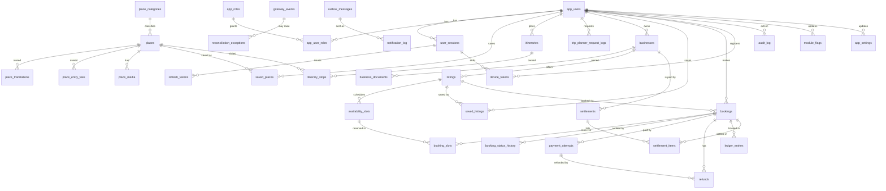

# OnePondy – Database Architecture

Audience: developers and operations. Source of truth is the EF Core model under
`backend/src/OnePondy.Infrastructure/Persistence` and its migrations. This document was
produced from a database built by applying every migration to an empty PostgreSQL instance.

- Engine: PostgreSQL 18 (Windows service), accessed through Npgsql + EF Core 10.
- Schema: `public`. 40 tables, 1 view (`customer_history`), plus `__EFMigrationsHistory`.
- Phase coverage: Phases 1–7 (payments, refunds, ledger, reconciliation, notifications and partner
  statements). Review and rating tables (Phase 10) **do not exist yet**.

## 1. Conventions

| Topic | Convention |
|---|---|
| Naming | `snake_case` for tables, columns, indexes and constraints (EFCore.NamingConventions). |
| Primary keys | `uuid`. Join/link tables use composite keys (for example `saved_places(user_id, place_id)`). |
| Timestamps | `timestamptz`, always UTC. Application code reads the clock from `TimeProvider`. |
| Money | `numeric(12,2)`, currency `char(3)` (INR today). Never `float`. |
| Enums | Stored as `snake_case` `varchar`, converted by `SnakeCaseEnum<T>`; every enum column has a `CHECK` constraint listing the allowed values. |
| JSON | `jsonb` columns for opening hours, price/cancellation snapshots and audit details. |
| Optimistic concurrency | PostgreSQL system column `xmin`, mapped as a `Version` property with `IsRowVersion()`. A stale write raises `DbUpdateConcurrencyException`, which the API returns as `409 Conflict`. |
| Delete behaviour | `RESTRICT` for anything that carries history (users, listings, bookings, slots); `CASCADE` for data that has no meaning without its parent (translations, stops, saved items). |
| Invariants | Business rules that must never be violated are also expressed as `CHECK` constraints, not only in C#. |
| Migrations | Code-first. `PendingModelChanges` is treated as an error, so a model change without a migration fails the integration tests. |

Tables using `xmin`: `places`, `businesses`, `listings`, `availability_slots`, `bookings`,
`refresh_tokens`, `payment_attempts`, `outbox_messages`, `settlements`. Itineraries intentionally have none.

## 2. Entity-relationship overview

## 3. Table groups

### 3.1 Identity and sessions

ASP.NET Identity is used for users and roles only. Passwords are not used; sign-in is by
one-time code, so `password_hash` stays `NULL`.

| Table | Purpose |
|---|---|
| `app_users` | Every account: customers, partners and staff. Soft-deleted by anonymisation (`deleted_at`, `is_active = false`). |
| `app_roles`, `app_user_roles` | Roles: `customer`, `administrator`, `content_editor`, `support_agent`. There is no partner role; a user is a partner by owning a row in `businesses`. |
| `app_user_claims`, `app_role_claims`, `app_user_logins`, `app_user_tokens` | Standard Identity tables, present but unused by the product. |
| `otp_challenges` | One row per code sent. Stores only a keyed hash of the code. |
| `user_sessions` | One row per signed-in device. Revocation lives here. |
| `refresh_tokens` | Rotating opaque tokens, stored hashed. |

**`app_users`** – key columns: `id`, `display_name varchar(120)`, `preferred_language varchar(8)`
(`en`/`ta`/`fr`), `is_active`, `deleted_at`, `email varchar(320)`, `normalized_email`,
`phone_number varchar(32)`, `created_at`, `updated_at`, plus the standard Identity columns.

- `ck_app_users_contact`: a live account has an e-mail or a phone number.
- `ck_app_users_phone_e164`: phone matches `^\+[1-9][0-9]{7,14}$`.
- `ck_app_users_language`: `en`, `ta` or `fr`.
- Unique partial indexes `ux_app_users_phone` and `ux_app_users_normalized_email` enforce one
  account per contact while allowing many `NULL`s (anonymised accounts).

**`otp_challenges`** – `id`, `channel` (`sms`/`email`), `purpose` (`sign_in`, `account_deletion`,
`staff_sign_in`), `destination varchar(320)`, `code_hash bytea`, `attempts`, `created_at`,
`expires_at`, `consumed_at`. Indexed by `(destination, created_at)` for the resend and
per-destination limits, and by `created_at` for the retention purge. No foreign key to users: a
code can be requested before an account exists.

**`user_sessions`** – `id`, `user_id` (RESTRICT), `device_name`, `created_at`, `last_refreshed_at`,
`expires_at`, `revoked_at`, `revoked_reason` (`signed_out`, `refresh_token_reuse`,
`account_deleted`, `role_changed`). The JWT carries the session id and every request checks the
session is not revoked, so revocation is immediate.

**`refresh_tokens`** – `id`, `session_id` (CASCADE), `token_hash bytea` (unique), `created_at`,
`expires_at`, `consumed_at`, `replaced_by_token_id`, `xmin`. A token is single use; presenting a
consumed token revokes the whole session (reuse detection).

### 3.2 Content (tourism places)

| Table | Purpose |
|---|---|
| `place_categories` | Lookup (`code` PK, `name`, `sort_order`, `is_active`). |
| `places` | The catalogue. Carries the verification state machine. |
| `place_translations` | Tamil and French copy (`PK (place_id, language)`). English lives on `places`. |
| `place_entry_fees` | Fee per visitor category (`PK (place_id, visitor_category)`). |
| `place_media` | Processed images (storage key only; files live on disk). |

**`places`** – `id`, `name`, `slug` (unique), `category_code` (RESTRICT), `description`,
`visitor_guidance`, `address`, `latitude`/`longitude`, `opening_hours jsonb`,
`verification_status` (`draft`, `pending`, `verified`, `rejected`), `verified_by_user_id`,
`verified_at`, `verification_source`, `last_reviewed_at`, `review_note`, `is_published`, audit
columns (`created_by_user_id`, `created_at`, `updated_by_user_id`, `updated_at`), `xmin`.

Database-enforced rules:

- `ck_places_publish_requires_verified`: `NOT is_published OR verification_status = 'verified'`.
  A place cannot be public unless verified.
- `ck_places_verification_provenance`: a verified place must have `verified_by_user_id`,
  `verified_at` and `verification_source`. Verified data is never anonymous.
- `ck_places_coordinates`, `_latitude`, `_longitude`: both coordinates or neither, within range.
- Partial indexes: `ix_places_public_category` (published only), `ix_places_review_due`
  (`last_reviewed_at` for published places, drives the 180-day review list).

**`place_translations`** – only `ta` and `fr` (`ck_place_translation_language`). Fallback to
English is done in the application.

**`place_entry_fees`** – `visitor_category` ∈ `standard`, `indian_adult`, `foreign_adult`,
`child`, `student`, `senior`; `amount >= 0`; `currency`.

**`place_media`** – `storage_key`, `width`, `height`, `alt_text` (required), `caption`, `licence`,
`attribution`, `source_url`, `sort_order`, `created_by_user_id`. Licence is one of `owned`,
`partner_supplied`, `cc_by`, `cc_by_sa`, `cc0`, `licensed_stock`, `other`.
`ck_place_media_attribution` requires an attribution for every licence except `owned` and `cc0`.

### 3.3 Configuration and audit

| Table | Purpose |
|---|---|
| `module_flags` | Per-module availability: `available`, `coming_soon`, `hidden` (PK `key`). Read by the mobile app through `GET /config`. |
| `app_settings` | Key/value settings (for example minimum app version). |
| `audit_log` | Append-only record of staff and sensitive actions. |

**`audit_log`** – `id`, `occurred_at`, `actor_user_id` (RESTRICT), `action`, `entity_type`,
`entity_id`, `details jsonb`. A `BEFORE UPDATE OR DELETE` trigger and a `BEFORE TRUNCATE` trigger
raise an exception, so rows cannot be altered even by an application bug. Indexed by
`(entity_type, entity_id, occurred_at)` for history screens and by `occurred_at`.

### 3.4 Customer planning

| Table | Purpose |
|---|---|
| `saved_places` | Customer bookmarks (`PK (user_id, place_id)`, both CASCADE). |
| `itineraries` | A trip plan: `title`, optional `start_date`/`end_date`, `status` (`draft`, `saved`, `archived`), `source` (`manual`, `ai_assisted`), nullable `share_token`. |
| `itinerary_stops` | Ordered stops: `itinerary_id` (CASCADE), `place_id` (CASCADE), `day_number >= 1`, `stop_order >= 0`, `planned_arrival`, `notes`. |
| `trip_planner_request_logs` | One row per AI planner call, used for daily quota and cost cap. |

- `ux_itinerary_stop_order` is `UNIQUE (itinerary_id, day_number, stop_order) DEFERRABLE
  INITIALLY DEFERRED`, so a reorder can rewrite positions inside one transaction without
  tripping the constraint mid-way.
- `ix_itineraries_share_token` is a unique partial index (`share_token IS NOT NULL`).
- `ck_itinerary_dates`: `end_date >= start_date` when both are set.
- `trip_planner_request_logs`: `day_count`, `interests`, `candidate_count`, `suggested_count`,
  `estimated_cost_usd numeric(10,4)`, `outcome` ∈ `suggested`, `no_candidates`,
  `provider_unavailable`. Index `(created_at, user_id)` serves the daily limit and cost queries.

### 3.5 Partners and listings

| Table | Purpose |
|---|---|
| `businesses` | A partner business with its approval state. |
| `business_documents` | GSTIN / FSSAI / other proof (storage key only; files are in a private folder). |
| `listings` | What a business sells: activity, stay, event, service or shop. |
| `availability_slots` | Dated, capacity-limited time slots for bookable listings. |
| `saved_listings` | Customer bookmarks (`PK (user_id, listing_id)`, both CASCADE). |

**`businesses`** – `owner_user_id` (RESTRICT), `name`, `business_type` (`restaurant`, `hotel`,
`activity`, `shop`, `tour_operator`, `service`), `description`, contact fields, coordinates,
`gstin varchar(15)`, `fssai_license_number varchar(14)`, `approval_status` (`pending`, `approved`,
`rejected`, `suspended`), `is_active`, `review_note`, `xmin`.

- `ck_business_active_requires_approval`: `NOT is_active OR approval_status = 'approved'`.
- `ck_business_restaurant_fssai`: an approved restaurant must hold an FSSAI number.
- Index `(business_type, approval_status, is_active)` for the console queue.

**`listings`** – `business_id` (RESTRICT), `listing_type`, `title`, `description`, `is_bookable`,
`base_price`, `currency`, `cancellation_policy jsonb`, `status` (`draft`, `pending`, `published`,
`suspended`), `review_note`, `xmin`.

- `ck_listing_bookable_policy`: a bookable listing must carry a cancellation policy.
- `ck_listing_bookable_type`: a shop can never be bookable.
- `ux_listings_id_business (id, business_id)` exists only so `bookings` can reference the pair.

**`availability_slots`** – `listing_id` (RESTRICT), `start_at`, `end_at`, `capacity`,
`reserved_count`, `xmin`.

- `ck_slot_capacity`: `0 <= reserved_count <= capacity`. **This is the last line of defence
  against overbooking**: even if two requests race past the application check, the second
  `UPDATE` violates the constraint (or the `xmin` check) and fails.
- `ck_slot_dates`: `end_at > start_at`; `ux_slot_listing_start (listing_id, start_at)`.

### 3.6 Bookings

| Table | Purpose |
|---|---|
| `bookings` | The booking and its price/cancellation snapshots. |
| `booking_slots` | Which slots a booking holds and how many seats (`PK (booking_id, slot_id)`). |
| `booking_status_history` | Immutable log of every status change. |

**`bookings`** – `customer_user_id` (RESTRICT), `business_id`, `listing_id`, `booking_type`,
`status`, `idempotency_key varchar(64)`, `expires_at` (hold deadline), `start_at`, `end_at`,
`guest_count`, `currency`, `subtotal`, `fees`, `tax_amount`, `discount_amount`, `total_amount`,
`price_snapshot jsonb`, `cancellation_policy_snapshot jsonb`, `cancellation_reason`, `xmin`.

- **Composite FK** `(listing_id, business_id) → listings(id, business_id)`: a booking cannot name
  a business that does not own the listing.
- `ux_bookings_idempotency (customer_user_id, idempotency_key)`: a retried create returns the
  original booking instead of creating a second.
- `ck_booking_total`: `total_amount = subtotal + fees + tax_amount - discount_amount`.
- `ck_booking_hold`: `pending` and `awaiting_payment` must have `expires_at`.
- `ck_booking_status`: all ten states (`pending`, `awaiting_payment`, `confirmed`, `failed`,
  `expired`, `rejected`, `cancelled`, `refund_pending`, `refunded`, `completed`). All ten are
  reachable once the `payments` module is on; with it off, a priced booking goes from `pending`
  straight to `confirmed` as before.
- `ix_bookings_hold_expiry` is partial (`status IN ('pending','awaiting_payment')`), so the
  expiry job scans only open holds.
- Snapshots keep the price and cancellation terms the customer agreed to, so later edits to the
  listing never change an existing booking.

**`booking_slots`** – `quantity > 0`; FKs to `bookings` and `availability_slots` are RESTRICT, so
a slot that was ever booked cannot be deleted (the API returns `slot_has_reservations`).

**`booking_status_history`** – `previous_status` (nullable on creation), `new_status`,
`changed_by_type` (`customer`, `partner`, `admin`, `system`), `changed_by_user_id`, `reason`,
`created_at`. `ck_booking_history_actor` ties `system` to a `NULL` user. Same append-only trigger
pair as `audit_log` (`booking_status_history_is_append_only`). FKs are RESTRICT.

### 3.7 Payments, refunds, ledger and statements (Phase 7)

All money is `numeric(12,2)`, currency `char(3)` (INR). Status columns are `snake_case` `varchar` with a `CHECK`
list. Every foreign key below is `RESTRICT`: a financial record never loses the booking, payment or business it
describes. The story behind these tables is in [workflows.md](workflows.md) §20–§24.

Since step 8.3 (migration 16) a payment, a refund and a statement line belong to **a booking or a food order**:
each has `booking_id` and `food_order_id`, and `num_nonnulls(booking_id, food_order_id) = 1` (`ck_*_subject`). A ledger
line and a reconciliation exception may name at most one of the two (a payout names neither).

**`payment_attempts`** – one row per gateway order (`provider` is `razorpay`). `booking_id` or `food_order_id`,
`provider_order_id`, `provider_payment_id` (null until paid), `amount > 0`, `currency`, `status`
(`created`, `captured`, `failed`, `expired`), `created_at`, `updated_at`. Has `xmin`. A trigger (§5) stops an attempt
ever changing what it pays for.
- `ux_payment_attempts_order (provider_order_id)` and `ux_payment_attempts_payment (provider_payment_id)` (partial,
  where not null): an order or a payment is never recorded twice.
- `ux_payment_attempts_open_booking (booking_id) WHERE status = 'created'`: a booking has at most one open order, so
  two simultaneous "pay" taps get the same order. `ux_payment_attempts_open_food_order` does the same for a food order
  (a null `booking_id` never collides in the first index, so each needs its own).
- `ck_payment_attempt_captured`: a `captured` attempt must have a `provider_payment_id`.
- `ix_payment_attempts_open` (partial, `created`) serves the Worker's check of orders still open at the gateway.

**`gateway_events`** – every webhook Razorpay sends, kept as received: `provider`, `provider_event_id`,
`event_type`, `payload` (`jsonb`), `signature_valid`, `received_at`, `processed_at`, `error`.
`ux_gateway_events_event (provider, provider_event_id)` makes a redelivered event a no-op, and
`ix_gateway_events_unprocessed` (partial, `processed_at IS NULL`) finds events that never finished. Rows whose signature
is wrong are not stored at all, so an unauthenticated caller cannot fill the table. Never deleted by the application.

**`refunds`** – `payment_attempt_id`, `booking_id` or `food_order_id` (a copy of the payment's, which a trigger
enforces), `amount > 0`, `reason` (`rejected`, `partner_cancelled`, `customer_cancelled`, `late_payment`), `status`
(`pending`, `processed`, `failed`), `provider_refund_id`, `requested_at`, `processed_at`. `ck_refund_processed`: a
`processed` refund has a provider refund id. `ux_refunds_provider_refund` is unique where not null. A trigger (§5)
stops the refunds of one payment adding up to more than was captured.

**`ledger_entries`** – the double-entry ledger, one row per line: `transaction_id`, `account`, `amount` (debit
positive, credit negative, never zero), `booking_id` or `food_order_id` (neither for a payout), `description`, `created_at`.
- `ck_ledger_account`: one of `gateway_clearing`, `customer_refunds`, `platform_commission`, `delivery_fees` and
  `tax_payable` (food, step 8.3), or `partner_payable:<business id>` / `partner_paid:<business id>`.
- `ux_ledger_entries_transaction_account (transaction_id, account)`: the transaction id is derived from the event
  (for example the payment attempt), so posting the same event twice is refused by the database, not only checked.
- Triggers (§5) make every transaction sum to zero when it commits and make the table append-only.

**`settlements`** and **`settlement_items`** – a partner statement and its lines. `settlements`: `business_id`,
`period_start`, `period_end`, `gross_amount`, `commission_amount`, `refund_amount`, `net_amount`, `status` (`draft`,
`approved`, `paid`), `payout_reference`, `created_at`, `approved_at`, `paid_at`. Has `xmin`.
- `ck_settlement_net`: `net_amount = gross_amount - commission_amount - refund_amount`.
- `ck_settlement_paid`: a `paid` statement has a payout reference and a paid time.
- `ux_settlements_period (business_id, period_start, period_end)`: one statement per business and period.
- `settlement_items`: `settlement_id`, `booking_id` or `food_order_id`, `kind` (`sale`, `refund`), `gross_amount`,
  `commission_amount` (both `>= 0`). `ux_settlement_items_booking_kind (booking_id, kind)` and
  `ux_settlement_items_food_order_kind (food_order_id, kind)`: a booking or order is a sale once and a refund at most
  once, across every statement, so none can count it twice.

**`reconciliation_exceptions`** – differences found between our records and the gateway's, listed for a person.
`kind` (twelve values, for example `payment_mismatch`, `refund_stuck`, `ledger_problem`), `status` (`open`, `resolved`,
`auto_resolved`), `fingerprint` (unique, so finding the same problem again bumps `occurrences` and `last_seen_at`
instead of adding a row), optional links to the booking or food order, payment attempt, refund and gateway event,
`provider_reference`, `expected_amount`, `actual_amount`, `detail`, `first_seen_at`, `last_seen_at`, `occurrences`,
`resolved_at`, `resolved_by_user_id`, `resolution_note`. `ck_reconciliation_person_note`: a `resolved` one names who and
why; `ck_reconciliation_resolved`: it has a resolved time exactly when it is not `open`.

### 3.8 Notifications (Phase 7)

**`outbox_messages`** – the transactional outbox (spec §10). A booking change and its notification are saved in one
transaction, so both happen or neither does; the Worker sends it afterwards. `type`, `payload` (`jsonb`: who it is for
and which booking, never the message text), `created_at`, `dispatched_at`, `attempts`, `last_error`, `next_attempt_at`
(back-off), `dedupe_key`. Has `xmin`, used as a lease so two Worker instances never send the same message.
`ix_outbox_pending` (partial, `dispatched_at IS NULL`) is what the dispatcher scans, and `ux_outbox_dedupe` (partial)
stops a reminder or "pay now" message being queued twice.

**`device_tokens`** – one row per phone: `user_id`, `session_id`, `token` (Expo push token, unique), `platform`
(`android`, `ios`), `created_at`, `last_seen_at`. Both foreign keys `CASCADE`: signing out, expiry, reuse detection,
role change and account deletion all end the session and so delete its phones, which is how "a signed-out phone
receives nothing" is guaranteed without the app having to remember anything.

**`notification_log`** – what was sent to whom, for support and for removing dead tokens: `outbox_message_id`,
`user_id`, `device_token_id` (`SET NULL` when the phone is removed), `type`, `status` (`sent`, `delivered`, `failed`),
`provider_ticket_id`, `error`, `created_at`, `receipt_checked_at`. It holds no message text.
`ix_notification_log_awaiting_receipt` (partial) finds tickets whose delivery receipt is still to be read.

### 3.9 View

**`customer_history`** – a unified "what has this customer done" view, created in
`AddListingsAndBookings` and extended by `ExtendCustomerHistoryAndAdminRefundReason` (migration 19). It selects
one row per booking (`id`, `kind = 'booking'`, `customer_user_id`, listing `title`, `status`, `scheduled_at`,
`total_amount`, `currency`, `created_at`) by joining `bookings` to `listings`, and, since Phase 8, one row per food
order (`kind = 'food_order'`, the restaurant's name as `title`, `estimated_ready_at` as `scheduled_at`) by joining
`food_orders` to `businesses`: the same nine columns, as a `UNION ALL`. It is a view and holds no data of its own, and
nothing in the application reads it yet. Rides (Phase 9) can be added as a further branch without changing readers. Phase 7 did **not** extend it with payment status (the plan
considered it); the app reads the receipt and refunds from the booking detail instead.

### 3.10 Food (Phase 8)

**Restaurants and menus (step 8.1, migration 14).**

- **`restaurant_profiles`** – one row per restaurant business (`business_id` is the key and a RESTRICT foreign key to `businesses`):
  `prep_time_minutes` (5 to 180), `min_order_amount` (0 to 100,000), `is_accepting_orders` (the open switch, default closed), `xmin` version.
- **`restaurant_delivery_areas`** – `(business_id, area_code)`, the area codes the app's picker uses (`puducherry` means the whole city), a CHECK on the code list.
- **`menu_categories`** – `name` (unique per restaurant, `ux_menu_categories_name`), `position`. `ux_menu_categories_id_business` lets a dish point at `(category_id, business_id)`, so a dish can never sit in another restaurant's category.
- **`menu_items`** – `price` (`numeric(12,2)`, more than 0), `is_veg`, `tax_rate_percent` (0 to 28, provisional default 5), `is_available` (sold out), `is_archived` (never deleted, because orders point at dishes; `ck_menu_item_archived_unavailable`).

**Orders (step 8.2, migration 15, `AddFoodOrders`).**

- **`food_orders`** – `customer_user_id` and `business_id` (both RESTRICT: orders outlive an anonymised account), `status` (13 values, CHECK),
  `idempotency_key` (unique per customer, `ux_food_orders_idempotency`), `expires_at` (required while `placed` or `awaiting_payment`, `ck_food_order_hold`),
  `delivery_area` (a specific area, never the whole city), `delivery_address`, `delivery_note`, `contact_phone`, `prep_time_minutes` and `estimated_ready_at`,
  the price breakdown (`subtotal`, `delivery_fee`, `packaging_fee`, `tax_amount`, `discount_amount`, `total_amount`; `ck_food_order_total` makes the
  total equal the parts), `closed_reason`, `xmin` version. Partial index `ix_food_orders_expiry` serves the Worker.
- **`food_order_lines`** – one row per dish: `menu_item_id` (RESTRICT), and a **copy** of `name`, `is_veg`, `unit_price`, `quantity` (1 to 20),
  `tax_rate_percent`, `subtotal` (`= unit_price × quantity`) and `tax_amount`, so a later menu edit never changes an order. One dish once per order.
- **`food_order_status_history`** – append-only, like booking history: every step with the previous and new status, who (`customer`, `partner`, `admin`, `system`, `driver`) and why.
- Triggers: `food_order_records_are_immutable()` refuses `UPDATE`, `DELETE` and `TRUNCATE` on lines and history; `food_order_matches_its_lines()` is a deferred
  constraint trigger that, at commit, refuses an order whose `subtotal` and `tax_amount` are not the sums of its lines (so an order cannot exist without lines).

**Paying for orders (step 8.3, migration 16, `AddFoodOrderPayments`).** No new tables: the Phase 7 payment tables (§3.7) gained `food_order_id`
(RESTRICT) with the exactly-one rules above, their own indexes (`ix_payment_attempts_food_order`, `ux_payment_attempts_open_food_order`,
`ix_refunds_food_order`, `ix_ledger_entries_food_order`, `ux_settlement_items_food_order_kind`), two ledger accounts (`delivery_fees`, `tax_payable`) and two
triggers (§5). Only columns were added and `booking_id` made nullable; no existing row is rewritten (the ledger is append-only). A food payment posts
five lines: `gateway_clearing` (the total), `platform_commission` (on the dishes), `partner_payable` (dishes and packaging less commission),
`delivery_fees` and `tax_payable`; a food refund reverses them exactly.

**Drivers (step 8.6, migration 17, `AddDriverProfiles`).**

- **`driver_profiles`** – one row per driver account (`user_id` is the key and a RESTRICT foreign key to `app_users`; the profile is removed explicitly when the account is deleted): `full_name`,
  `vehicle_type` (`bicycle`, `scooter`, `motorbike`), `vehicle_number` and `licence_number` (normalised upper case, none for a bicycle), `approval_status` (`pending`, `approved`, `rejected`, `suspended`),
  `review_note`, `is_on_duty` and `on_duty_since`, `xmin` version. Checks: only an approved driver is on duty (`ck_driver_duty_requires_approval`); "on duty since" exists exactly while on duty; a motorised
  vehicle has both numbers and a bicycle neither (`ck_driver_documents`); a rejection or suspension always has a note. `ux_driver_profiles_licence` (filtered, not null) makes a licence belong to one account.

**Deliveries (step 8.7, migration 18, `AddDeliveryJobs`).**

- **`delivery_jobs`** – one per food order (`ux_delivery_jobs_order`; `food_order_id` and `driver_user_id` are RESTRICT foreign keys): `status` (`open`, `accepted`, `picked_up`, `delivered`, `cancelled`),
  `driver_user_id` (empty while open, set once taken, kept after delivery), a time for each step (`opened_at`, `accepted_at`, `picked_up_at`, `delivered_at`, `cancelled_at`), `cancel_reason`, the driver's **latest**
  position (`last_latitude`, `last_longitude`, `last_location_at`) and `xmin` version. Checks: who holds the job fits its status (`ck_delivery_job_driver`); every step has its time (`ck_delivery_job_times`); the
  position exists only while the job is `accepted` or `picked_up`, is all three columns or none, and is on Earth (`ck_delivery_job_location_*`), so it is erased by the database's own rules when a job ends.
  `ux_delivery_jobs_one_active_per_driver` (filtered to `accepted` and `picked_up`) allows one live job per driver. The migration also gives every order already `ready_for_pickup` its open job.

**Cash on delivery (step 8.8, migration 20, `AddCashOnDelivery`).**

- **`food_orders`** gained `payment_method` (`online` or `cash_on_delivery`, default `online`, CHECK) and the cash taken at the door: `cash_collected`, `cash_collected_at` and `cash_collected_by` (a RESTRICT foreign key to the driver). `ck_food_order_cash`: the three are all-or-none; they exist only on a
  delivered cash on delivery order, and `cash_collected` equals `total_amount`; and a delivered cash on delivery order always has them.
- **`restaurant_profiles.accepts_cash_on_delivery`** (default false): the restaurant's opt-in.
- **`driver_cash_deposits`** – cash a driver handed in: `driver_user_id`, `amount` (more than 0), `received_at` (not after `recorded_at`), `recorded_by_user_id`, optional `reference` and `note`, `recorded_at`. Never updated or deleted
  (trigger). Its money movement is in the ledger.
- **Ledger.** A delivered cash order posts, with the same five-way split as an online payment, a debit to the per-driver account **`driver_cash:{driver}`** (instead of `gateway_clearing`): what that driver owes OnePondy. A deposit posts a credit to that account
  and a debit to **`cash_received`**, with no booking or order on the lines. A driver's balance is the sum of their account. `ck_ledger_account` lists the new accounts.
- **`trg_driver_cash_never_negative`** (deferred constraint trigger on `ledger_entries`, for `driver_cash:` accounts): at commit, under an advisory lock on the account, raises if the account's sum is below nothing, so a driver cannot hand in more than they hold even when two
  deposits commit at once.

**Reviews (Phase 10, step 10.1, migration 21, `AddReviews`).**

- **`reviews`** – one customer's rating and comment on one completed transaction: `customer_user_id`; exactly one of `booking_id` and `food_order_id` (a booking
  also carries its `listing_id`; a food order's subject is its `business_id`); `rating` (1 to 5); `text` (up to 1000, optional); `author_name` (a first name, or "A
  customer"); `status` (`pending`, `published`, `rejected`, `removed`); `auto_check_flags` (what the automatic check found, for the moderator);
  `moderation_reason`, `moderated_by_user_id`, `moderated_at`, `published_at`; the business's one reply (`reply_text`, `replied_at`, `replied_by_user_id`);
  `transaction_completed_at` (the review window counts from it); `created_at`, `updated_at`, `edited_at` (set when the author used their one edit); and the `xmin` version.
- **Rules the database enforces:** `ux_reviews_booking` and `ux_reviews_food_order` (one review per transaction, even when requests arrive together);
  `ck_review_rating`, `ck_review_text`, `ck_review_status`; `ck_review_subject` (a booking or a food order, never both, and a booking brings its listing);
  `ck_review_moderation` (a waiting review has no moderator or publication time; a published one has both; a rejected or removed one has a moderator and a reason,
  and only a removed one was ever published); `ck_review_reply` (a reply is all three columns or none, and only on a review that was published).
- **Indexes** for the public pages and ratings (`ix_reviews_listing_status`, `ix_reviews_business_status_published`), the moderators' queue (`ix_reviews_status_created`)
  and a customer's own reviews (`ix_reviews_customer`). There is no trigger: who may change what is decided in `ReviewService` (a business has no endpoint that changes a review).

**Rides (Phase 9, steps 9.1 and 9.2, migration 23, `AddRides`).**

- **`ride_driver_profiles`** – a driver in ride mode, keyed by the account: `full_name`, `vehicle_class` (`auto`, `cab`, `bike_taxi`), `vehicle_number`, `licence_number`, `permit_number`, `insurance_policy_number`,
  `insurance_valid_until` (date), `approval_status`, `review_note`, `is_on_duty`, `on_duty_since`, timestamps and the `xmin` version. Unique
  licence and unique vehicle number. Checks: only an approved driver is on duty; "on duty since" exists exactly while on duty; a rejection or suspension has a reason.
- **`ride_driver_positions`** (migration 25, `MoveRideDriverPosition`) – the driver's latest position for dispatch: one row per driver (`user_id`, `latitude`, `longitude`, `recorded_at`), on Earth. It is a separate table so
  that reporting a position every few seconds never changes the profile's version, which administrators and the driver use to know they act on what they last saw (a position inside the profile made **Suspend** and the
  duty switch fail with "changed since you loaded it", found on a real phone). **The position exists only while on duty:** a trigger deletes it when the profile goes off duty, and another refuses one for a driver
  who is not on duty.
- **`ride_quotes`** – a fare the server worked out: the rider, class, pickup and destination (coordinates and the name the rider gave), `distance_km`, `fare`, `currency`, `cancellation_terms`, `created_at`, `expires_at`.
- **`rides`** – one ride: the rider, `quote_id` (unique: a quote becomes one ride), the snapshot of class, places, note, distance, fare and terms, `status` (`requested`, `accepted`, `arrived`, `in_progress`,
  `completed`, `cancelled`, `expired`), `driver_user_id`, a time for each step, `cancelled_by` and `cancel_reason`, `cash_collected`, the driver's latest position (`driver_latitude`, `driver_longitude`,
  `driver_location_at`), `search_ends_at`, and the `xmin` version.
- **Rules the database enforces:** checks for the status, who holds the ride in each status, a time for every step, **the driver's position only while accepted, arrived or in progress**, complete and on Earth,
  `cash_collected = fare`; a **unique index of one open ride per rider** and **one active ride per driver**; and a **trigger** (`ride_follows_the_rules`) that allows only the legal moves, never changes a finished
  ride, never changes the rider, quote or fare, never gives an active ride to a second driver, and refuses delete and truncate (rides are kept).
- **`ride_safety_events`** (migration 24, `AddRideSafety`) – an SOS or an incident: the ride, `kind`, `category`, who and which side, `details` (incidents), the position (SOS), `status` (`open`, `acknowledged`, `resolved`), who and when for each step, `resolution_note`, version. A unique index allows one open SOS per person per ride; a trigger keeps reports forever and freezes a resolved one. **`ride_shares`** – a hashed secret, an expiry and a revocation time per ride.
- **`customer_history`** gains a branch for rides (`kind = 'ride'`, the title is "pickup to destination", the amount is the fare).

**Support requests (Phase 10, step 10.3, migration 22, `AddSupportTickets`).**

- **`support_tickets`** – one request for help: `requester_user_id`; `business_id` (set when a business owner wrote about a business); `topic` (`booking`, `food_order`, `payment`, `account`, `business`, `other`);
  `subject` (up to 120); `status` (`open`, `waiting_for_requester`, `resolved`); `booking_id` or `food_order_id` (at most one: what it is about); `assigned_to_user_id` and `assigned_at`; `escalated_at` and
  `escalation_reason` (a code such as `first_reply_overdue`, or an agent's words); `first_response_at`; `resolved_at` and `resolved_by_user_id`; `last_requester_message_at`, `last_staff_message_at`,
  `created_at`, `updated_at`; and the `xmin` version.
- **`support_messages`** – one message: `ticket_id` (cascade), `author_user_id`, `author_kind` (`requester` or `staff`), `body` (1 to 2000 characters), `created_at`.
- **Rules the database enforces:** `ck_support_ticket_status`, `_topic`, `_subject`; `ck_support_ticket_about` (a booking or an order, not both); `ck_support_ticket_resolved` (resolved if and only if there is a time and a
  person); `ck_support_ticket_assigned` (a person and a time, or neither); `ck_support_ticket_escalated` (a time and a reason, or neither); `ck_support_message_body` and `_author_kind`.
- **Indexes** for the agents' queue (`ix_support_tickets_status_waiting`), a person's own requests (`ix_support_tickets_requester`), an agent's requests (`ix_support_tickets_assigned`) and a thread
  (`ix_support_messages_ticket_time`). There is no trigger: who may see or change what is decided in `SupportService`, and the audit entries are written in the same save.

**Administrators' monitoring (step 8.9, migration 19).** No new tables: the `customer_history` view (§3.9) lists food orders, and `ck_refund_reason` allows `admin_cancelled`.

## 4. Foreign-key delete policy

| Parent → child | Policy | Reason |
|---|---|---|
| `app_users` → sessions, bookings, businesses, audit, places, media | RESTRICT | Users are anonymised, never hard-deleted, so history keeps a valid actor. |
| `app_users` → saved places/listings, itineraries, planner logs | CASCADE | Personal data removed on account deletion. |
| `user_sessions` → `refresh_tokens` | CASCADE | Tokens are meaningless without the session. |
| `places` → translations, fees, media, saved, stops | CASCADE | Owned or bookmark data. |
| `businesses` → `business_documents` | CASCADE | Owned data. |
| `businesses` → `listings`, `listings` → `availability_slots` | RESTRICT | Commercial history must survive. |
| `app_users`, `bookings`, `food_orders`, `businesses`, `listings` → `reviews` | RESTRICT | A review is removed by the service when its author's account is deleted; nothing else cascades. |
| `app_users`, `bookings`, `food_orders`, `businesses` → `support_tickets`; `support_tickets` → `support_messages` | RESTRICT; CASCADE for messages | A request is removed by the service when its author's account is deleted (its messages go with it); nothing else cascades. |
| `listings`/`availability_slots` → bookings, `booking_slots` | RESTRICT | A booking can never lose its listing or slot. |
| `bookings` → `booking_slots`, `booking_status_history` | RESTRICT | History is immutable. |
| `bookings`, `food_orders`, `payment_attempts`, `businesses` → `payment_attempts`, `refunds`, `ledger_entries`, `settlements`, `settlement_items`, `reconciliation_exceptions` | RESTRICT | Financial records must outlive everything they describe. |
| `app_users` → `driver_profiles`, `delivery_jobs` (driver), `driver_cash_deposits` (driver and the administrator who recorded it), `food_orders.cash_collected_by`; `food_orders` → `delivery_jobs` | RESTRICT | Who delivered which order is a record. A driver profile is removed explicitly on account deletion (never by cascade). |
| `app_users`, `user_sessions` → `device_tokens` | CASCADE | A phone is meaningful only while its session lives. |
| `device_tokens` → `notification_log` | SET NULL | The log survives a removed phone. |
| `app_users`, `outbox_messages` → `notification_log` | RESTRICT | The log is kept for the retention period. |

Because `booking_slots.booking_id` is RESTRICT, it is hand-set in the `HardenBookingSchema`
migration; EF Core cannot express a non-cascade ownership FK in the model snapshot.

## 5. Triggers

| Trigger | Table | Effect |
|---|---|---|
| `trg_audit_log_append_only` (row) and `trg_audit_log_no_truncate` (statement), function `audit_log_is_append_only()` | `audit_log` | Raises on `UPDATE`, `DELETE`, `TRUNCATE`. |
| `trg_booking_status_history_append_only` (row) | `booking_status_history` | Raises on `UPDATE`, `DELETE`. |
| `trg_booking_status_history_no_truncate` (statement) | `booking_status_history` | Raises on `TRUNCATE`. |
| `trg_ledger_entries_balance` (row, **deferred constraint trigger**), function `ledger_entries_must_balance()` | `ledger_entries` | At commit, raises unless every ledger transaction touched sums to zero. A transaction that does not balance cannot be saved. |
| `trg_ledger_entries_append_only` (row) and `trg_ledger_entries_no_truncate` (statement), function `ledger_entries_is_append_only()` | `ledger_entries` | Raises on `UPDATE`, `DELETE`, `TRUNCATE`: a mistake is corrected by a new, balanced transaction. |
| `trg_refunds_within_captured` (row), function `refunds_within_captured_amount()` | `refunds` | Locks the payment and raises if its refunds (other than failed ones) would exceed what was captured, so two simultaneous refunds cannot both pass. |
| `trg_food_order_status_history_append_only` / `_no_truncate` and `trg_food_order_lines_append_only` / `_no_truncate`, function `food_order_records_are_immutable()` | `food_order_status_history`, `food_order_lines` | Raises on `UPDATE`, `DELETE`, `TRUNCATE`: an order's lines and history are written once. |
| `trg_food_orders_match_lines` and `trg_food_order_lines_match_order` (rows, **deferred constraint triggers**), function `food_order_matches_its_lines()` | `food_orders`, `food_order_lines` | At commit, raises unless the order's `subtotal` and `tax_amount` equal the sums of its lines. |
| `trg_delivery_jobs_rules` (row, `UPDATE` and `DELETE`) and `trg_delivery_jobs_no_truncate` (statement), function `delivery_job_follows_the_rules()` | `delivery_jobs` | Allows only the forward steps (open → accepted → picked up → delivered; accepted → open when given up; cancelled from any live state), never gives an accepted or picked-up job to a second driver (the rule behind "exactly one driver gets it"), freezes finished jobs, and refuses deletes, truncates and moving a job to another order. |
| `trg_driver_cash_deposits_append_only` (row) and `trg_driver_cash_deposits_no_truncate` (statement), function `driver_cash_deposits_are_immutable()` | `driver_cash_deposits` | Raises on `UPDATE`, `DELETE`, `TRUNCATE`: a recorded hand-in is never changed. |
| `trg_driver_cash_never_negative` (row, **deferred constraint trigger**), function `driver_cash_never_negative()` | `ledger_entries` | At commit, locks the driver's cash account and raises if its sum would be below nothing. |
| `trg_payment_attempts_keep_subject` (row), function `payment_attempt_keeps_its_subject()` | `payment_attempts` | Raises if an update changes `booking_id` or `food_order_id`: a payment is for one thing for good. |
| `trg_refunds_match_payment` (row), function `refund_matches_its_payment()` | `refunds` | Raises unless the refund's `booking_id` and `food_order_id` are its payment's, so money is only ever given back for what was paid for. |

## 6. Migrations

Applied in this order (folder `Persistence/Migrations`):

| # | Migration | Adds |
|---|---|---|
| 1 | `20261026091025_InitialCoreSchema` | Identity tables, OTP challenges, sessions, refresh tokens. |
| 2 | `20261026114335_AddContentConfigurationAndAudit` | Places, categories, translations, fees, media, module flags, settings, audit log and trigger. |
| 3 | `20261026125203_AddSavedPlacesAndItineraries` | Saved places, itineraries, stops. |
| 4 | `20261028071353_AddTripPlannerRequestLogs` | AI planner usage log. |
| 5 | `20261028074813_AddBusinesses` | Businesses and documents. |
| 6 | `20261028161435_AddListingsAndBookings` | Listings, slots, saved listings, bookings, booking slots, history, `customer_history` view. |
| 7 | `20261029044723_HardenBookingSchema` | Missing FKs and checks, RESTRICT on booking ownership FKs, append-only trigger on history. |
| 8 | `20261029080451_AddPaymentsAndLedger` | `payment_attempts`, `gateway_events`, `refunds`, `ledger_entries`, `settlements`, `settlement_items`, `outbox_messages`; the ledger and refund triggers; the `payments` module flag. |
| 9 | `20261029085314_AddOneOpenPaymentAttemptPerBooking` | One open payment order per booking. |
| 10 | `20261029093526_AddLedgerTransactionAccountUniqueness` | One line per account in a ledger transaction, which makes a repeated event refused by the database. |
| 11 | `20261029095555_AddReconciliationExceptions` | `reconciliation_exceptions`. |
| 12 | `20261029101305_AddPushNotifications` | `device_tokens`, `notification_log`, and `next_attempt_at`, `dedupe_key` on the outbox. |
| 13 | `20261029110845_AddSettlementRowVersion` | `xmin` row version on `settlements` (no new physical column). |
| 14 | `20261029130624_AddRestaurantsAndMenus` | `restaurant_profiles`, `restaurant_delivery_areas`, `menu_categories`, `menu_items`. |
| 15 | `20261029152153_AddFoodOrders` | `food_orders`, `food_order_lines`, `food_order_status_history`; their immutability and sum-of-lines triggers. |
| 16 | `20261029235224_AddFoodOrderPayments` | `food_order_id` on the payment, refund, ledger, statement-line and reconciliation tables, the exactly-one checks, the `delivery_fees` and `tax_payable` accounts, and the subject triggers. |
| 17 | `20261030053514_AddDriverProfiles` | `driver_profiles` (one row per driver account) with checks: only an approved driver is on duty, "on duty since" exists exactly while on duty, a motorised vehicle has its registration and licence and a bicycle has neither, a rejection or suspension always has a note; a unique index on the licence number. |
| 18 | `20261030101407_AddDeliveryJobs` | `delivery_jobs` (one per food order) with checks (status, who holds it, a time for every step, the driver's position only while accepted or picked up, complete and on Earth); unique indexes for one job per order and one live job per driver; a trigger that allows only the forward steps, never gives a taken job to a second driver, freezes finished jobs and refuses deletes and truncates; gives each order already ready for pickup its open job. |
| 19 | `20261030112541_ExtendCustomerHistoryAndAdminRefundReason` | The `customer_history` view now also lists food orders (kind `food_order`); `ck_refund_reason` allows `admin_cancelled`. |
| 20 | `20261102044345_AddCashOnDelivery` | `food_orders.payment_method` (`online` for every existing row), `cash_collected`, `cash_collected_at`, `cash_collected_by`; `restaurant_profiles.accepts_cash_on_delivery`; `driver_cash_deposits`; the ledger accounts `driver_cash:{driver}` and `cash_received`; the `cashOnDelivery` module flag (off); triggers that keep deposits immutable and a driver's cash account from going below nothing. |
| 21 | `20261102130258_AddReviews` | `reviews`: one review per completed booking or delivered food order, with unique indexes, checks and the moderation and reply columns. No triggers. |
| 25 | `20261103075231_MoveRideDriverPosition` | `ride_driver_positions` (with the two triggers above); the position columns and their checks leave `ride_driver_profiles`, and positions already reported move across. |
| 24 | `20261103050729_AddRideSafety` | `ride_safety_events` (with checks, the one-open-SOS index and the keep-forever trigger) and `ride_shares`. |
| 23 | `20261103044905_AddRides` | `ride_driver_profiles`, `ride_quotes` and `rides` with their checks, the one-open-ride and one-active-ride indexes, the `ride_follows_the_rules` trigger, and the `ride` branch of `customer_history`. |
| 22 | `20261103033839_AddSupportTickets` | `support_tickets` and `support_messages`: a request and its conversation, with checks that keep a ticket's columns consistent with its status. No triggers. |

Rules for new migrations:

1. Change the model, then `dotnet ef migrations add <Name>` from the repo root.
2. Review the generated SQL; hand-edit only for things EF cannot snapshot (triggers, non-cascade
   ownership FKs) and say so in a comment.
3. Run `dotnet test`; the integration suite applies all migrations to a fresh database and fails
   on pending model changes.
4. Deploy with the migration applied **before** the new API build starts.

## 7. Retention and deletion

Details are in [data-retention.md](data-retention.md). In short:

- The Worker purges `otp_challenges` older than 1 day, consumed/expired `refresh_tokens` older
  than 30 days and ended `user_sessions` older than 90 days (hourly).
- Account deletion anonymises `app_users` (`display_name` becomes "Deleted user", phone and e-mail
  are cleared, `is_active = false`, `deleted_at` set, security stamp rotated) and removes saved places, saved listings, itineraries, reviews and support requests. Sessions are
  revoked with reason `account_deleted`. Bookings, audit rows and partner records are kept.
- The Worker removes `notification_log` rows and finished `outbox_messages` after 30 days. Payment, refund, ledger and
  statement rows have no end date yet (they need the tax review) and are linked to the anonymised customer row.
- Deletion is blocked while the customer has bookings in progress (`pending`,
  `awaiting_payment`, `confirmed`, `refund_pending`) or food orders in progress, or, for partners, while their business has
  any, or, for a driver, while they are on duty or hold cash for OnePondy (`driver_holds_cash`). A driver's profile is removed with the account.
- **Known gap:** an order's delivery address and contact phone stay on the order after its customer's account is anonymised (the order is a financial record). They are
  not scrubbed; see [data-retention.md](data-retention.md).

## 8. Not yet in the schema (planned)

- Reviews and ratings.
- Commission per listing or business: today the provisional rate is the setting `Payments:CommissionPercent`, applied when a payment arrives and recorded in the ledger, so changing it never rewrites history.
- GST and tax-collected-at-source columns: the ledger keeps tax separate from the amounts so it can be added without rewriting history, but nothing tax-related is switched on until the legal and tax review.
- Optional `places.location` (PostGIS) and a place link on listings. Nearby search currently
  sorts by distance in application memory (`lat`/`lng` on `GET /places`).
