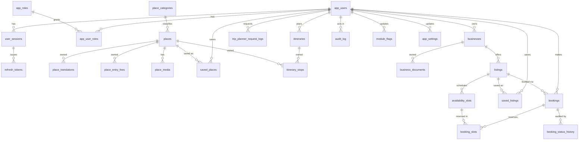

# OnePondy – Database Architecture

Audience: developers and operations. Source of truth is the EF Core model under
`backend/src/OnePondy.Infrastructure/Persistence` and its migrations. This document was
produced from a database built by applying every migration to an empty PostgreSQL instance.

- Engine: PostgreSQL 18 (Windows service), accessed through Npgsql + EF Core 10.
- Schema: `public`. 30 tables, 1 view (`customer_history`), plus `__EFMigrationsHistory`.
- Phase coverage: Phases 1–6. Payment, refund, push-notification and review tables
  (Phase 7+) **do not exist yet**.

## 1. Conventions

| Topic | Convention |
|---|---|
| Naming | `snake_case` for tables, columns, indexes and constraints (EFCore.NamingConventions). |
| Primary keys | `uuid`. Join/link tables use composite keys (for example `saved_places(user_id, place_id)`). |
| Timestamps | `timestamptz`, always UTC. Application code reads the clock from `TimeProvider`. |
| Money | `numeric(12,2)`, currency `char(3)` (INR today). Never `float`. |
| Enums | Stored as `snake_case` `varchar`, converted by `SnakeCaseEnum<T>`; every enum column has a `CHECK` constraint listing the allowed values. |
| JSON | `jsonb` columns for opening hours, price/cancellation snapshots and audit details. |
| Optimistic concurrency | PostgreSQL system column `xmin`, mapped as a `Version` property with `IsRowVersion()`. A stale write raises `DbUpdateConcurrencyException`, which the API returns as `409 Conflict`. |
| Delete behaviour | `RESTRICT` for anything that carries history (users, listings, bookings, slots); `CASCADE` for data that has no meaning without its parent (translations, stops, saved items). |
| Invariants | Business rules that must never be violated are also expressed as `CHECK` constraints, not only in C#. |
| Migrations | Code-first. `PendingModelChanges` is treated as an error, so a model change without a migration fails the integration tests. |

Tables using `xmin`: `places`, `businesses`, `listings`, `availability_slots`, `bookings`,
`refresh_tokens`. Itineraries intentionally have none.

## 2. Entity-relationship overview

## 3. Table groups

### 3.1 Identity and sessions

ASP.NET Identity is used for users and roles only. Passwords are not used; sign-in is by
one-time code, so `password_hash` stays `NULL`.

| Table | Purpose |
|---|---|
| `app_users` | Every account: customers, partners and staff. Soft-deleted by anonymisation (`deleted_at`, `is_active = false`). |
| `app_roles`, `app_user_roles` | Roles: `customer`, `administrator`, `content_editor`, `support_agent`. There is no partner role; a user is a partner by owning a row in `businesses`. |
| `app_user_claims`, `app_role_claims`, `app_user_logins`, `app_user_tokens` | Standard Identity tables, present but unused by the product. |
| `otp_challenges` | One row per code sent. Stores only a keyed hash of the code. |
| `user_sessions` | One row per signed-in device. Revocation lives here. |
| `refresh_tokens` | Rotating opaque tokens, stored hashed. |

**`app_users`** – key columns: `id`, `display_name varchar(120)`, `preferred_language varchar(8)`
(`en`/`ta`/`fr`), `is_active`, `deleted_at`, `email varchar(320)`, `normalized_email`,
`phone_number varchar(32)`, `created_at`, `updated_at`, plus the standard Identity columns.

- `ck_app_users_contact`: a live account has an e-mail or a phone number.
- `ck_app_users_phone_e164`: phone matches `^\+[1-9][0-9]{7,14}$`.
- `ck_app_users_language`: `en`, `ta` or `fr`.
- Unique partial indexes `ux_app_users_phone` and `ux_app_users_normalized_email` enforce one
  account per contact while allowing many `NULL`s (anonymised accounts).

**`otp_challenges`** – `id`, `channel` (`sms`/`email`), `purpose` (`sign_in`, `account_deletion`,
`staff_sign_in`), `destination varchar(320)`, `code_hash bytea`, `attempts`, `created_at`,
`expires_at`, `consumed_at`. Indexed by `(destination, created_at)` for the resend and
per-destination limits, and by `created_at` for the retention purge. No foreign key to users: a
code can be requested before an account exists.

**`user_sessions`** – `id`, `user_id` (RESTRICT), `device_name`, `created_at`, `last_refreshed_at`,
`expires_at`, `revoked_at`, `revoked_reason` (`signed_out`, `refresh_token_reuse`,
`account_deleted`, `role_changed`). The JWT carries the session id and every request checks the
session is not revoked, so revocation is immediate.

**`refresh_tokens`** – `id`, `session_id` (CASCADE), `token_hash bytea` (unique), `created_at`,
`expires_at`, `consumed_at`, `replaced_by_token_id`, `xmin`. A token is single use; presenting a
consumed token revokes the whole session (reuse detection).

### 3.2 Content (tourism places)

| Table | Purpose |
|---|---|
| `place_categories` | Lookup (`code` PK, `name`, `sort_order`, `is_active`). |
| `places` | The catalogue. Carries the verification state machine. |
| `place_translations` | Tamil and French copy (`PK (place_id, language)`). English lives on `places`. |
| `place_entry_fees` | Fee per visitor category (`PK (place_id, visitor_category)`). |
| `place_media` | Processed images (storage key only; files live on disk). |

**`places`** – `id`, `name`, `slug` (unique), `category_code` (RESTRICT), `description`,
`visitor_guidance`, `address`, `latitude`/`longitude`, `opening_hours jsonb`,
`verification_status` (`draft`, `pending`, `verified`, `rejected`), `verified_by_user_id`,
`verified_at`, `verification_source`, `last_reviewed_at`, `review_note`, `is_published`, audit
columns (`created_by_user_id`, `created_at`, `updated_by_user_id`, `updated_at`), `xmin`.

Database-enforced rules:

- `ck_places_publish_requires_verified`: `NOT is_published OR verification_status = 'verified'`.
  A place cannot be public unless verified.
- `ck_places_verification_provenance`: a verified place must have `verified_by_user_id`,
  `verified_at` and `verification_source`. Verified data is never anonymous.
- `ck_places_coordinates`, `_latitude`, `_longitude`: both coordinates or neither, within range.
- Partial indexes: `ix_places_public_category` (published only), `ix_places_review_due`
  (`last_reviewed_at` for published places, drives the 180-day review list).

**`place_translations`** – only `ta` and `fr` (`ck_place_translation_language`). Fallback to
English is done in the application.

**`place_entry_fees`** – `visitor_category` ∈ `standard`, `indian_adult`, `foreign_adult`,
`child`, `student`, `senior`; `amount >= 0`; `currency`.

**`place_media`** – `storage_key`, `width`, `height`, `alt_text` (required), `caption`, `licence`,
`attribution`, `source_url`, `sort_order`, `created_by_user_id`. Licence is one of `owned`,
`partner_supplied`, `cc_by`, `cc_by_sa`, `cc0`, `licensed_stock`, `other`.
`ck_place_media_attribution` requires an attribution for every licence except `owned` and `cc0`.

### 3.3 Configuration and audit

| Table | Purpose |
|---|---|
| `module_flags` | Per-module availability: `available`, `coming_soon`, `hidden` (PK `key`). Read by the mobile app through `GET /config`. |
| `app_settings` | Key/value settings (for example minimum app version). |
| `audit_log` | Append-only record of staff and sensitive actions. |

**`audit_log`** – `id`, `occurred_at`, `actor_user_id` (RESTRICT), `action`, `entity_type`,
`entity_id`, `details jsonb`. A `BEFORE UPDATE OR DELETE` trigger and a `BEFORE TRUNCATE` trigger
raise an exception, so rows cannot be altered even by an application bug. Indexed by
`(entity_type, entity_id, occurred_at)` for history screens and by `occurred_at`.

### 3.4 Customer planning

| Table | Purpose |
|---|---|
| `saved_places` | Customer bookmarks (`PK (user_id, place_id)`, both CASCADE). |
| `itineraries` | A trip plan: `title`, optional `start_date`/`end_date`, `status` (`draft`, `saved`, `archived`), `source` (`manual`, `ai_assisted`), nullable `share_token`. |
| `itinerary_stops` | Ordered stops: `itinerary_id` (CASCADE), `place_id` (CASCADE), `day_number >= 1`, `stop_order >= 0`, `planned_arrival`, `notes`. |
| `trip_planner_request_logs` | One row per AI planner call, used for daily quota and cost cap. |

- `ux_itinerary_stop_order` is `UNIQUE (itinerary_id, day_number, stop_order) DEFERRABLE
  INITIALLY DEFERRED`, so a reorder can rewrite positions inside one transaction without
  tripping the constraint mid-way.
- `ix_itineraries_share_token` is a unique partial index (`share_token IS NOT NULL`).
- `ck_itinerary_dates`: `end_date >= start_date` when both are set.
- `trip_planner_request_logs`: `day_count`, `interests`, `candidate_count`, `suggested_count`,
  `estimated_cost_usd numeric(10,4)`, `outcome` ∈ `suggested`, `no_candidates`,
  `provider_unavailable`. Index `(created_at, user_id)` serves the daily limit and cost queries.

### 3.5 Partners and listings

| Table | Purpose |
|---|---|
| `businesses` | A partner business with its approval state. |
| `business_documents` | GSTIN / FSSAI / other proof (storage key only; files are in a private folder). |
| `listings` | What a business sells: activity, stay, event, service or shop. |
| `availability_slots` | Dated, capacity-limited time slots for bookable listings. |
| `saved_listings` | Customer bookmarks (`PK (user_id, listing_id)`, both CASCADE). |

**`businesses`** – `owner_user_id` (RESTRICT), `name`, `business_type` (`restaurant`, `hotel`,
`activity`, `shop`, `tour_operator`, `service`), `description`, contact fields, coordinates,
`gstin varchar(15)`, `fssai_license_number varchar(14)`, `approval_status` (`pending`, `approved`,
`rejected`, `suspended`), `is_active`, `review_note`, `xmin`.

- `ck_business_active_requires_approval`: `NOT is_active OR approval_status = 'approved'`.
- `ck_business_restaurant_fssai`: an approved restaurant must hold an FSSAI number.
- Index `(business_type, approval_status, is_active)` for the console queue.

**`listings`** – `business_id` (RESTRICT), `listing_type`, `title`, `description`, `is_bookable`,
`base_price`, `currency`, `cancellation_policy jsonb`, `status` (`draft`, `pending`, `published`,
`suspended`), `review_note`, `xmin`.

- `ck_listing_bookable_policy`: a bookable listing must carry a cancellation policy.
- `ck_listing_bookable_type`: a shop can never be bookable.
- `ux_listings_id_business (id, business_id)` exists only so `bookings` can reference the pair.

**`availability_slots`** – `listing_id` (RESTRICT), `start_at`, `end_at`, `capacity`,
`reserved_count`, `xmin`.

- `ck_slot_capacity`: `0 <= reserved_count <= capacity`. **This is the last line of defence
  against overbooking**: even if two requests race past the application check, the second
  `UPDATE` violates the constraint (or the `xmin` check) and fails.
- `ck_slot_dates`: `end_at > start_at`; `ux_slot_listing_start (listing_id, start_at)`.

### 3.6 Bookings

| Table | Purpose |
|---|---|
| `bookings` | The booking and its price/cancellation snapshots. |
| `booking_slots` | Which slots a booking holds and how many seats (`PK (booking_id, slot_id)`). |
| `booking_status_history` | Immutable log of every status change. |

**`bookings`** – `customer_user_id` (RESTRICT), `business_id`, `listing_id`, `booking_type`,
`status`, `idempotency_key varchar(64)`, `expires_at` (hold deadline), `start_at`, `end_at`,
`guest_count`, `currency`, `subtotal`, `fees`, `tax_amount`, `discount_amount`, `total_amount`,
`price_snapshot jsonb`, `cancellation_policy_snapshot jsonb`, `cancellation_reason`, `xmin`.

- **Composite FK** `(listing_id, business_id) → listings(id, business_id)`: a booking cannot name
  a business that does not own the listing.
- `ux_bookings_idempotency (customer_user_id, idempotency_key)`: a retried create returns the
  original booking instead of creating a second.
- `ck_booking_total`: `total_amount = subtotal + fees + tax_amount - discount_amount`.
- `ck_booking_hold`: `pending` and `awaiting_payment` must have `expires_at`.
- `ck_booking_status`: all ten states (`pending`, `awaiting_payment`, `confirmed`, `failed`,
  `expired`, `rejected`, `cancelled`, `refund_pending`, `refunded`, `completed`). Only the Phase 6
  subset is reachable today.
- `ix_bookings_hold_expiry` is partial (`status IN ('pending','awaiting_payment')`), so the
  expiry job scans only open holds.
- Snapshots keep the price and cancellation terms the customer agreed to, so later edits to the
  listing never change an existing booking.

**`booking_slots`** – `quantity > 0`; FKs to `bookings` and `availability_slots` are RESTRICT, so
a slot that was ever booked cannot be deleted (the API returns `slot_has_reservations`).

**`booking_status_history`** – `previous_status` (nullable on creation), `new_status`,
`changed_by_type` (`customer`, `partner`, `admin`, `system`), `changed_by_user_id`, `reason`,
`created_at`. `ck_booking_history_actor` ties `system` to a `NULL` user. Same append-only trigger
pair as `audit_log` (`booking_status_history_is_append_only`). FKs are RESTRICT.

### 3.7 View

**`customer_history`** – a unified "what has this customer done" view, created in
`AddListingsAndBookings`. Today it selects one row per booking (`id`, `kind = 'booking'`,
`customer_user_id`, listing `title`, `status`, `scheduled_at`, `total_amount`, `currency`,
`created_at`) by joining `bookings` to `listings`. It is a view and holds no data of its own. It
is shaped so that food orders (Phase 8) and rides (Phase 9) can be added as further `UNION`
branches without changing readers.

## 4. Foreign-key delete policy

| Parent → child | Policy | Reason |
|---|---|---|
| `app_users` → sessions, bookings, businesses, audit, places, media | RESTRICT | Users are anonymised, never hard-deleted, so history keeps a valid actor. |
| `app_users` → saved places/listings, itineraries, planner logs | CASCADE | Personal data removed on account deletion. |
| `user_sessions` → `refresh_tokens` | CASCADE | Tokens are meaningless without the session. |
| `places` → translations, fees, media, saved, stops | CASCADE | Owned or bookmark data. |
| `businesses` → `business_documents` | CASCADE | Owned data. |
| `businesses` → `listings`, `listings` → `availability_slots` | RESTRICT | Commercial history must survive. |
| `listings`/`availability_slots` → bookings, `booking_slots` | RESTRICT | A booking can never lose its listing or slot. |
| `bookings` → `booking_slots`, `booking_status_history` | RESTRICT | History is immutable. |

Because `booking_slots.booking_id` is RESTRICT, it is hand-set in the `HardenBookingSchema`
migration; EF Core cannot express a non-cascade ownership FK in the model snapshot.

## 5. Triggers

| Trigger | Table | Effect |
|---|---|---|
| `trg_audit_log_append_only` (row) and `trg_audit_log_no_truncate` (statement), function `audit_log_is_append_only()` | `audit_log` | Raises on `UPDATE`, `DELETE`, `TRUNCATE`. |
| `trg_booking_status_history_append_only` (row) | `booking_status_history` | Raises on `UPDATE`, `DELETE`. |
| `trg_booking_status_history_no_truncate` (statement) | `booking_status_history` | Raises on `TRUNCATE`. |

## 6. Migrations

Applied in this order (folder `Persistence/Migrations`):

| # | Migration | Adds |
|---|---|---|
| 1 | `20261026091025_InitialCoreSchema` | Identity tables, OTP challenges, sessions, refresh tokens. |
| 2 | `20261026114335_AddContentConfigurationAndAudit` | Places, categories, translations, fees, media, module flags, settings, audit log and trigger. |
| 3 | `20261026125203_AddSavedPlacesAndItineraries` | Saved places, itineraries, stops. |
| 4 | `20261028071353_AddTripPlannerRequestLogs` | AI planner usage log. |
| 5 | `20261028074813_AddBusinesses` | Businesses and documents. |
| 6 | `20261028161435_AddListingsAndBookings` | Listings, slots, saved listings, bookings, booking slots, history, `customer_history` view. |
| 7 | `20261029044723_HardenBookingSchema` | Missing FKs and checks, RESTRICT on booking ownership FKs, append-only trigger on history. |

Rules for new migrations:

1. Change the model, then `dotnet ef migrations add <Name>` from the repo root.
2. Review the generated SQL; hand-edit only for things EF cannot snapshot (triggers, non-cascade
   ownership FKs) and say so in a comment.
3. Run `dotnet test`; the integration suite applies all migrations to a fresh database and fails
   on pending model changes.
4. Deploy with the migration applied **before** the new API build starts.

## 7. Retention and deletion

Details are in [data-retention.md](data-retention.md). In short:

- The Worker purges `otp_challenges` older than 1 day, consumed/expired `refresh_tokens` older
  than 30 days and ended `user_sessions` older than 90 days (hourly).
- Account deletion anonymises `app_users` (`display_name` becomes "Deleted user", phone and e-mail
  are cleared, `is_active = false`, `deleted_at` set, security stamp rotated) and removes saved places, saved listings and itineraries. Sessions are
  revoked with reason `account_deleted`. Bookings, audit rows and partner records are kept.
- Deletion is blocked while the customer has bookings in progress (`pending`,
  `awaiting_payment`, `confirmed`, `refund_pending`) or, for partners, while their business has
  any.

## 8. Not yet in the schema (planned)

- Payments, refunds, webhook events (Phase 7, blocked on gateway and legal decisions).
- Push-notification tokens and notification log.
- Reviews and ratings.
- Optional `places.location` (PostGIS) and a place link on listings. Nearby search currently
  sorts by distance in application memory (`lat`/`lng` on `GET /places`).
