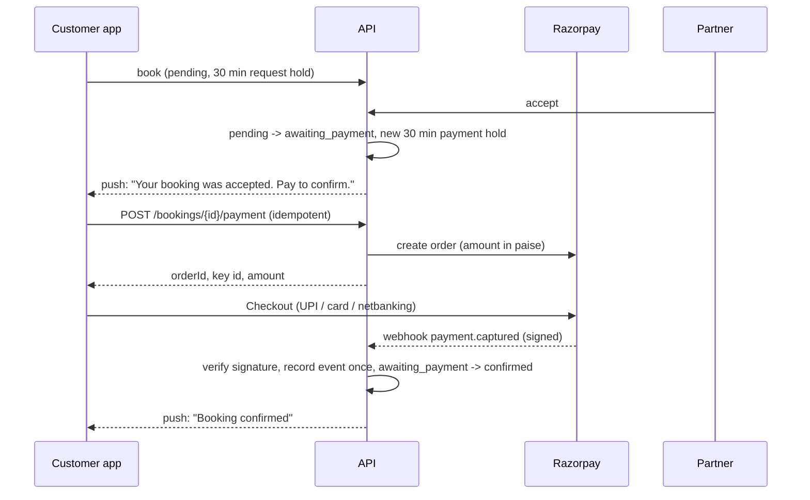

# Phase 7 – Payments, Ledger and Notifications: Implementation Plan

Audience: developers and the product owner. Status: **plan only, nothing built yet.** Spec reference:
`OnePondy_Functional_Specification.md` Phase 7, §7 (booking states), §17 (schema), §20–21.

## 1. Decisions

| Decision | Choice | Status |
|---|---|---|
| D3 Payment gateway | **Razorpay**, UPI + cards + net banking. No wallets. Cash on delivery is a Phase 8 question. | Confirmed |
| D7 Push provider | **Expo Push Service** (Android needs a Firebase project for credentials; iOS later needs Apple credentials, D4). | Confirmed |
| Payment timing | **Customer pays after the partner accepts.** | Confirmed |
| D19 SMS | **MSG91** for production (needs DLT). **Twilio Verify** for development and test servers, already built. | Confirmed |
| D19 Email | Decide later. Email codes and e-mailed receipts stay unavailable until then. | Open |
| Payment window after acceptance | A **fresh 30 minutes from acceptance** (the request hold is replaced, not extended). | **Assumption, please confirm** |
| Go-live | Payments stay in **sandbox** until legal review and an end-to-end settlement test are both done. | Confirmed |

New open decisions this plan needs (to be added to the spec as D21 and D22):

- **D21 Commission and payout model:** what percentage OnePondy keeps, and whether partners are paid by
  Razorpay Route (split at payment time) or by OnePondy through periodic settlements. Route avoids
  OnePondy holding partner money, which matters for the RBI payment-aggregator point in §21, but needs
  each partner to complete Razorpay linked-account KYC. Recommendation: **Route**, subject to legal review.
  Until decided, the ledger records commission and partner payable either way and no real payout happens.
- **D22 Refund rule on cancellation:** proposed from the snapshotted policy: full refund if cancelled at
  least `freeCancellationHours` before the start, otherwise `refundPercentage`% of the total. Rejection,
  partner cancellation and expiry-after-payment always refund 100%.

## 2. Guardrails (apply to every step)

1. **Sandbox only.** A `Payments:Mode` setting (`Sandbox` default). The API refuses to start with live
   Razorpay keys (`rzp_live_…`) unless `Payments:AllowLive` is explicitly true, and that switch is only
   flipped after the go-live checklist in §9. Tests assert the refusal.
2. **Never trust the app.** The app only opens Razorpay Checkout. A booking becomes `confirmed` solely from a
   signature-verified webhook or a server-side fetch from Razorpay (spec rule 9, Phase 7 acceptance criteria).
3. **No secrets in Git or logs.** Key id/secret and the webhook secret live in user-secrets locally and server
   config elsewhere. Card data never touches OnePondy. Log gateway ids and statuses only.
4. **Idempotent everywhere.** Duplicate webhooks, retried requests and replays change nothing a second time.
5. **Money is `numeric(12,2)` INR in the database and `decimal` in code**, converted to integer paise only at
   the Razorpay boundary.
6. **Ledger always balances**, enforced by the database, not only by code.

## 3. Booking flow with payment

Today a partner's "accept" moves `pending → confirmed`. Priced bookings change to:

Rules:

- **Which bookings need payment:** total amount above zero while the `payments` module flag is `available`.
  Free listings, and everything while the flag is off, keep today's behaviour (accept → confirmed).
- **Accept** moves to `awaiting_payment` and sets `expires_at = now + 30 min`. Seats stay held.
- **Reject** follows the spec table: allowed from `pending` and from `awaiting_payment`, and it releases the seats. A
  rejection before payment needs no refund; one that races a payment is handled by the late-payment refund (7.4).
- **Cancel** is allowed from `pending`, `confirmed` and, for the customer only, `awaiting_payment` (decided 2026-10-29; the
  spec table now says so). Seats are released at once. The gateway order may still be open, so a payment that lands
  afterwards is recorded and refunded in full (built in 7.2). A partner declines a booking that is awaiting payment with
  Reject, not Cancel.
- **Payment attempts:** a customer may retry; each attempt is a row. An order is created once per attempt and
  reused if the screen is reopened while it is still open.
- **Failure:** a verified failure moves `awaiting_payment → failed` and releases seats, as the spec says; the
  customer can book again.
- **Expiry:** the Worker, before expiring an `awaiting_payment` booking, asks Razorpay for the order's status.
  Paid → confirm; unpaid → expire. A payment that arrives after expiry is **refunded**, or the booking is
  re-confirmed if the seats are still free (spec §17 note).
- **Cancel after confirmation:** `confirmed → cancelled → refund_pending → refunded`, amount from D22.
- **Complete:** unchanged. Completion is what makes a partner payable (settlement, §6).

Domain change: add `AcceptForPayment` (`pending → awaiting_payment`) beside the existing `Confirm`, keep the
transition table in the spec as the source of truth, and add tests for every row of it.

## 4. Schema (Migration 3, `AddPaymentsAndLedger`)

New tables (all money `numeric(12,2)`, status columns with `CHECK` lists, snake_case like the rest):

| Table | Purpose and key constraints |
|---|---|
| `payment_attempts` | One row per Razorpay order: `booking_id`, `provider` (`razorpay`), `provider_order_id` (unique), `provider_payment_id`, `amount`, `currency`, `status` (`created`, `captured`, `failed`, `expired`), timestamps. `xmin` version. |
| `gateway_events` | Every webhook received, raw JSON, `provider_event_id` unique per provider so replays are ignored, `signature_valid`, `processed_at`, `error`. Rows are never deleted by the application. |
| `refunds` | `payment_attempt_id`, `booking_id`, `amount`, `reason`, `status` (`pending`, `processed`, `failed`), `provider_refund_id` unique, requested/processed times. Sum of refunds ≤ captured amount (trigger). |
| `ledger_entries` | Double-entry: `transaction_id`, `account`, signed `amount`, `booking_id`, `description`. A **deferred constraint trigger** requires every `transaction_id` to sum to zero. Append-only like `audit_log`. |
| `settlements` and `settlement_items` | A statement per business per period: items are completed bookings (and refund adjustments), totals, `status` (`draft`, `approved`, `paid`), payout reference. |
| `outbox_messages` | `type`, JSON `payload`, `created_at`, `dispatched_at`, `attempts`, `last_error`, partial index on undispatched. Written in the same transaction as the state change. |
| `device_tokens` (step 7.7 migration, not Migration 3) | `user_id`, Expo token (unique), platform, `last_seen_at`, revoked flag. Removed on sign-out and account deletion. |
| `notification_log` (step 7.7 migration) | What was sent to whom, receipt status, for support and for removing dead tokens. |

Also: extend `customer_history` with payment status, add `payments` to the module keys, and add commission
settings to `app_settings`. Account-deletion guard already blocks on `awaiting_payment`, `confirmed` and
`refund_pending`; settlement items keep the customer row (anonymised) for tax retention.

Rules from the spec still apply: migrations reviewed by hand, run as the `onepondy_app` role (so table
ownership is right), and the integration suite's pending-model-change check stays on.

## 5. Backend components

| Piece | Responsibility |
|---|---|
| `IPaymentGateway` (Application) | Create order, fetch order/payment, refund, verify payment signature, verify webhook. Razorpay implementation in Infrastructure; an `UnavailablePaymentGateway` when keys are missing, like the AI planner and OTP senders. |
| `PaymentService` | Start a payment for a booking the caller owns, return checkout details, enforce one open order per attempt, handle retries. |
| `WebhookService` | `POST /api/v1/webhooks/payments`: read raw body, verify `X-Razorpay-Signature` (HMAC-SHA256 with the webhook secret), insert into `gateway_events` (duplicate id ⇒ 200 and stop), then apply the event in one transaction. Always answers fast; unknown events are stored and ignored. |
| `RefundService` | Compute the amount (D22), create a Razorpay refund, move the booking through `refund_pending`, post ledger entries on `refund.processed`. |
| `LedgerService` | The only writer of `ledger_entries`; builds balanced transactions for capture, commission split, refund and payout. |
| `ReconciliationService` | Compares our records with Razorpay: stuck `awaiting_payment` orders (every few minutes) and the daily settlement report (once a day). Differences become rows on a console "exceptions" screen, never silent fixes. |
| `SettlementService` | Builds statements from completed bookings, approval and mark-paid by an administrator. |
| `OutboxDispatcher` + `ExpoPushSender` | Worker job: read undispatched messages, send through Expo, check receipts, delete dead tokens, retry with back-off. |

Worker additions: `PaymentReconciliationJob`, `OutboxDispatchJob`, and the payment step added to
`BookingHoldExpiry`.

API additions: `POST /bookings/{id}/payment`, `GET /bookings/{id}/receipt`, `POST /webhooks/payments`
(public, signature-protected, excluded from the rate limiter's user policy), `POST/DELETE /devices`,
partner `GET /partner/businesses/{id}/statements`, and administrator endpoints for payments, refunds,
reconciliation exceptions and settlements. The webhook is the only unauthenticated write; everything else
reuses the existing authorization and ownership rules.

## 6. Money, refunds and settlement

- **Capture:** ledger debits `gateway_clearing` for the total, credits `partner_payable` for the partner's
  share and `platform_commission` for ours.
- **Refund:** reverses the matching share of both credits against `customer_refunds`.
- **Completion** makes the partner's share eligible for a statement. Statements list bookings, commission,
  refunds and the net payable.
- **GST:** commission is invoiced to partners; tax treatment (including tax collected at source under §21)
  is a legal/tax item. The ledger keeps tax separate from the amounts above so it can be added without
  rewriting history. Nothing tax-related is switched on until the review.
- **Payout:** under Route, Razorpay settles to partners and the ledger only records it; under manual
  settlement an administrator marks a statement paid with a bank reference. Either way, sandbox only until §9.

## 7. Notifications (Expo push)

- App asks for notification permission only after the first booking, registers the Expo token with
  `POST /devices`, and removes it on sign-out.
- Events: booking accepted (pay now), confirmed, rejected, cancelled, expired, refund processed, and a
  reminder the day before. Partners get "new booking request" in the console area and, if they use the app, by push.
- **Privacy:** the push text is generic ("Your booking has an update"). The payload carries only a booking id,
  and tapping it opens the app, which loads details through the normal authorized API. A token belonging to
  a user who is no longer the booking's owner is never sent a message for it.
- Delivery goes through the outbox, so a status change and its notification either both happen or neither does.
- Needs: an Expo account, a Firebase project with the Android credentials uploaded, and a rebuilt dev client.

## 8. Clients

- **Mobile:** a payment screen opened from the "accepted, pay now" state (and from push), Razorpay Checkout
  via its React Native SDK (a native module, so the dev client must be rebuilt), receipts and payment status
  on the booking detail, refund status after cancellation. The app never decides the result: after Checkout
  closes it polls the booking until the server reports `confirmed` or `failed`.
- **Console:** payments and refunds list, reconciliation exceptions, settlements (draft, approve, mark paid),
  and the partner's own statements page with CSV export.

## 9. Build order, tests and the go-live gate

| Step | Deliverable | Proof |
|---|---|---|
| 7.1 | Migration 3, domain transitions, `payments` module key, config guard | Unit tests for every transition-table row; ledger-balance trigger test on real PostgreSQL |
| 7.2 | `IPaymentGateway` + Razorpay sandbox client, `PaymentService`, payment endpoint | Fake-gateway unit tests; a real sandbox order created |
| 7.3 | Webhook endpoint, `gateway_events`, confirmation, failure, duplicate and bad-signature handling | Integration tests: signed event confirms once, replay ignored, tampered body rejected, failure never confirms |
| 7.4 | Expiry with gateway check, late-payment refund | Worker tests with a controllable clock |
| 7.5 | Refunds and ledger | Refund amounts per D22, partial and full, over-refund impossible, ledger balances |
| 7.6 | Reconciliation job and exceptions | Seeded mismatches are found and listed |
| 7.7 | Outbox, `device_tokens`, Expo sender | Delivery after commit, retry, dead-token cleanup, no private data in text |
| 7.8 | Mobile payment screen, receipts, push | Emulator run against Razorpay sandbox (test UPI/card) |
| 7.9 | Console payments, settlements, partner statements | Console run, statement totals match the ledger |
| 7.10 | Docs: update the architecture, database and workflow documents, spec rows | Reviewed |

**Go-live gate** (all required before `Payments:AllowLive` is ever set): legal and tax review complete (§21),
D21 and D22 signed off, partner agreements in place, Razorpay live-account KYC complete, an end-to-end
settlement exercised in sandbox with a statement that reconciles to the ledger and to Razorpay's report, a
tested refund path, monitoring and alerts on failed webhooks and the outbox backlog, and the DLT-registered
MSG91 sender live so real users can sign in.

## 10. What I need from you

1. Confirm the **30-minute payment window** after acceptance, or give another duration.
2. A Razorpay account in **test mode**: the key id and secret and a webhook secret, set as user-secrets by you
   (`Payments:Razorpay:KeyId`, `KeySecret`, `WebhookSecret`). Never paste them in chat. The webhook also needs a
   public URL later; for local work I will use signature-verified test payloads and Razorpay's own simulator.
3. A view on **D21** (Route vs manual payouts, commission %) and **D22** (the refund rule above). I can build
   with the defaults and make them settings, but the numbers are yours.
4. Start the legal and tax review in parallel and the DLT registration for MSG91.
5. Later, for push: an Expo account and a Firebase project.

Steps 7.1 to 7.7 need none of the third-party accounts except step 7.2's sandbox order, so I can start
building as soon as the payment window is confirmed.

## 11. Build notes (as built)

These record where what was built differs from, or settles a question in, the plan above.

**7.2 (payment start).** Cancelling while `awaiting_payment` is allowed for the customer (spec table updated). One open
payment attempt per booking is a database rule (`ux_payment_attempts_open_booking`). A capture is accepted for an
attempt in any state except already captured, because a customer can still pay an order we had given up on.

**7.3 (webhook), `PaymentWebhookService` and `POST /api/v1/webhooks/payments`.**

- **Authentication is the signature.** HMAC-SHA256 of the exact raw body with `Payments:Razorpay:WebhookSecret`, compared in
  constant time. A missing or wrong signature answers 400 and is **not stored**, so an unauthenticated caller cannot fill the
  table. With no secret configured the endpoint answers 503.
- **Each event is applied once.** `X-Razorpay-Event-Id` is unique in `gateway_events`. A redelivery of a finished event answers
  200 `duplicate`. An event that was stored but never finished (the server stopped part way) is applied on the next delivery;
  applying is idempotent. Two identical deliveries at the same instant produce one confirmation (tested against PostgreSQL).
- **Answers the gateway acts on.** 2xx stops retries: processed, duplicate, ignored, and "needs attention" (valid but not
  applicable, such as an unknown order or a wrong amount, stored with the reason for a person to review). 409
  `payment_busy` asks the gateway to deliver again, used when the booking changed at the same instant.
- **Stored payload is sanitised, a change from "raw JSON".** Razorpay's payment event carries the payer's email, phone number
  and card or UPI details. Only the event type, payment, order and refund ids, amount, currency, status, method and error code
  are kept. This keeps personal data out of the table (DPDP) and nothing needs the rest: reconciliation (7.6) asks Razorpay
  directly.
- **`payment.failed` does not fail the booking.** Razorpay lets a customer retry on the same order until the window ends, so
  failing the booking on the first failed try would turn a later successful retry into a refund. The failed try is recorded,
  and the booking ends by payment or by expiry. The domain's `Fail` move stays available for a different rule if wanted.
- **Events handled:** `payment.captured` and `order.paid` (confirm, or refund in full if the booking no longer wants the
  money), `payment.failed` (record), `refund.processed` (mark the refund processed, and a cancelled or rejected booking becomes
  `refunded`), `refund.failed` (mark failed, booking keeps waiting). Others are stored and ignored. Only `captured` payments in
  INR for exactly the amount due are applied.
- The webhook works whether or not the `payments` module flag is on: a payment already made must always be recorded.

**7.4 (expiry with a gateway check).**

- **The Worker asks before it expires.** For a booking that was waiting for payment, `BookingHoldExpiry` first asks Razorpay
  for the payments on each of the booking's orders (`GET /orders/{id}/payments`). A captured payment is applied exactly as a
  webhook would apply it, so a customer who paid at the last moment keeps the booking. Bookings the partner never answered, and
  bookings nobody started paying for, expire without calling the gateway.
- **"Could not ask" is not "not paid".** If Razorpay cannot be reached, or the answer cannot be applied (wrong amount, another
  currency), the booking is left alone for now and retried every minute, up to `Payments:GatewayCheckGrace` (default 15
  minutes) past its deadline. After that the hold is released anyway, so a long outage cannot hold seats forever, and a payment
  that still turns up is refunded in full by the 7.2 logic. The job logs a warning while bookings are waiting, so an operator
  sees the gateway problem.
- **Orders are closed with the booking.** Cancelling, rejecting or expiring a booking now marks its open payment attempts
  `expired` in the same save, so a finished booking never keeps an open order (and a new payment is refused). A payment that
  still lands on a closed order is accepted and refunded. If that payment arrives in the same instant, the two saves collide on
  the attempt's row version and one retries, so neither is lost.
- **Late payment is refunded, not re-confirmed.** Spec §17 allows "refunded, or re-confirmed if the inventory is still
  available". Expired is a final state in the spec's table, and re-confirming would reopen it and could oversell a slot that
  was released and rebooked, so the refund option is the one built. Re-confirmation can be added later if the business wants it.
- **Checked end to end.** An integration test runs the Worker and the webhook at the same instant, six rounds, and requires one
  consistent ending every time: paid and kept with no refund, or expired with the full amount refunded.

**7.5 (refunds and the ledger).**

- **What a cancellation refunds** (`RefundCalculator`, the proposed D22 rule): the customer cancelling gets everything back up to
  the listing's free-cancellation deadline and the listing's refund percentage after it; a partner cancelling always refunds
  everything. The deadline and percentage are each listing's own terms, copied onto the booking when it was made, so the
  partner sets them per listing. A policy that returns nothing leaves the booking `cancelled` with no refund.
- **Off by default.** While `Payments:RefundsEnabled` is `false`, cancelling a *paid* booking is refused (503
  `refunds_not_enabled`) and nothing changes, rather than cancelling it and quietly keeping the customer's money. Free
  bookings, and bookings not yet paid, cancel as before. Refunds of late or duplicate payments (7.2 and 7.4) are not held back:
  that money should never have been kept.
- **One save.** The cancellation, the `refund_pending` move, the seats being given back and the refund record are saved
  together; only then is Razorpay asked. If Razorpay cannot be reached the refund stays recorded without a gateway id and a new
  Worker job (`PendingRefundJob`, every minute) sends it once it is two minutes old, so a refund is never lost waiting for a
  webhook that will not come.
- **No double refunds.** The refund's own id is sent as Razorpay's `X-Refund-Idempotency` header, so a repeat after a lost
  answer returns the first refund. (From Razorpay's documentation; not exercised against the live sandbox, which needs a real
  checkout payment.) Our own database also refuses refunds that add up to more than was paid, and a customer and a partner
  cancelling at the same instant produce exactly one refund; the other gets 409 `booking_changed`.
- **The ledger** (`LedgerService`, the only writer). A payment that confirms a booking: gateway_clearing debit, the commission
  and the partner's `partner_payable` credit. A payment no booking wants: gateway_clearing debit, `customer_refunds` credit.
  A refund the gateway reports paid: the reverse, in proportion, using the commission actually booked at the time, not today's
  rate. Every business event is one transaction that adds up to zero (the database refuses otherwise), is saved with the change
  it describes, and has an id derived from the event, with a unique (transaction, account) rule so booking an event twice is
  recognised and impossible to double count.
- **Not here yet:** statements and settlements to partners (7.9), reconciliation against Razorpay's reports (7.6), refund status in
  the app (7.8). The commission is a provisional 10% for sandbox only.
