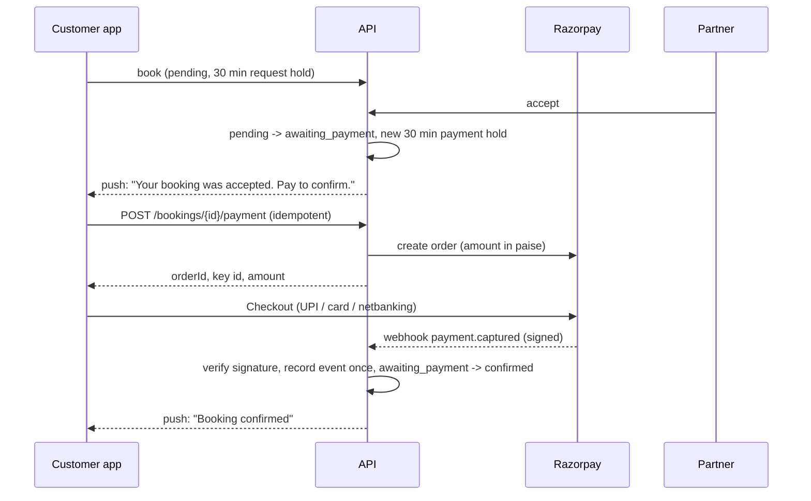

# Phase 7 – Payments, Ledger and Notifications: Implementation Plan

Audience: developers and the product owner. Status: **plan only, nothing built yet.** Spec reference:
`OnePondy_Functional_Specification.md` Phase 7, §7 (booking states), §17 (schema), §20–21.

## 1. Decisions

| Decision | Choice | Status |
|---|---|---|
| D3 Payment gateway | **Razorpay**, UPI + cards + net banking. No wallets. Cash on delivery is a Phase 8 question. | Confirmed |
| D7 Push provider | **Expo Push Service** (Android needs a Firebase project for credentials; iOS later needs Apple credentials, D4). | Confirmed |
| Payment timing | **Customer pays after the partner accepts.** | Confirmed |
| D19 SMS | **MSG91** for production (needs DLT). **Twilio Verify** for development and test servers, already built. | Confirmed |
| D19 Email | Decide later. Email codes and e-mailed receipts stay unavailable until then. | Open |
| Payment window after acceptance | A **fresh 30 minutes from acceptance** (the request hold is replaced, not extended). | **Assumption, please confirm** |
| Go-live | Payments stay in **sandbox** until legal review and an end-to-end settlement test are both done. | Confirmed |

New open decisions this plan needs (to be added to the spec as D21 and D22):

- **D21 Commission and payout model:** what percentage OnePondy keeps, and whether partners are paid by
  Razorpay Route (split at payment time) or by OnePondy through periodic settlements. Route avoids
  OnePondy holding partner money, which matters for the RBI payment-aggregator point in §21, but needs
  each partner to complete Razorpay linked-account KYC. Recommendation: **Route**, subject to legal review.
  Until decided, the ledger records commission and partner payable either way and no real payout happens.
- **D22 Refund rule on cancellation:** proposed from the snapshotted policy: full refund if cancelled at
  least `freeCancellationHours` before the start, otherwise `refundPercentage`% of the total. Rejection,
  partner cancellation and expiry-after-payment always refund 100%.

## 2. Guardrails (apply to every step)

1. **Sandbox only.** A `Payments:Mode` setting (`Sandbox` default). The API refuses to start with live
   Razorpay keys (`rzp_live_…`) unless `Payments:AllowLive` is explicitly true, and that switch is only
   flipped after the go-live checklist in §9. Tests assert the refusal.
2. **Never trust the app.** The app only opens Razorpay Checkout. A booking becomes `confirmed` solely from a
   signature-verified webhook or a server-side fetch from Razorpay (spec rule 9, Phase 7 acceptance criteria).
3. **No secrets in Git or logs.** Key id/secret and the webhook secret live in user-secrets locally and server
   config elsewhere. Card data never touches OnePondy. Log gateway ids and statuses only.
4. **Idempotent everywhere.** Duplicate webhooks, retried requests and replays change nothing a second time.
5. **Money is `numeric(12,2)` INR in the database and `decimal` in code**, converted to integer paise only at
   the Razorpay boundary.
6. **Ledger always balances**, enforced by the database, not only by code.

## 3. Booking flow with payment

Today a partner's "accept" moves `pending → confirmed`. Priced bookings change to:

Rules:

- **Which bookings need payment:** total amount above zero while the `payments` module flag is `available`.
  Free listings, and everything while the flag is off, keep today's behaviour (accept → confirmed).
- **Accept** moves to `awaiting_payment` and sets `expires_at = now + 30 min`. Seats stay held.
- **Reject** is only possible while `pending`, so a rejection never needs a refund. A partner who wants out
  after accepting uses cancel, which refunds (below).
- **Payment attempts:** a customer may retry; each attempt is a row. An order is created once per attempt and
  reused if the screen is reopened while it is still open.
- **Failure:** a verified failure moves `awaiting_payment → failed` and releases seats, as the spec says; the
  customer can book again.
- **Expiry:** the Worker, before expiring an `awaiting_payment` booking, asks Razorpay for the order's status.
  Paid → confirm; unpaid → expire. A payment that arrives after expiry is **refunded**, or the booking is
  re-confirmed if the seats are still free (spec §17 note).
- **Cancel after confirmation:** `confirmed → cancelled → refund_pending → refunded`, amount from D22.
- **Complete:** unchanged. Completion is what makes a partner payable (settlement, §6).

Domain change: add `AcceptForPayment` (`pending → awaiting_payment`) beside the existing `Confirm`, keep the
transition table in the spec as the source of truth, and add tests for every row of it.

## 4. Schema (Migration 3, `AddPaymentsAndLedger`)

New tables (all money `numeric(12,2)`, status columns with `CHECK` lists, snake_case like the rest):

| Table | Purpose and key constraints |
|---|---|
| `payment_attempts` | One row per Razorpay order: `booking_id`, `provider` (`razorpay`), `provider_order_id` (unique), `provider_payment_id`, `amount`, `currency`, `status` (`created`, `captured`, `failed`, `expired`), timestamps. `xmin` version. |
| `gateway_events` | Every webhook received, raw JSON, `provider_event_id` unique per provider so replays are ignored, `signature_valid`, `processed_at`, `error`. Append-only. |
| `refunds` | `payment_attempt_id`, `booking_id`, `amount`, `reason`, `status` (`pending`, `processed`, `failed`), `provider_refund_id` unique, requested/processed times. Sum of refunds ≤ captured amount (trigger). |
| `ledger_accounts` | Small fixed set: `gateway_clearing`, `customer_refunds`, `platform_commission`, `partner_payable:{business}` and `partner_paid:{business}`. |
| `ledger_entries` | Double-entry: `transaction_id`, `account`, signed `amount`, `booking_id`, `description`. A **deferred constraint trigger** requires every `transaction_id` to sum to zero. Append-only like `audit_log`. |
| `settlements` and `settlement_items` | A statement per business per period: items are completed bookings (and refund adjustments), totals, `status` (`draft`, `approved`, `paid`), payout reference. |
| `outbox_messages` | `type`, JSON `payload`, `created_at`, `dispatched_at`, `attempts`, `last_error`, partial index on undispatched. Written in the same transaction as the state change. |
| `device_tokens` | `user_id`, Expo token (unique), platform, `last_seen_at`, revoked flag. Removed on sign-out and account deletion. |
| `notification_log` | What was sent to whom, receipt status, for support and for removing dead tokens. |

Also: extend `customer_history` with payment status, add `payments` to the module keys, and add commission
settings to `app_settings`. Account-deletion guard already blocks on `awaiting_payment`, `confirmed` and
`refund_pending`; settlement items keep the customer row (anonymised) for tax retention.

Rules from the spec still apply: migrations reviewed by hand, run as the `onepondy_app` role (so table
ownership is right), and the integration suite's pending-model-change check stays on.

## 5. Backend components

| Piece | Responsibility |
|---|---|
| `IPaymentGateway` (Application) | Create order, fetch order/payment, refund, verify payment signature, verify webhook. Razorpay implementation in Infrastructure; an `UnavailablePaymentGateway` when keys are missing, like the AI planner and OTP senders. |
| `PaymentService` | Start a payment for a booking the caller owns, return checkout details, enforce one open order per attempt, handle retries. |
| `WebhookService` | `POST /api/v1/webhooks/payments`: read raw body, verify `X-Razorpay-Signature` (HMAC-SHA256 with the webhook secret), insert into `gateway_events` (duplicate id ⇒ 200 and stop), then apply the event in one transaction. Always answers fast; unknown events are stored and ignored. |
| `RefundService` | Compute the amount (D22), create a Razorpay refund, move the booking through `refund_pending`, post ledger entries on `refund.processed`. |
| `LedgerService` | The only writer of `ledger_entries`; builds balanced transactions for capture, commission split, refund and payout. |
| `ReconciliationService` | Compares our records with Razorpay: stuck `awaiting_payment` orders (every few minutes) and the daily settlement report (once a day). Differences become rows on a console "exceptions" screen, never silent fixes. |
| `SettlementService` | Builds statements from completed bookings, approval and mark-paid by an administrator. |
| `OutboxDispatcher` + `ExpoPushSender` | Worker job: read undispatched messages, send through Expo, check receipts, delete dead tokens, retry with back-off. |

Worker additions: `PaymentReconciliationJob`, `OutboxDispatchJob`, and the payment step added to
`BookingHoldExpiry`.

API additions: `POST /bookings/{id}/payment`, `GET /bookings/{id}/receipt`, `POST /webhooks/payments`
(public, signature-protected, excluded from the rate limiter's user policy), `POST/DELETE /devices`,
partner `GET /partner/businesses/{id}/statements`, and administrator endpoints for payments, refunds,
reconciliation exceptions and settlements. The webhook is the only unauthenticated write; everything else
reuses the existing authorization and ownership rules.

## 6. Money, refunds and settlement

- **Capture:** ledger debits `gateway_clearing` for the total, credits `partner_payable` for the partner's
  share and `platform_commission` for ours.
- **Refund:** reverses the matching share of both credits against `customer_refunds`.
- **Completion** makes the partner's share eligible for a statement. Statements list bookings, commission,
  refunds and the net payable.
- **GST:** commission is invoiced to partners; tax treatment (including tax collected at source under §21)
  is a legal/tax item. The ledger keeps tax separate from the amounts above so it can be added without
  rewriting history. Nothing tax-related is switched on until the review.
- **Payout:** under Route, Razorpay settles to partners and the ledger only records it; under manual
  settlement an administrator marks a statement paid with a bank reference. Either way, sandbox only until §9.

## 7. Notifications (Expo push)

- App asks for notification permission only after the first booking, registers the Expo token with
  `POST /devices`, and removes it on sign-out.
- Events: booking accepted (pay now), confirmed, rejected, cancelled, expired, refund processed, and a
  reminder the day before. Partners get "new booking request" in the console area and, if they use the app, by push.
- **Privacy:** the push text is generic ("Your booking has an update"). The payload carries only a booking id,
  and tapping it opens the app, which loads details through the normal authorized API. A token belonging to
  a user who is no longer the booking's owner is never sent a message for it.
- Delivery goes through the outbox, so a status change and its notification either both happen or neither does.
- Needs: an Expo account, a Firebase project with the Android credentials uploaded, and a rebuilt dev client.

## 8. Clients

- **Mobile:** a payment screen opened from the "accepted, pay now" state (and from push), Razorpay Checkout
  via its React Native SDK (a native module, so the dev client must be rebuilt), receipts and payment status
  on the booking detail, refund status after cancellation. The app never decides the result: after Checkout
  closes it polls the booking until the server reports `confirmed` or `failed`.
- **Console:** payments and refunds list, reconciliation exceptions, settlements (draft, approve, mark paid),
  and the partner's own statements page with CSV export.

## 9. Build order, tests and the go-live gate

| Step | Deliverable | Proof |
|---|---|---|
| 7.1 | Migration 3, domain transitions, `payments` module key, config guard | Unit tests for every transition-table row; ledger-balance trigger test on real PostgreSQL |
| 7.2 | `IPaymentGateway` + Razorpay sandbox client, `PaymentService`, payment endpoint | Fake-gateway unit tests; a real sandbox order created |
| 7.3 | Webhook endpoint, `gateway_events`, confirmation, failure, duplicate and bad-signature handling | Integration tests: signed event confirms once, replay ignored, tampered body rejected, failure never confirms |
| 7.4 | Expiry with gateway check, late-payment refund | Worker tests with a controllable clock |
| 7.5 | Refunds and ledger | Refund amounts per D22, partial and full, over-refund impossible, ledger balances |
| 7.6 | Reconciliation job and exceptions | Seeded mismatches are found and listed |
| 7.7 | Outbox, `device_tokens`, Expo sender | Delivery after commit, retry, dead-token cleanup, no private data in text |
| 7.8 | Mobile payment screen, receipts, push | Emulator run against Razorpay sandbox (test UPI/card) |
| 7.9 | Console payments, settlements, partner statements | Console run, statement totals match the ledger |
| 7.10 | Docs: update the architecture, database and workflow documents, spec rows | Reviewed |

**Go-live gate** (all required before `Payments:AllowLive` is ever set): legal and tax review complete (§21),
D21 and D22 signed off, partner agreements in place, Razorpay live-account KYC complete, an end-to-end
settlement exercised in sandbox with a statement that reconciles to the ledger and to Razorpay's report, a
tested refund path, monitoring and alerts on failed webhooks and the outbox backlog, and the DLT-registered
MSG91 sender live so real users can sign in.

## 10. What I need from you

1. Confirm the **30-minute payment window** after acceptance, or give another duration.
2. A Razorpay account in **test mode**: the key id and secret and a webhook secret, set as user-secrets by you
   (`Payments:Razorpay:KeyId`, `KeySecret`, `WebhookSecret`). Never paste them in chat. The webhook also needs a
   public URL later; for local work I will use signature-verified test payloads and Razorpay's own simulator.
3. A view on **D21** (Route vs manual payouts, commission %) and **D22** (the refund rule above). I can build
   with the defaults and make them settings, but the numbers are yours.
4. Start the legal and tax review in parallel and the DLT registration for MSG91.
5. Later, for push: an Expo account and a Firebase project.

Steps 7.1 to 7.7 need none of the third-party accounts except step 7.2's sandbox order, so I can start
building as soon as the payment window is confirmed.
