# OnePondy – Full Workflows

Audience: developers, QA and operations. Every workflow below describes what the code does today
(Phases 1–7). Anything not built is labelled **Not built**. Error `code` values are the
stable strings the API returns in problem JSON.

Related documents: [backend-architecture.md](backend-architecture.md),
[database-architecture.md](database-architecture.md), [data-retention.md](data-retention.md).

## Contents

1. [Actors and permissions](#1-actors-and-permissions)
2. [Sign-in with a one-time code](#2-sign-in-with-a-one-time-code)
3. [Session refresh and sign-out](#3-session-refresh-and-sign-out)
4. [Account deletion](#4-account-deletion)
5. [Staff sign-in and first administrator](#5-staff-sign-in-and-first-administrator)
6. [Place verification and publication](#6-place-verification-and-publication)
7. [Place media upload](#7-place-media-upload)
8. [Browsing places, saving and sharing](#8-browsing-places-saving-and-sharing)
9. [Itineraries](#9-itineraries)
10. [AI trip planner](#10-ai-trip-planner)
11. [Partner onboarding](#11-partner-onboarding)
12. [Listings and moderation](#12-listings-and-moderation)
13. [Availability slots](#13-availability-slots)
14. [Booking lifecycle](#14-booking-lifecycle)
15. [Hold expiry (Worker)](#15-hold-expiry-worker)
16. [Saved listings](#16-saved-listings)
17. [Module flags and minimum app version](#17-module-flags-and-minimum-app-version)
18. [Audit trail](#18-audit-trail)
19. [End-to-end journey](#19-end-to-end-journey)
20. [Paying for a booking](#20-paying-for-a-booking)
21. [Refunds, cancellation money and the ledger](#21-refunds-cancellation-money-and-the-ledger)
22. [Reconciliation (Worker)](#22-reconciliation-worker)
23. [Notifications (Expo push)](#23-notifications-expo-push)
24. [Partner statements and payouts](#24-partner-statements-and-payouts)
25. [Food orders (Phase 8)](#25-food-orders-phase-8-steps-81-to-84)
26. [Not built](#26-not-built)

---

## 1. Actors and permissions

| Actor | How they are identified | Can do |
|---|---|---|
| Guest | No token | Browse config, places, published listings and availability; open a shared itinerary. |
| Customer | Signed in, role `customer` | Profile, saved places/listings, itineraries, AI planner, create, pay for and cancel own bookings, receipts and refund status, push notifications. |
| Partner | Signed in **and** owner of a business | Apply as a business, manage own business, listings, slots and incoming bookings, and read own approved and paid statements. Not a role: ownership is the permission. |
| Content editor | Role `content_editor` | Create, edit, submit and moderate places and media. |
| Support agent | Role `support_agent` | Read-only console access to content. |
| Administrator | Role `administrator` | Everything above plus staff, module flags, minimum app version, audit log, partner and listing moderation, payments and refunds, reconciliation, and partner statements and payouts. |
| Worker | Background service | Releases expired holds (asking the payment gateway first); sends refunds; reconciles payments; sends push notifications and reminders; purges old authentication and notification data. |

Every new sign-in account starts as a customer. A customer becomes a partner by applying for a
business.

---

## 2. Sign-in with a one-time code

There are no passwords. The same flow registers a new user and signs in an existing one.

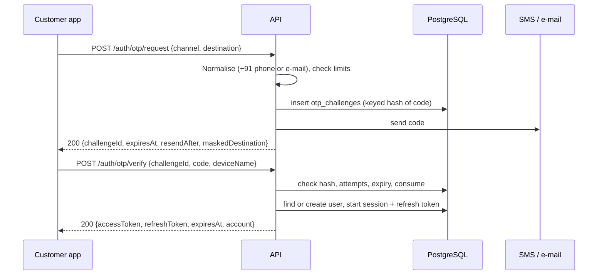

Rules:

1. **Destination:** SMS numbers are normalised to E.164 and only calling code `+91` is allowed;
   e-mail addresses are lower-cased for comparison.
2. **Limits:** 30 s between sends to the same destination (across every purpose), 3 sends per
   destination per 10 minutes, 1000 sends per day overall, and the per-IP `auth` rate limit.
   Breaches return `429` with `retryAfterSeconds`.
3. **Code:** 6 digits, valid for 5 minutes, 5 wrong attempts invalidate it. Only a keyed hash is stored.
4. **Verify:** success consumes the challenge (single use). The account is found by phone or
   e-mail, or created on first sign-in with the default display name and language.
5. **Session:** a `user_sessions` row and the first `refresh_tokens` row are created. The access
   token (15 min) carries user id, roles and session id.
6. **Delivery:** in Development/Testing the code is written to the log. Elsewhere delivery returns
   `503` until an SMS/e-mail provider is configured (open decision D19).

Failure paths: wrong/expired/used code → `401`; too many attempts → code invalidated; unsupported
country code or malformed e-mail → `400`.

---

## 3. Session refresh and sign-out

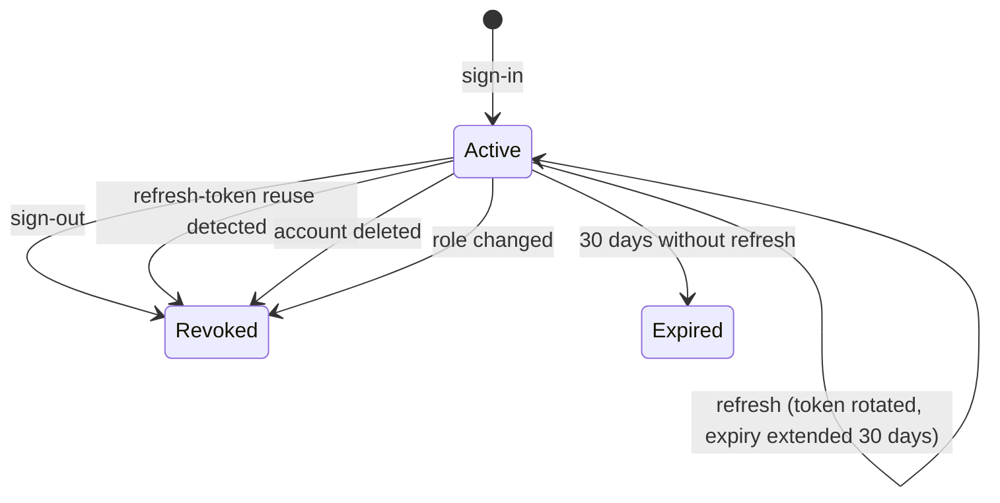

**Refresh (`POST /auth/refresh`):**

1. Look the token up by its keyed hash. Unknown, empty or over-long → `401 invalid_refresh_token`.
2. If the token was **already consumed**, someone is replaying an old token: the whole session is
   revoked (`refresh_token_reuse`), a metric is raised, and the call fails with `401`.
3. Expired token, inactive session, or an account that no longer exists → `401`.
4. Otherwise a new refresh token is issued, the old one is marked consumed and linked to its
   replacement, the session expiry is pushed 30 days out, and a new access token is returned.
5. If two requests rotate the same token at the same instant, one wins; the other gets `401` and
   the client retries with the newer token.

**Sign-out (`POST /auth/logout`):** revokes the current session (`signed_out`). Because every
request checks the session, the access token stops working immediately, not after 15 minutes.

---

## 4. Account deletion

Two entry points share the same service. Both require a fresh code, so a stolen access token
cannot delete an account.

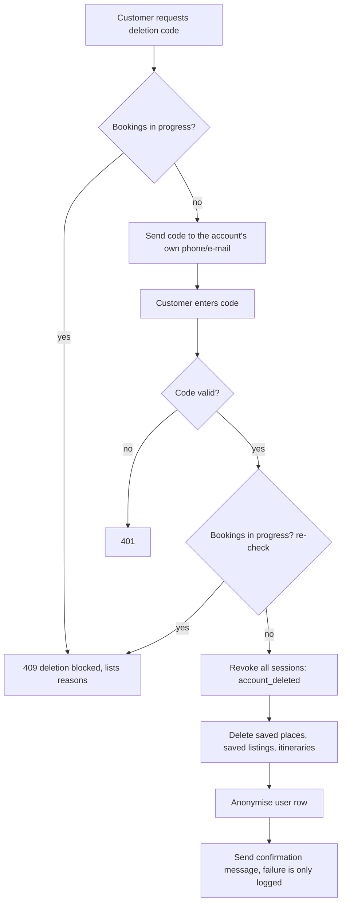

1. **In the app:** `POST /account/deletion/code` then `POST /account/deletion/confirm`. The code
   goes to the contact already on the account, and the guard is checked **early** so the customer
   is told about blockers before they receive a code.
2. **On the web** (for people without the app, page at `/account/delete/`):
   `POST /account/deletion-requests` then `/deletion-requests/confirm`. The page does not reveal
   whether an account exists; the guard is checked only after the code is verified.
3. **Guard (`BookingsDeletionGuard`):** deletion is refused while the user has bookings in
   `pending`, `awaiting_payment`, `confirmed` or `refund_pending`
   (reason `bookings_in_progress`), or owns a business that has such bookings
   (`partner_bookings_in_progress`).
4. **Effect:** all sessions are revoked with reason `account_deleted`; saved places, saved
   listings and itineraries are deleted; the user row is anonymised (display name "Deleted user",
   phone and e-mail cleared, inactive, `deleted_at` set, security stamp rotated). The user row is
   never hard-deleted, so bookings, audit rows and partner records keep a valid reference.
5. The confirmation message is best effort; a delivery failure does not undo the deletion.

---

## 5. Staff sign-in and first administrator

The console uses the same code mechanism with purpose `StaffSignIn` and e-mail only.

1. Staff enters their e-mail at the console. `POST /admin/auth/otp/request` always responds the
   same way, but a code is only sent if the address belongs to a staff user (or has just been
   bootstrapped as the first administrator, below). This stops the form being used to discover staff
   accounts.
2. `POST /admin/auth/otp/verify` checks the code **and** that the user has a staff role, then
   starts a session. The console stores tokens in `httpOnly` cookies; the browser never sees them.
3. The console's proxy refreshes the access token in the background using the refresh cookie.
4. Partners signing in to the console's `/partner` area use the customer sign-in flow and a
   separate cookie pair, so a partner session never grants staff access.

**First administrator:** `Console:BootstrapAdministrators` lists e-mail addresses that become
administrators automatically, but only while **no administrator exists**. After that, only an
existing administrator can add or change staff (`/admin/staff`). Changing or removing a role
revokes that user's sessions (`role_changed`) so the new permission applies immediately.

---

## 6. Place verification and publication

Tourism content is only shown to the public after a human has verified it. The status is a state
machine; the database also enforces "published implies verified".

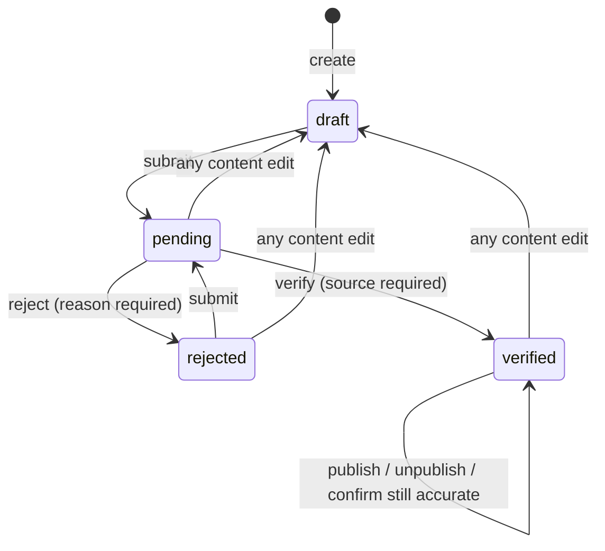

| Step | Who | Rules |
|---|---|---|
| Create / edit | content_editor, administrator | Name, slug, category, description, address, coordinates, opening hours, entry fees, Tamil/French translations. An edit that changes nothing is ignored. **Any real edit to a non-draft place returns it to `draft`, unpublishes it and clears verification.** |
| Submit | content_editor, administrator | Only `draft` or `rejected`. The place must have a description and a location. |
| Verify | content_editor, administrator | Only `pending`. Records the verifier, the time and a **source** (where the facts were confirmed). |
| Reject | content_editor, administrator | Only `pending`. A reason is required and shown to the editor. |
| Publish / unpublish | content_editor, administrator | Publish only when `verified`. Unpublish keeps the verification. |
| Confirm still accurate | content_editor, administrator | Only `verified`. Re-records the review time and source without changing content. |

**Periodic review:** every published place has `last_reviewed_at`. Places not reviewed within
`Content:ReviewInterval` (default 180 days) appear in the console's review-due list (served by the
partial index `ix_places_review_due`). Confirming the place clears it from the list.

**Concurrency:** all edits carry the place `version`; a stale save returns `409`. Every step writes
an `audit_log` row (§18).

**Policy note:** the same content editor may edit, submit and verify their own place; there is no
separate-verifier ("four-eyes") rule. Add one in `PlaceAdminService.VerifyAsync` if the business
wants it.

---

## 7. Place media upload

`POST /admin/places/{id}/media` (content editors).

1. Accepts JPEG, PNG or WebP up to 10 MB; at most 20 images per place.
2. Rejects images whose long edge is under 800 px or short edge under 450 px (this works for
   portrait photos too), or above 50 million pixels.
3. Requires alt text. Requires a licence from: `owned`, `partner_supplied`, `cc_by`, `cc_by_sa`,
   `cc0`, `licensed_stock`, `other`. Every licence except `owned` and `cc0` also requires an
   attribution. Source URL and caption are optional.
4. SkiaSharp decodes the image, **strips all metadata (EXIF and GPS)**, and writes WebP renditions
   (quality 82) named `large` (1600 px wide), `medium` (800) and `thumb` (400) into `Media:RootPath`.
5. A `place_media` row stores only the storage key and dimensions. The first image is the cover.
6. Staff can reorder images, edit alt text/caption/licence, and delete (files are removed too).
7. Images are served from `/media` with a one-year immutable cache.

Adding or changing media does not reset a place's verification status.

---

## 8. Browsing places, saving and sharing

- **Browse:** `GET /places` (public) returns only `is_published` **and** `verified` places. Filters:
  `category`, `q` (matches name, including translations), `lang`, paging. With `lat`+`lng` (both,
  or neither) results are sorted nearest first and include distance in km (computed in memory;
  no PostGIS yet).
- **Detail:** `GET /places/{idOrSlug}` returns the place in the requested language
  (`ta`, `fr`, falling back to English field by field), opening hours, fees and media.
- **Language:** `lang` parameter, otherwise the request's `Accept-Language`.
- **Saved places:** `POST/DELETE/GET /saved-places` store bookmarks per user. Only a place that is
  currently published and verified can be saved (`place_not_available` otherwise); saving twice is
  harmless. Unpublishing a place later does not delete the bookmark: the saved list still shows it,
  flagged `isCurrentlyPublished = false`, so users do not lose what they saved.
- Saved places and itineraries are removed on account deletion (§4).

---

## 9. Itineraries

A trip plan owned by one user.

| Status | Meaning |
|---|---|
| `draft` | Created by the AI planner; not yet confirmed by the user. |
| `saved` | Normal active plan. Manually created plans start here. |
| `archived` | Hidden from the default list; can be restored. |

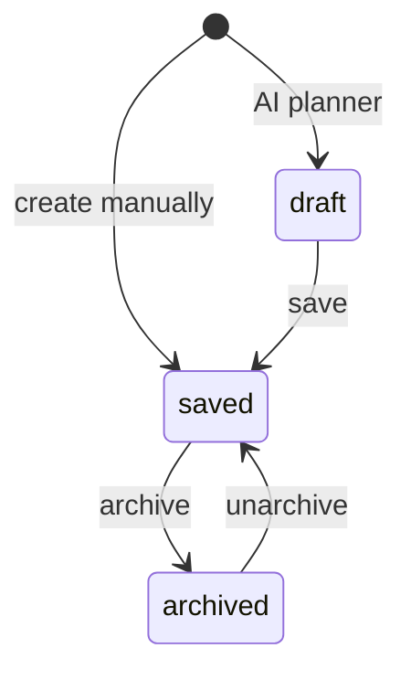

Rules:

1. A title (max 180 characters) is required; optional start and end dates, end not before start.
2. Up to **100 stops**. A stop is a place, a `day_number` (1 or more), an automatic `stop_order`,
   optional planned arrival and notes (max 1000 characters).
3. A stop can only be added for a place that is currently published and verified
   (`place_not_available` otherwise).
4. **Reorder:** one call supplies the new `(day, order)` for stops; each stop may appear once and
   must belong to the itinerary. It runs in one transaction; the unique position constraint is
   deferrable so intermediate states do not fail.
5. **Delete:** removes the itinerary and its stops.
6. **Sharing:** `POST /itineraries/{id}/share` creates an unguessable 24-byte token and returns a
   link; disabling sharing removes the token, after which the link answers `itinerary_not_shared`.
   `GET /itineraries/shared/{token}` is public, read-only and shows place names, not the owner's identity.
7. Another user's itinerary always answers `itinerary_not_found`.

---

## 10. AI trip planner

`POST /trip-planner/plan` (signed in).

The request carries start and end date, interests (place category codes), pace, budget band,
optional mobility needs and an optional location.

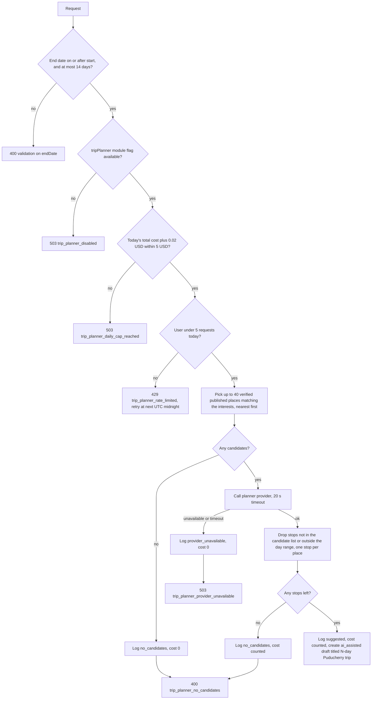

Key guarantees:

- The model can only choose from places the platform already trusts; invented places are discarded.
- Cost control is enforced from `trip_planner_request_logs`: at most 5 requests per user per UTC
  day and 5 USD of estimated spend per UTC day across all users (0.02 USD per call that reached the
  provider and returned). **Every logged request counts toward the per-user limit**, including
  ones that ended with no candidates or a provider failure.
- The result is a **draft** itinerary: the user reviews it and saves it (§9) or deletes it.
- Every failure message suggests building the trip manually, so the app always has a fallback.
- With no Gemini key configured the provider answers unavailable and the rest of the app is unaffected.

---

## 11. Partner onboarding

A signed-in customer applies for a business; staff review it.

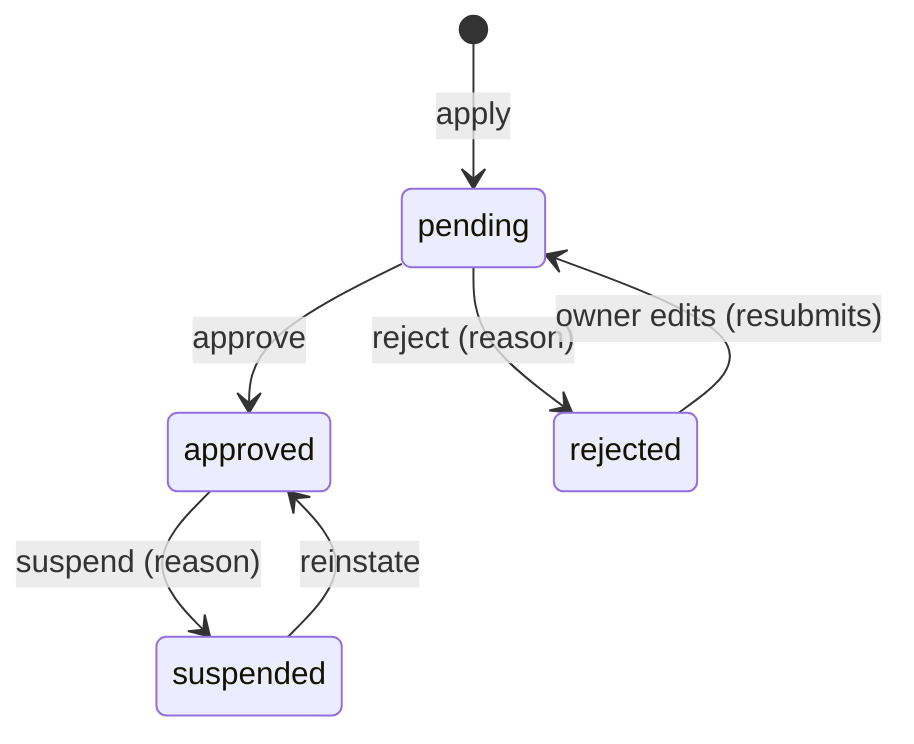

1. **Apply:** `POST /partner/businesses` with name, type (`restaurant`, `hotel`, `activity`, `shop`,
   `tour_operator`, `service`), contact details, address, optional coordinates, GSTIN (15 characters)
   and FSSAI number (14 characters). Lengths are validated; the number formats and the numbers
   themselves are checked by staff, not by the system. A user may own several businesses.
2. **Documents:** the owner uploads proof (GSTIN certificate, FSSAI licence, other) to
   `/partner/businesses/{id}/documents`, as a file of at most 10 MB with a document kind. Files go
   to the **private** folder and are served only to the owner and administrators. Uploads and
   removals are allowed only while the application is `pending` or `rejected`. Note: the file type is
   taken from the upload and not inspected, which is acceptable only because files are never served
   to the public; add content-type checks before documents are ever shown to other users.
3. **Edit:** allowed only while `pending` or `rejected`. Editing a rejected application **resubmits
   it** (back to `pending`, review note cleared). Approved and suspended businesses are locked
   (`business_locked`).
4. **Approve (administrator):** a restaurant needs an FSSAI number or approval is refused
   (`business_cannot_approve`). Approval sets `is_active = true`.
5. **Reject (administrator):** only from `pending`, reason required; the owner sees the reason.
6. **Suspend / reinstate (administrator):** suspension requires a reason and sets
   `is_active = false`. The business's listings disappear from public browsing and nothing new can
   be booked; **existing bookings are untouched** and can still be handled.
7. The database also enforces `is_active ⇒ approved` and "approved restaurant ⇒ FSSAI".

Every decision writes an audit row. A non-owner asking for someone else's business gets
`business_not_found`.

---

## 12. Listings and moderation

A listing is one thing a business offers: `activity`, `stay`, `event`, `service` or `shop`.

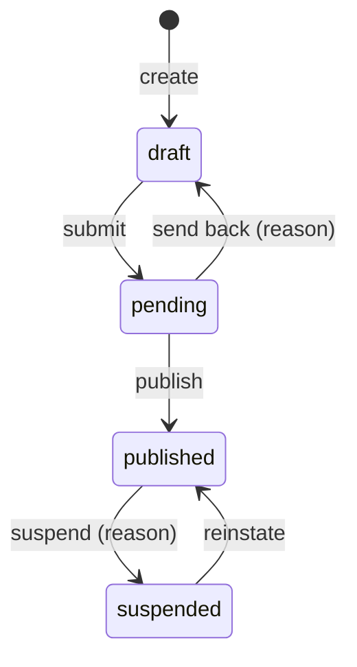

1. **Create/edit (owner):** title, description, base price (0 or more, INR), type, and whether it is
   bookable. Editing is allowed only in `draft` (`listing_locked` otherwise).
2. **Shops are never bookable.** A bookable listing must carry a **cancellation policy**: free
   cancellation hours (0 or more), refund percentage (0–100) and optional notes. Both rules are
   checked in the domain and again by database constraints.
3. **Only an active (approved) business** can create, submit, publish or reinstate listings
   (`listing_business_not_active`).
4. **Submit:** `draft → pending`.
5. **Moderate (administrator):** publish, send back (reason shown to the owner, status returns to
   `draft`), suspend a published listing (reason required), reinstate a suspended one.
6. **Public visibility:** a listing is public only when it is `published` **and** its business is
   active. Public detail and availability return `listing_not_found` otherwise.
7. All edits and transitions carry `version`; stale writes return `listing_changed` (`409`).

---

## 13. Availability slots

Only listings the owner marks bookable use slots; each slot is a dated block with a capacity.

1. **Create:** start, end (end after start) and capacity of at least 1. One slot per
   `(listing, start time)`.
2. **Reserved count:** maintained by the booking engine, never edited by hand. The database
   guarantees `0 ≤ reserved ≤ capacity`.
3. **Change capacity:** cannot go below what is already reserved.
4. **Remove:** refused with `slot_has_reservations` if seats are held **or any booking ever used
   the slot**, even a cancelled one, so booking history keeps its slot. The console shows this as
   "that time has booking history".
5. **Public view:** `GET /listings/{id}/availability?from=` lists upcoming slots with live
   remaining capacity for published, bookable listings.
6. Slots can be managed while the listing is published; only the listing's own content is locked.

---

## 14. Booking lifecycle

### 14.1 States

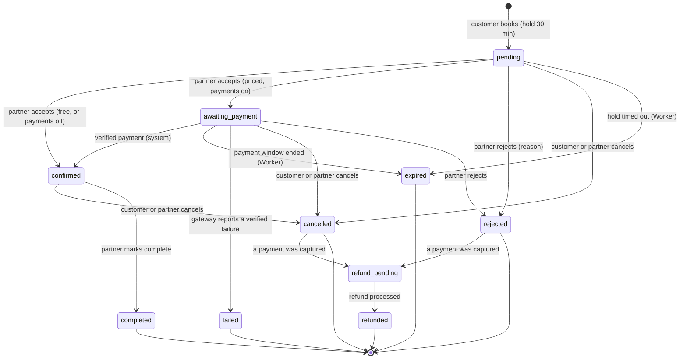

The four payment states are reachable only when online payment is on (the `payments` module flag
and Razorpay keys, sandbox only; see §20). With it off, or for a free listing, a booking behaves as
in Phase 6 and the partner confirms it directly. `refund_pending` and `refunded` are reached only
after a captured payment is refunded (§21).

### 14.2 Create (`POST /bookings`)

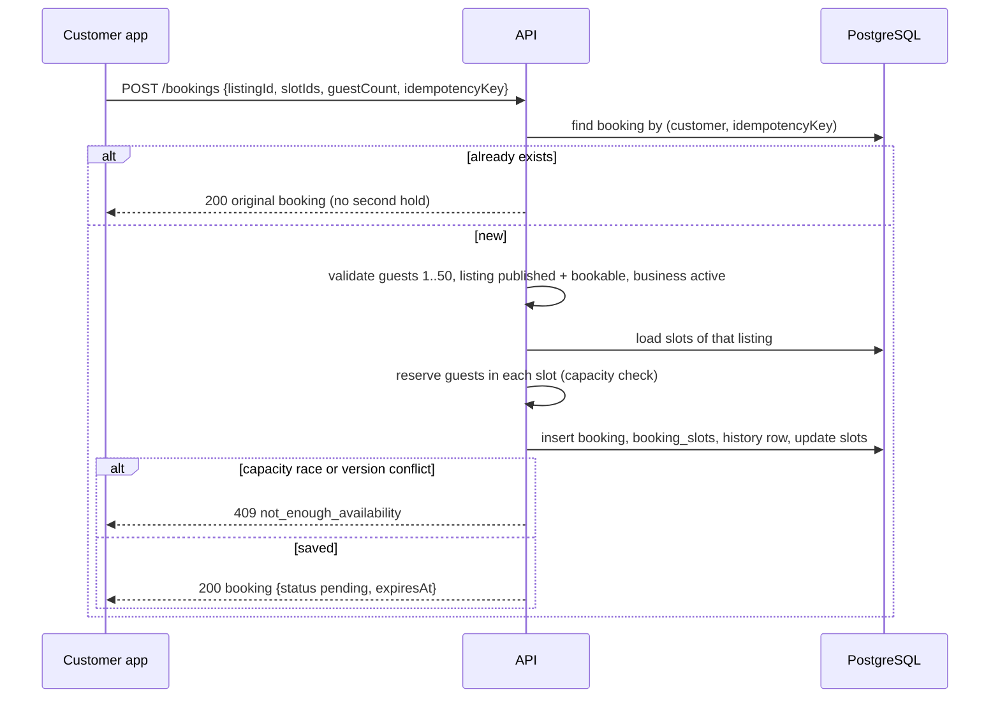

Details:

1. **Idempotency:** the app generates an `idempotencyKey` once per attempt and reuses it on retry.
   A retry, including after a dropped response, returns the **original** booking. If two identical
   requests race, the unique index rejects the second and the first booking is returned. The key is
   scoped per customer.
2. **Validation:** guests 1–50 (`validation_failed`); listing exists (`listing_not_found`);
   listing published, bookable and its business active (`listing_not_bookable`); every slot belongs
   to the listing (`slot_not_found`).
3. **Capacity:** each chosen slot is reserved for `guestCount` seats. If any slot lacks room the
   whole request fails with `not_enough_availability` and nothing is held.
4. **Price snapshot:** `unit price × guests × number of slots`, stored with the booking together
   with a copy of the cancellation policy. Fees, tax and discount are 0 today. Later edits to the
   listing never change an existing booking.
5. **Hold:** status `pending`, `expires_at = now + 30 minutes`. The booking's start and end are the
   earliest start and latest end of its slots. A history row `null → pending` (actor: customer) is written.
6. **Concurrency:** two customers taking the last seats at once cannot both succeed: slot rows use
   `xmin` and a `reserved ≤ capacity` constraint, and the loser receives `not_enough_availability`.

### 14.3 Partner decisions

All partner actions go to `/partner/businesses/{businessId}/bookings/{id}/…`, require the caller to
own that business (otherwise `booking_not_found`), and send the booking `version`.

| Action | From | To | Seats | Notes |
|---|---|---|---|---|
| Accept | `pending` | `confirmed`, or `awaiting_payment` for a priced booking when payments are on | stay reserved | Hold expiry cleared; for a payment, a fresh 30-minute window starts (§20). |
| Reject | `pending`, `awaiting_payment` | `rejected` (then `refund_pending` if a payment was captured) | **released** | Reason required (max 500). |
| Cancel | `pending`, `awaiting_payment`, `confirmed` | `cancelled` (then `refund_pending` if paid) | **released** | Reason optional; a partner cancel refunds everything. |
| Complete | `confirmed` | `completed` | unchanged | Marks the visit as done. |

### 14.4 Customer actions

- `GET /bookings`, `GET /bookings/{id}`: only the customer's own bookings; the detail includes slots,
  price snapshot, cancellation policy and the full status history.
- `POST /bookings/{id}/cancel`: allowed from `pending`, `awaiting_payment` or `confirmed`; seats are
  released and the reason is stored. Someone else's booking answers `booking_not_found`.
- The detail also carries the **receipt** (amount, time and the gateway's payment id) and each
  **refund** with its progress.
- `POST /bookings/{id}/payment` and `/payment/refresh` pay for and re-check an accepted booking (§20).
- **Cancellation policy** (free hours, refund percentage) decides the refund when a paid booking is
  cancelled by the customer (§21). A booking that was never paid refunds nothing because nothing was charged.

### 14.5 Concurrency and stale screens

Every action sends the `version` the client last saw. If the booking changed since (for example the
customer cancelled while the partner was accepting), the call fails with `booking_changed` (`409`)
and the screen should reload. An action not allowed from the current state returns
`booking_invalid_transition` (`409`).

### 14.6 History and audit

Each change adds a `booking_status_history` row: previous and new status, actor type
(`customer`, `partner`, `admin`, `system`), actor id, reason and time. Rows cannot be updated or
deleted (database trigger), so the history is trustworthy for disputes.

### 14.7 Seat release (fix noted 2026-10-29)

Seats are released whenever a booking moves to `cancelled`, `rejected`, `expired` or `failed`. An
earlier build released seats only for bookings cancelled while still `pending`; cancelling a
**confirmed** booking left its seats reserved. This is fixed and covered by the unit test
`Cancelling_a_confirmed_booking_releases_its_slot_for_either_side`. Slots affected on any
environment that ran the earlier build may show too many reserved seats; compare
`availability_slots.reserved_count` with the sum of `booking_slots.quantity` over bookings in
`pending` or `confirmed` and correct any difference.

---

## 15. Hold expiry (Worker)

Unanswered requests must not block inventory forever.

1. `BookingHoldExpiryJob` runs every minute (and once at start-up).
2. `BookingHoldExpiry` selects up to 100 bookings in `pending`/`awaiting_payment` whose
   `expires_at` has passed, oldest first (using the partial index `ix_bookings_hold_expiry`).
3. For a booking in `awaiting_payment` it first **asks the payment gateway** whether the customer paid;
   a payment found is applied and the booking confirmed instead of expired. If the gateway cannot be
   asked, the hold is kept for `Payments:GatewayCheckGrace` (15 minutes) longer. Then, for each,
   `TryExpireAsync` moves it to `expired` (actor: system), releases its seats and writes
   history. Each booking is saved on its own. If another worker instance or a partner's accept got
   there first, the version check fails and that booking is simply skipped.
4. The customer sees "expired" in the app and can book again.

A partner can still accept a request whose 30 minutes have passed until the Worker marks it
expired (at most about a minute later). If the Worker is stopped, holds stay in place until it is
started again, so keep the service running and monitored.

---

## 16. Saved listings

- `POST/DELETE/GET /saved-listings` let a customer bookmark published listings to book later.
- Only a published listing (with an active business) can be saved (`listing_not_available`).
- Unlike saved places, the list returns **only listings that are currently published**: if a saved
  listing is suspended or unpublished it quietly drops out of the list, and returns if the listing
  is reinstated. The bookmark row itself is kept.
- Saved listings are deleted on account deletion (§4).

---

## 17. Module flags and minimum app version

Lets the team switch features on without an app release.

1. `GET /config` (public, cached for 60 s) returns each module's status (`available`,
   `coming_soon`, `hidden`) and the minimum supported app version.
2. The app loads it at start-up and keeps it fresh; screens for modules that are not `available`
   show "coming soon" or are hidden. The module keys are `food`, `rides`, `stays`, `activities`,
   `tripPlanner`, `notifications` and `support`; tourism content is always on.
3. Administrators change a module with `PUT /admin/config/modules/{key}` and the minimum version
   with `PUT /admin/config/min-app-version`. Both are audited.
4. An app older than the minimum version is told to update before continuing.
5. Server-side checks also respect the flags (for example the AI planner refuses when its flag is
   not `available`), so a stale app cannot bypass them.

---

## 18. Audit trail

- `AuditTrail` records who did what to which entity (actor, action, entity type and id, JSON
  details) in the same transaction as the change, so an action and its record succeed or fail
  together.
- Covered: place lifecycle and media, module flags, minimum version, staff changes, business
  decisions, listing creation/update/moderation.
- The table is append-only, enforced by database triggers, including `TRUNCATE`.
- Administrators browse it at `GET /admin/audit` (filters: entity type, entity id, action prefix,
  actor; paged) and in the console's Audit screen. Booking changes are recorded separately in `booking_status_history` (§14.6).

---

## 19. End-to-end journey

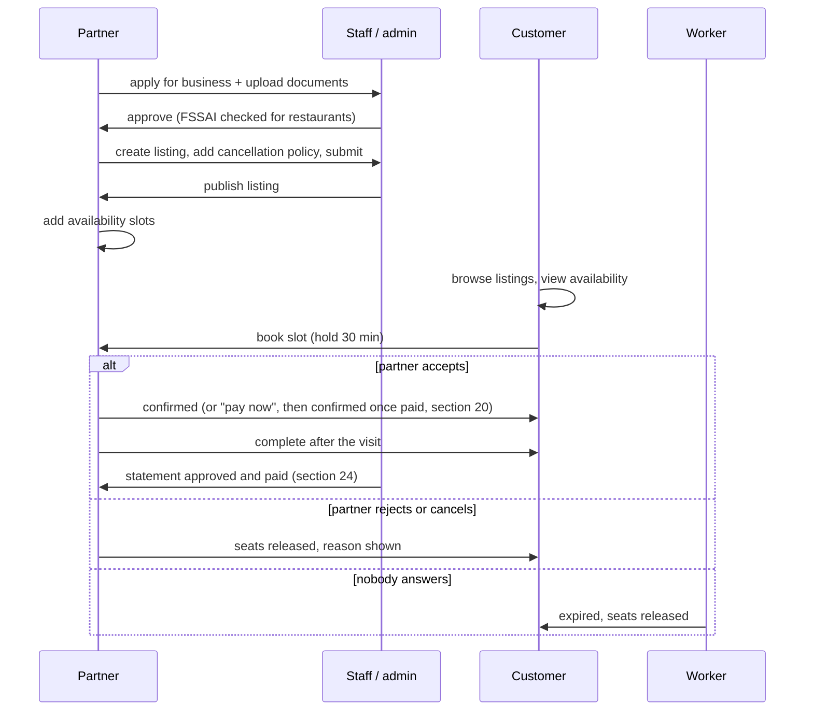

---

## 20. Paying for a booking

Online payment is behind the `payments` module flag, which starts **off** (`coming_soon`), and behind the Razorpay keys.
With it off, or for a free listing, nothing below happens and a partner's accept confirms the booking directly (§14.3).
It is **sandbox only**: the API refuses to start with live keys unless `Payments:Mode` is `Live` **and**
`Payments:AllowLive` is `true`, and neither is set until the go-live gate in [phase-7-plan.md](phase-7-plan.md) §9 is met.

### 20.1 From accept to paid

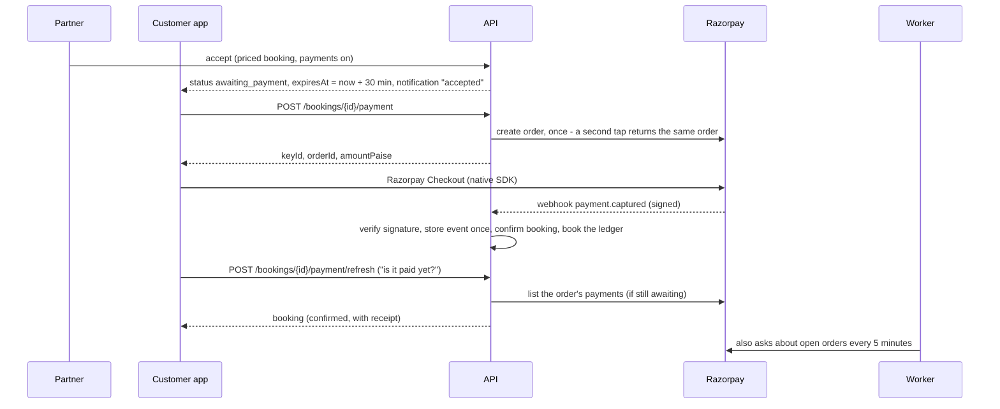

1. **Accept.** The partner's accept moves a priced booking `pending → awaiting_payment` and replaces the request hold with a
   fresh payment window (`Payments:PaymentWindow`, 30 minutes; allowed 5 minutes to 2 hours). Seats stay held. The customer is
   notified. The partner may still reject, and the customer may still cancel, while it waits.
2. **Start (`POST /bookings/{id}/payment`).** Only the booking's customer; only while `awaiting_payment` (`payment_not_due`
   otherwise, `payment_window_closed` once the window has ended). The server creates one Razorpay order for the booking's
   total in paise. A database rule allows one open order per booking, so two simultaneous taps get the same order.
3. **Checkout.** The app opens Razorpay's SDK with the order id and the public key id (the secret never leaves the server).
4. **The app never decides the result.** After Checkout closes the app calls `POST /bookings/{id}/payment/refresh`, which asks
   Razorpay itself and applies a captured payment through the same path a webhook takes, then returns the booking. The app
   re-asks a few times and then says "we are confirming your payment"; the booking screen also re-reads itself every 5 seconds.
   This also makes payment work on a laptop, which Razorpay's webhook cannot reach.
5. **Webhook (`POST /webhooks/payments`).** There is no sign-in: the signature is the authentication. HMAC-SHA256 of the exact
   raw body with `Payments:Razorpay:WebhookSecret`, compared in constant time. A missing or wrong signature answers 400 and is
   **not stored**; with no secret configured it answers 503. A valid event is stored once by Razorpay's event id (a redelivery
   changes nothing) and then applied. Handled: `payment.captured` and `order.paid`, `payment.failed`, `refund.processed`,
   `refund.failed`. Anything else is stored and ignored. Only identifiers, amounts and statuses are read; the payer's email,
   phone and card details in the event are never read or kept. An event that could not be applied is left unprocessed so Razorpay
   delivers it again.
6. **Confirm.** A captured payment for the right amount moves the booking `awaiting_payment → confirmed` (actor: system),
   records the attempt as `captured`, books the ledger (§21) and notifies the customer ("confirmed") and the partner ("paid").
   A wrong amount is not applied; it is listed as a reconciliation exception (§22).
7. **A failed try** is recorded but does not end the booking: the customer may try again on the same order until the window
   ends. The booking ends by payment or by expiry.

### 20.2 When the time runs out, or paying races cancelling

- **Expiry asks the gateway first** (§15). A customer who paid but whose webhook was lost is confirmed, not expired.
- **If Razorpay cannot be asked**, the hold is kept for `Payments:GatewayCheckGrace` (15 minutes) past its deadline before it is
  released anyway.
- **A payment that arrives after the booking was cancelled, expired or rejected** is never silently kept: it is recorded and
  refunded in full (reason `late_payment`), and the customer is told.
- **A customer cancelling while paying** (allowed in `awaiting_payment`) and the payment landing at the same moment is the same
  case: whichever is recorded first decides, and a payment after a cancel is refunded.

### 20.3 Errors

`payment_not_due`, `payment_window_closed`, `payments_unavailable` (module off or no keys), `booking_changed`,
`booking_not_found` (someone else's booking; never reveals it exists).

---

## 21. Refunds, cancellation money and the ledger

### 21.1 How much is refunded (provisional, spec D22)

| Reason | Refund |
|---|---|
| Partner rejected, or partner cancelled | Everything paid |
| Customer cancelled at or before the listing's free-cancellation deadline (start time minus `free_cancellation_hours`) | Everything paid |
| Customer cancelled after it | The listing's `refund_percentage` of what was paid (rounded to the paisa) |
| A payment that arrived after the booking had ended | Everything paid |

Refunds are **off by default** (`Payments:RefundsEnabled` is `false`) until the cancellation policy is approved. With them off,
cancelling a paid booking is refused with `refunds_not_enabled` rather than keeping the money.

### 21.2 Steps

1. Cancelling (or rejecting) a paid booking moves it `→ cancelled/rejected → refund_pending` and writes a `refunds` row
   (`pending`) in the same save, so the decision cannot be lost. Seats are released at once. If both sides cancel at the same
   instant the loser gets `booking_changed`.
2. The Worker's `PendingRefundJob` (every minute) sends pending refunds to Razorpay, using the refund's own id as the idempotency
   key so a retry never refunds twice. A database trigger stops all refunds of one payment from exceeding what was captured.
3. Razorpay's `refund.processed` webhook marks the refund `processed`, moves the booking `refund_pending → refunded`, books the
   ledger and notifies the customer ("refund sent"). `refund.failed` marks it `failed` and logs a warning, and the reconciliation job (§22) lists it
   for a person; the customer still sees "on its way" while the team sorts it out.
4. The booking detail shows the receipt and each refund with its progress, and the customer is told their bank may take a few
   working days.

### 21.3 The ledger (`ledger_entries`)

A double-entry record of every movement of money. A debit is positive and a credit negative; the database refuses any
transaction that does not sum to zero at commit, and refuses to change or delete a line. A mistake is fixed by a new balanced
transaction. `LedgerService` is the only writer. Each event has a transaction id derived from it, so posting it twice is refused.

| Event | Lines |
|---|---|
| Payment confirms a booking (sandbox commission 10%, `Payments:CommissionPercent`) | `gateway_clearing` +1000; `platform_commission` −100; `partner_payable:<business>` −900 |
| Payment nobody wants (late, duplicate) | `gateway_clearing` +amount; `customer_refunds` −amount |
| Refund processed (late payment) | `customer_refunds` +amount; `gateway_clearing` −amount |
| Refund processed (a booking's) | `gateway_clearing` −refund; `platform_commission` + the commission in proportion (from what was actually booked, not today's rate); `partner_payable` + the rest |
| Statement paid (§24) | `partner_payable` +net; `partner_paid` −net |

The commission rate is a provisional setting for sandbox testing; the real rate is a business decision (D21).

---

## 22. Reconciliation (Worker)

Webhooks can be lost, so the Worker compares our records with Razorpay's. It never fixes a difference silently: it lists
it for a person, except the few it can apply by the same safe path a webhook takes (a payment or refund whose webhook never
arrived), which it applies **and records**.

| Job | Schedule | What it does |
|---|---|---|
| `PaymentReconciliationJob` | every 5 minutes | Asks Razorpay about recent open orders and applies a captured payment whose webhook was lost; looks for webhook events stored but never finished (15 min), refunds recorded but never sent (15 min), refunds waiting at the gateway for too long (6 h) and refunds the gateway shows failed; checks recent payments and refunds have balanced ledger entries. |
| Daily comparison (run by the same job, after 03:00 UTC for the previous day) | once a day | Lists the day's payments at Razorpay and compares them with ours: unknown or missing payments, differing amounts or payment ids, and refund totals that do not add up. |

Each finding is a row in `reconciliation_exceptions` (twelve kinds). The same problem found again updates its row (`occurrences`,
`last_seen_at`) instead of adding another. In the console (**Payments → Reconciliation**) an administrator sees what needs
attention (`GET /admin/payments/exceptions`, with `open-count` for a badge) and closes an item with a note of what was done
(`POST /admin/payments/exceptions/{id}/resolve`); that is recorded in the audit log with their name. Alert on the Worker's
error log lines and on a growing open count.

---

## 23. Notifications (Expo push)

### 23.1 From booking change to phone

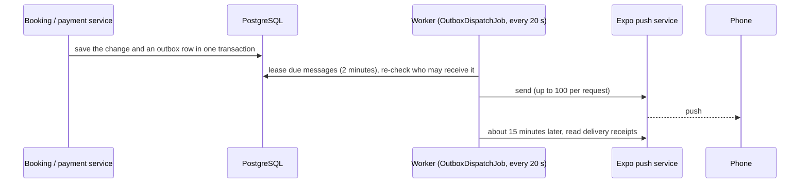

1. **Outbox.** A notification is written in the same transaction as the change that caused it, so both happen or neither does.
2. **Who gets what.** New request: the partner. Accepted (pay now): the customer. Confirmed: the customer; paid: the partner.
   Rejected: the customer. Cancelled: the other side. Expired: the customer. Refund sent: the customer. Reminder: the customer,
   about 24 hours before a confirmed booking (`BookingReminderJob`, every 30 minutes; queued once per booking).
3. **Privacy at sending time.** Before each send the recipient is checked again: a customer message goes only to that booking's
   customer, a partner message only to the business's owner, never to a closed account. The text is generic English ("Your
   booking is confirmed.") with no name, amount, listing, date or place; the only data sent is the type and the booking id. The
   app opens the booking and loads details through the normal sign-in-protected API. Reminders and "pay now" messages are
   dropped if no longer true.
4. **Retry.** A failed send is retried after 1, 5, 30 and 120 minutes and given up on after five attempts (logged as an error). A
   message older than 24 hours is dropped, not delivered late. Two Worker instances never send the same message (lease plus row
   version).
5. **Receipts.** Expo accepting a message is not the phone showing it, so its receipt is read later. A phone Expo says no longer
   has the app (`DeviceNotRegistered`) is deleted at once.
6. **Off by default.** `Notifications:Enabled` is `false`: messages queue but nothing is sent, and any older than 24 hours are
   dropped when sending starts.

### 23.2 The phone (`/devices`)

- `POST /api/v1/devices` registers an Expo push token and platform (`android`/`ios`) for the caller's current session and returns
  a device id; `DELETE /api/v1/devices/{id}` removes it. At most 10 phones per account.
- The app asks for permission **once**, after the customer's first booking, never before and never again. It registers on each
  sign-in only if permission was already given, and unregisters on sign-out. A phone is used only while the session that
  registered it is still signed in (sign-out, expiry, reuse detection, role change and account deletion all end it), and a phone
  registered by someone else later belongs to them.
- Tapping a notification opens that booking, but only for a signed-in customer and only for a known type with a well-formed
  booking id.
- An Android phone cannot get an Expo token without an Expo (EAS) project id in the app configuration. Until there is one, the app
  quietly does not register.

---

## 24. Partner statements and payouts

A statement is what one business is owed for the bookings that finished in a period. It is built from the ledger and checked
against it, so it is a view of the books and never a second opinion.

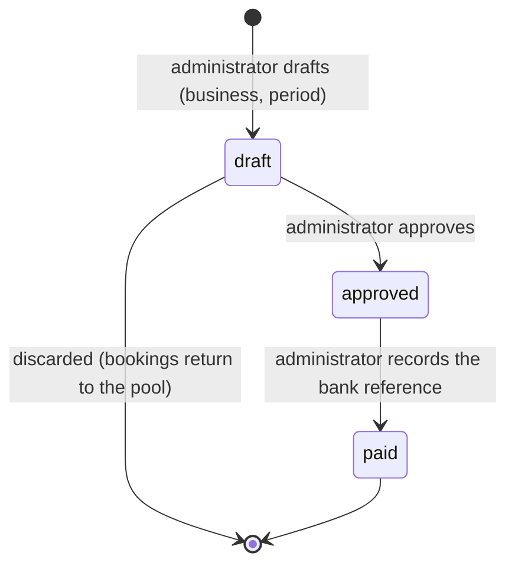

1. **Draft** (`POST /admin/settlements`, administrators only). A period is whole UTC days that have finished. Included: bookings
   `completed` by the end of the period, and `refunded` ones after a partial refund (the partner keeps what the customer was not
   given back, for example after a late cancellation); not already on a statement. A booking refunded in full, or never paid
   online, owes nothing and never appears. A refund that comes after its sale was settled is carried on a later statement. Totals:
   gross sales, commission kept (less any returned), refunds, and net. For each booking the arithmetic must equal what the ledger
   says the partner is owed, otherwise nothing is drafted (`settlement_ledger_mismatch`). No net payable gives
   `settlement_nothing_due`; the same period twice gives `settlement_period_exists`; at most 500 bookings per statement.
2. **Approve.** Makes it visible to the partner. A draft is the administrators' working copy only.
3. **Pay.** The administrator transfers the money themselves (or, later, Razorpay Route does), then records the bank reference
   (UTR). This books the payout in the ledger and cannot be undone. Nothing approved or paid is ever changed or discarded.
4. **Concurrency.** Statements carry a row version, and the ledger refuses a second payout of the same statement, so two
   administrators acting at once cannot both succeed; the other gets `settlement_busy` or `settlement_invalid_state` (409).
5. **Partners** see only their own approved and paid statements (`GET /partner/businesses/{id}/statements`, detail, and a CSV
   download); anyone else gets 404. The CSV is UTF-8 with a byte-order mark, and text typed by partners that begins with `=`,
   `+`, `-` or `@` is defused against spreadsheet formula injection.
6. **Console.** Administrators: **Payments** (payments, refunds, reconciliation; no customer details, only the booking id) and
   **Statements**. Partners: **Statements** on their business page. Every step is in the audit log.

Not built: Razorpay Route payouts (D21), GST and tax-collected-at-source on commission (waiting for the legal and tax review),
per-listing commission.

---

## 25. Food orders (Phase 8, steps 8.1 to 8.4)

### 25.1 States

```
placed ──accept (online payment on)──► awaiting_payment ──paid──► confirmed ──► preparing ──► ready_for_pickup ──► out_for_delivery ──► delivered
   │      accept (payment off / nothing to pay) ─────────────────► confirmed                    (the last two are the driver's, step 8.7)
   ├─ reject (restaurant) ─► rejected
   ├─ cancel (customer) ───► cancelled          awaiting_payment also: expired · failed
   └─ no answer in time ───► expired
rejected / cancelled ──(a payment was taken)──► refund_pending ──► refunded
```

Who may cancel: the **customer** from `placed`, `awaiting_payment` and `confirmed` (until the kitchen starts); the **restaurant** from `confirmed`,
`preparing` and `ready_for_pickup`, with a reason (a waiting order is rejected instead); an **administrator** from any state before it leaves the
restaurant or is on its way. Any other move is refused with `order_invalid_transition`. The table lives in `FoodOrder` and is tested row by row.

### 25.2 Pricing and placing (`POST /food/quote`, `POST /food/orders`)

1. The app sends the restaurant, the delivery area (a specific area, not the whole city) and dishes with quantities. **It never sends a price.**
2. The server checks: the restaurant is open, approved, active and serves the area (the same rule the browse screens use); every dish is on *that*
   restaurant's menu, not archived and not sold out (`order_item_unavailable` names them); quantities are 1 to 20, at most 30 dishes (a dish listed
   twice becomes one line); the food total reaches the restaurant's minimum (`order_below_minimum`).
3. Price: per line `unit price × quantity`, tax per line (the dish's rate, rounded to the paisa, away from zero), then a flat delivery fee and packaging
   fee from settings. The order's tax is the sum of the lines'. Fees carry no tax in v1 (part of the tax review).
4. **Placing** also needs the `food` module to be available, an `idempotencyKey` (the same key from the same customer returns the same order, even
   under simultaneous retries), a delivery address and a phone the driver can call, and `expectedTotal`: the total the customer was shown. If the menu
   changed since, the order is refused with `order_price_changed` and the new total, never charged at a different price.
5. The order is saved with a **copy** of every dish (name, price, tax rate), a deadline (`Food:AcceptWindow`, 5 minutes) and its first history row.

### 25.3 The restaurant's inbox

`GET /partner/businesses/{id}/orders` lists newest first (optionally `?status=`). The restaurant sees dishes, amounts, the area and the status, but **not
the customer's address or phone**: OnePondy's own drivers deliver (F1), so only the driver (step 8.7) will see them. Accept moves the order to
`awaiting_payment` with a fresh window (`Food:PaymentWindow`, 10 minutes) while online payment is on, otherwise straight to `confirmed`. Starting to
prepare sets the ready estimate from the restaurant's preparation time. Every action carries the order's `version`; a stale one gets `order_changed` (409).

### 25.4 Simultaneous actions

Two staff accepting at once, or the restaurant accepting while the customer cancels, both start from the same version: the database lets exactly one
save through and the other receives `order_changed` (409), never an error and never two winners. The same goes for a deadlock victim.

### 25.5 Expiry (Worker, `FoodOrderExpiryJob`, every minute)

An order still `placed` or `awaiting_payment` after `expires_at` becomes `expired` (recorded as the system). Before an `awaiting_payment` order expires,
Razorpay is asked whether it was paid, exactly as for a booking (§21): a payment found there is applied and the order confirmed instead; if Razorpay
cannot be asked, the order waits up to `Food:GatewayCheckGrace` (5 minutes) and then expires anyway, and a payment that still arrives is refunded in full.
Expiring, cancelling or rejecting an order also closes its open Razorpay order in the same save.

### 25.6 Paying for an order (step 8.3)

The same machinery as bookings (§20 to §24), with a payment, refund, ledger line and statement line belonging to the order instead of a booking.

1. The restaurant accepts; with the `payments` module on, the order waits for payment (`Food:PaymentWindow`, 10 minutes).
2. `POST /food/orders/{id}/payment` returns the Razorpay order to open in the app (the same one if asked twice, even at the same instant). The receipt
   on Razorpay's side is `fo_` plus the order id, and the order's notes name `food_order_id`.
3. The **signed webhook** (or the app's `POST /food/orders/{id}/payment/refresh`, which asks Razorpay itself, or reconciliation) applies the payment: the
   order is confirmed and the ledger books the total as: commission on the dishes (`platform_commission`), the restaurant's share of the dishes plus
   the packaging fee (`partner_payable`), the delivery fee (`delivery_fees`) and the GST (`tax_payable`). This split is provisional (D21, F3).
4. A payment nothing wants any more (the order was cancelled, rejected or expired meanwhile, or it is a second payment) is recorded and refunded in
   full, always, whatever the refund setting. A cancelled or rejected order moves to `refund_pending`; an expired one stays expired.
5. **Cancelling a paid order** (the customer before cooking starts, or the restaurant until it leaves) refunds it **in full** (F8). While
   `Payments:RefundsEnabled` is off (the default) that cancel is refused with `refunds_not_enabled` and nothing changes. When on, the cancellation,
   the refund and `refund_pending` are saved together, then the refund is sent to Razorpay (retried by the Worker if it does not get through).
   Razorpay's refund webhook completes it: `refunded`, and the ledger reverses every line of the payment.
6. A **delivered** order goes on the restaurant's next statement: its side only (dishes and packaging, less commission), once. Until the driver app
   (step 8.7) no order can be delivered through the API, so this is proven by tests only.

The customer's order view shows the payment as a receipt and any refunds with their status.

### 25.7 In the customer app (step 8.4)

1. **Food** on Home opens the restaurant list, but only when the server's `food` flag is `available` (otherwise it is "Soon" or hidden, as for the other modules).
   The list shows open restaurants for the area the customer picked (the whole city lists every open one), with preparation time and smallest order. No sign-in
   is needed to look around.
2. **The menu** shows each dish with its price, a veg or non-veg label, and "Sold out" where it is; the restaurant's FSSAI number is shown. `+` and `-` fill a
   **cart** kept in memory (one restaurant at a time: adding from another asks "Start a new cart?"). Each time a menu is read, dishes that have gone or sold out
   leave the cart. Prices on the menu are an estimate and say so.
3. **Checkout** needs an account (a guest is taken to sign in; the cart is kept). The customer picks one of the areas the restaurant serves, gives an address and
   a phone, and sees the **server's** breakdown: dishes, GST, delivery fee, packaging and total. The app sends dishes and quantities, never prices. **Place order**
   sends the total shown (`expectedTotal`) with an idempotency key that stays the same for the same cart and area, so a retry after a dropped connection can
   never make a second order. If the menu changed meanwhile, the order is refused, the new total is shown and the cart is priced again. A cart under the
   restaurant's smallest order says how much more to add. The customer is told they pay only after the restaurant accepts.
4. **The order screen** (also reached from the Bookings tab, which lists food orders below bookings) updates by itself while anything is awaited (every 5 seconds
   waiting for the restaurant or for payment, every 15 while cooking, on its way or refunding): status in plain words, the whole price, the delivery address, the
   restaurant's licence number, the history, and when it should be ready. Once the restaurant accepts, **Pay** opens the same Razorpay checkout as for a
   booking; whatever the checkout reports, the server decides whether it is paid (the app asks it, as for bookings). A receipt and any refund appear on the
   order. The customer may cancel until cooking starts; for a paid order the sheet says a full refund follows, and if refunds are off the server's refusal is
   explained.
5. A confirmed order is described as paid only when it has a receipt: with online payment off an accepted order is confirmed without any payment, and the app says
   "Confirmed", never "Paid".
6. Nothing in the app sends notifications about orders yet, so it does not ask for permission to.

### 25.8 Not built yet

Notifications about orders, an administrator's cancel of a food order, the console inbox (8.5), the driver app and delivery (8.6 to 8.7), cash on delivery
(8.8, only if approved), administrators' order monitoring (8.9).

---

## 26. Not built

| Area | Status |
|---|---|
| Live payments and payouts | **Sandbox only.** Waiting for the legal and tax review, sign-off of the commission (D21) and refund rule (D22), partner agreements and Razorpay live KYC (go-live gate in phase-7-plan.md §9). |
| Razorpay Route payouts; GST and tax collected at source on commission | Open (D21; legal and tax review). Payouts are recorded by an administrator for now. |
| Push delivery to real phones | Built but untested on a device: needs an Expo (EAS) project id and a Firebase project. |
| SMS / e-mail provider for real code delivery | Twilio Verify is wired for development; MSG91 (production SMS) needs DLT registration; e-mail provider undecided (D19). **Launch blocker.** |
| Reviews and ratings, rides | Later phases. Food ordering: restaurants, menus, orders to the kitchen, paying for them (sandbox) and the customer app's screens are built (section 25); delivery is not. |
| Admin view of all bookings; listing photos | Known gaps. |
| PostGIS-based nearby search | Deferred; in-memory distance sort for now. |
