# OnePondy – Full Workflows

Audience: developers, QA and operations. Every workflow below describes what the code does today
(Phases 1–6). Anything not built is labelled **Not built (Phase 7+)**. Error `code` values are the
stable strings the API returns in problem JSON.

Related documents: [backend-architecture.md](backend-architecture.md),
[database-architecture.md](database-architecture.md), [data-retention.md](data-retention.md).

## Contents

1. [Actors and permissions](#1-actors-and-permissions)
2. [Sign-in with a one-time code](#2-sign-in-with-a-one-time-code)
3. [Session refresh and sign-out](#3-session-refresh-and-sign-out)
4. [Account deletion](#4-account-deletion)
5. [Staff sign-in and first administrator](#5-staff-sign-in-and-first-administrator)
6. [Place verification and publication](#6-place-verification-and-publication)
7. [Place media upload](#7-place-media-upload)
8. [Browsing places, saving and sharing](#8-browsing-places-saving-and-sharing)
9. [Itineraries](#9-itineraries)
10. [AI trip planner](#10-ai-trip-planner)
11. [Partner onboarding](#11-partner-onboarding)
12. [Listings and moderation](#12-listings-and-moderation)
13. [Availability slots](#13-availability-slots)
14. [Booking lifecycle](#14-booking-lifecycle)
15. [Hold expiry (Worker)](#15-hold-expiry-worker)
16. [Saved listings](#16-saved-listings)
17. [Module flags and minimum app version](#17-module-flags-and-minimum-app-version)
18. [Audit trail](#18-audit-trail)
19. [End-to-end journey](#19-end-to-end-journey)
20. [Not built (Phase 7+)](#20-not-built-phase-7)

---

## 1. Actors and permissions

| Actor | How they are identified | Can do |
|---|---|---|
| Guest | No token | Browse config, places, published listings and availability; open a shared itinerary. |
| Customer | Signed in, role `customer` | Profile, saved places/listings, itineraries, AI planner, create and cancel own bookings. |
| Partner | Signed in **and** owner of a business | Apply as a business, manage own business, listings, slots and incoming bookings. Not a role: ownership is the permission. |
| Content editor | Role `content_editor` | Create, edit, submit and moderate places and media. |
| Support agent | Role `support_agent` | Read-only console access to content. |
| Administrator | Role `administrator` | Everything above plus staff, module flags, minimum app version, audit log, partner and listing moderation. |
| Worker | Background service | Releases expired holds; purges old authentication data. |

Every new sign-in account starts as a customer. A customer becomes a partner by applying for a
business.

---

## 2. Sign-in with a one-time code

There are no passwords. The same flow registers a new user and signs in an existing one.

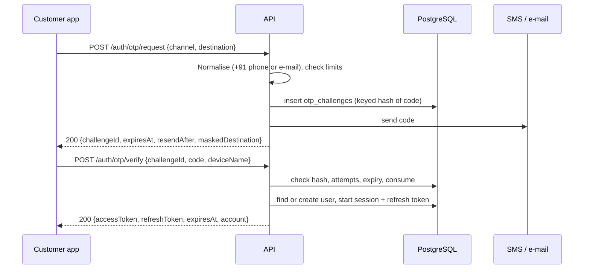

Rules:

1. **Destination:** SMS numbers are normalised to E.164 and only calling code `+91` is allowed;
   e-mail addresses are lower-cased for comparison.
2. **Limits:** 30 s between sends to the same destination (across every purpose), 3 sends per
   destination per 10 minutes, 1000 sends per day overall, and the per-IP `auth` rate limit.
   Breaches return `429` with `retryAfterSeconds`.
3. **Code:** 6 digits, valid for 5 minutes, 5 wrong attempts invalidate it. Only a keyed hash is stored.
4. **Verify:** success consumes the challenge (single use). The account is found by phone or
   e-mail, or created on first sign-in with the default display name and language.
5. **Session:** a `user_sessions` row and the first `refresh_tokens` row are created. The access
   token (15 min) carries user id, roles and session id.
6. **Delivery:** in Development/Testing the code is written to the log. Elsewhere delivery returns
   `503` until an SMS/e-mail provider is configured (open decision D19).

Failure paths: wrong/expired/used code → `401`; too many attempts → code invalidated; unsupported
country code or malformed e-mail → `400`.

---

## 3. Session refresh and sign-out

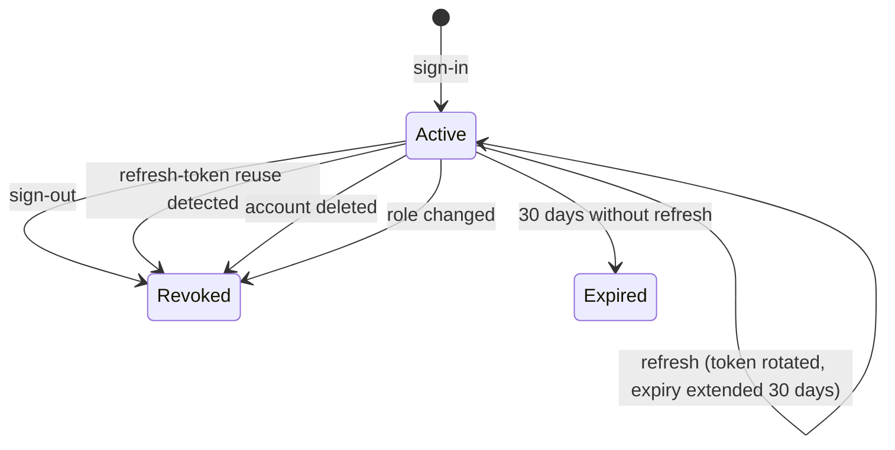

**Refresh (`POST /auth/refresh`):**

1. Look the token up by its keyed hash. Unknown, empty or over-long → `401 invalid_refresh_token`.
2. If the token was **already consumed**, someone is replaying an old token: the whole session is
   revoked (`refresh_token_reuse`), a metric is raised, and the call fails with `401`.
3. Expired token, inactive session, or an account that no longer exists → `401`.
4. Otherwise a new refresh token is issued, the old one is marked consumed and linked to its
   replacement, the session expiry is pushed 30 days out, and a new access token is returned.
5. If two requests rotate the same token at the same instant, one wins; the other gets `401` and
   the client retries with the newer token.

**Sign-out (`POST /auth/logout`):** revokes the current session (`signed_out`). Because every
request checks the session, the access token stops working immediately, not after 15 minutes.

---

## 4. Account deletion

Two entry points share the same service. Both require a fresh code, so a stolen access token
cannot delete an account.

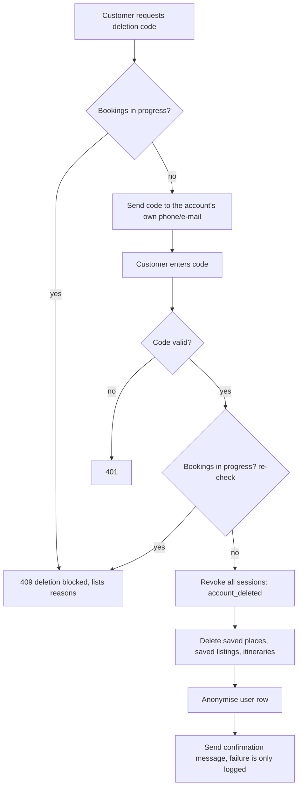

1. **In the app:** `POST /account/deletion/code` then `POST /account/deletion/confirm`. The code
   goes to the contact already on the account, and the guard is checked **early** so the customer
   is told about blockers before they receive a code.
2. **On the web** (for people without the app, page at `/account/delete/`):
   `POST /account/deletion-requests` then `/deletion-requests/confirm`. The page does not reveal
   whether an account exists; the guard is checked only after the code is verified.
3. **Guard (`BookingsDeletionGuard`):** deletion is refused while the user has bookings in
   `pending`, `awaiting_payment`, `confirmed` or `refund_pending`
   (reason `bookings_in_progress`), or owns a business that has such bookings
   (`partner_bookings_in_progress`).
4. **Effect:** all sessions are revoked with reason `account_deleted`; saved places, saved
   listings and itineraries are deleted; the user row is anonymised (display name "Deleted user",
   phone and e-mail cleared, inactive, `deleted_at` set, security stamp rotated). The user row is
   never hard-deleted, so bookings, audit rows and partner records keep a valid reference.
5. The confirmation message is best effort; a delivery failure does not undo the deletion.

---

## 5. Staff sign-in and first administrator

The console uses the same code mechanism with purpose `StaffSignIn` and e-mail only.

1. Staff enters their e-mail at the console. `POST /admin/auth/otp/request` always responds the
   same way, but a code is only sent if the address belongs to a staff user (or has just been
   bootstrapped as the first administrator, below). This stops the form being used to discover staff
   accounts.
2. `POST /admin/auth/otp/verify` checks the code **and** that the user has a staff role, then
   starts a session. The console stores tokens in `httpOnly` cookies; the browser never sees them.
3. The console's proxy refreshes the access token in the background using the refresh cookie.
4. Partners signing in to the console's `/partner` area use the customer sign-in flow and a
   separate cookie pair, so a partner session never grants staff access.

**First administrator:** `Console:BootstrapAdministrators` lists e-mail addresses that become
administrators automatically, but only while **no administrator exists**. After that, only an
existing administrator can add or change staff (`/admin/staff`). Changing or removing a role
revokes that user's sessions (`role_changed`) so the new permission applies immediately.

---

## 6. Place verification and publication

Tourism content is only shown to the public after a human has verified it. The status is a state
machine; the database also enforces "published implies verified".

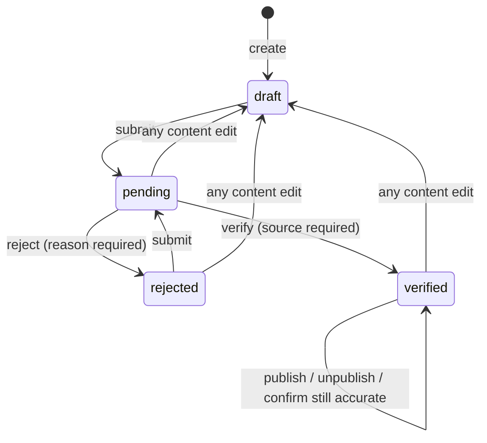

| Step | Who | Rules |
|---|---|---|
| Create / edit | content_editor, administrator | Name, slug, category, description, address, coordinates, opening hours, entry fees, Tamil/French translations. An edit that changes nothing is ignored. **Any real edit to a non-draft place returns it to `draft`, unpublishes it and clears verification.** |
| Submit | content_editor, administrator | Only `draft` or `rejected`. The place must have a description and a location. |
| Verify | content_editor, administrator | Only `pending`. Records the verifier, the time and a **source** (where the facts were confirmed). |
| Reject | content_editor, administrator | Only `pending`. A reason is required and shown to the editor. |
| Publish / unpublish | content_editor, administrator | Publish only when `verified`. Unpublish keeps the verification. |
| Confirm still accurate | content_editor, administrator | Only `verified`. Re-records the review time and source without changing content. |

**Periodic review:** every published place has `last_reviewed_at`. Places not reviewed within
`Content:ReviewInterval` (default 180 days) appear in the console's review-due list (served by the
partial index `ix_places_review_due`). Confirming the place clears it from the list.

**Concurrency:** all edits carry the place `version`; a stale save returns `409`. Every step writes
an `audit_log` row (§18).

**Policy note:** the same content editor may edit, submit and verify their own place; there is no
separate-verifier ("four-eyes") rule. Add one in `PlaceAdminService.VerifyAsync` if the business
wants it.

---

## 7. Place media upload

`POST /admin/places/{id}/media` (content editors).

1. Accepts JPEG, PNG or WebP up to 10 MB; at most 20 images per place.
2. Rejects images whose long edge is under 800 px or short edge under 450 px (this works for
   portrait photos too), or above 50 million pixels.
3. Requires alt text. Requires a licence from: `owned`, `partner_supplied`, `cc_by`, `cc_by_sa`,
   `cc0`, `licensed_stock`, `other`. Every licence except `owned` and `cc0` also requires an
   attribution. Source URL and caption are optional.
4. SkiaSharp decodes the image, **strips all metadata (EXIF and GPS)**, and writes WebP renditions
   (quality 82) named `large` (1600 px wide), `medium` (800) and `thumb` (400) into `Media:RootPath`.
5. A `place_media` row stores only the storage key and dimensions. The first image is the cover.
6. Staff can reorder images, edit alt text/caption/licence, and delete (files are removed too).
7. Images are served from `/media` with a one-year immutable cache.

Adding or changing media does not reset a place's verification status.

---

## 8. Browsing places, saving and sharing

- **Browse:** `GET /places` (public) returns only `is_published` **and** `verified` places. Filters:
  `category`, `q` (matches name, including translations), `lang`, paging. With `lat`+`lng` (both,
  or neither) results are sorted nearest first and include distance in km (computed in memory;
  no PostGIS yet).
- **Detail:** `GET /places/{idOrSlug}` returns the place in the requested language
  (`ta`, `fr`, falling back to English field by field), opening hours, fees and media.
- **Language:** `lang` parameter, otherwise the request's `Accept-Language`.
- **Saved places:** `POST/DELETE/GET /saved-places` store bookmarks per user. Only a place that is
  currently published and verified can be saved (`place_not_available` otherwise); saving twice is
  harmless. Unpublishing a place later does not delete the bookmark: the saved list still shows it,
  flagged `isCurrentlyPublished = false`, so users do not lose what they saved.
- Saved places and itineraries are removed on account deletion (§4).

---

## 9. Itineraries

A trip plan owned by one user.

| Status | Meaning |
|---|---|
| `draft` | Created by the AI planner; not yet confirmed by the user. |
| `saved` | Normal active plan. Manually created plans start here. |
| `archived` | Hidden from the default list; can be restored. |

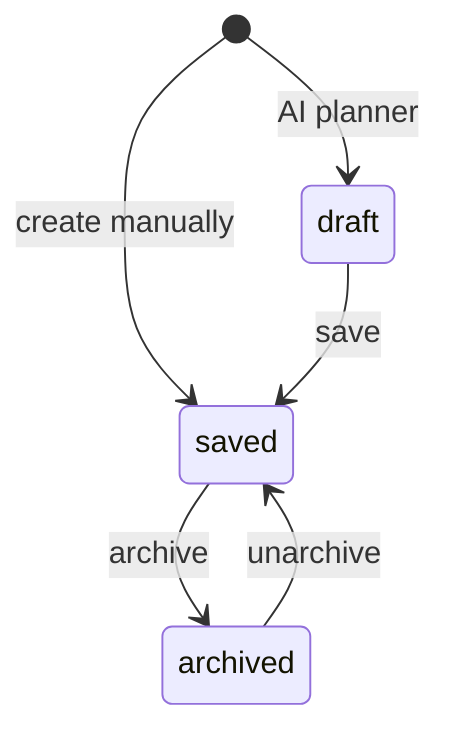

Rules:

1. A title (max 180 characters) is required; optional start and end dates, end not before start.
2. Up to **100 stops**. A stop is a place, a `day_number` (1 or more), an automatic `stop_order`,
   optional planned arrival and notes (max 1000 characters).
3. A stop can only be added for a place that is currently published and verified
   (`place_not_available` otherwise).
4. **Reorder:** one call supplies the new `(day, order)` for stops; each stop may appear once and
   must belong to the itinerary. It runs in one transaction; the unique position constraint is
   deferrable so intermediate states do not fail.
5. **Delete:** removes the itinerary and its stops.
6. **Sharing:** `POST /itineraries/{id}/share` creates an unguessable 24-byte token and returns a
   link; disabling sharing removes the token, after which the link answers `itinerary_not_shared`.
   `GET /itineraries/shared/{token}` is public, read-only and shows place names, not the owner's identity.
7. Another user's itinerary always answers `itinerary_not_found`.

---

## 10. AI trip planner

`POST /trip-planner/plan` (signed in).

The request carries start and end date, interests (place category codes), pace, budget band,
optional mobility needs and an optional location.

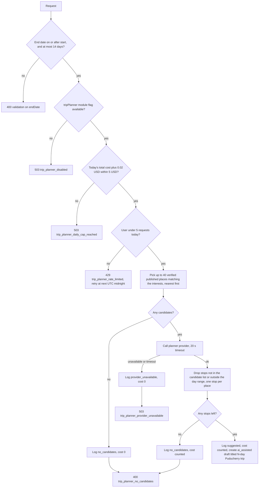

Key guarantees:

- The model can only choose from places the platform already trusts; invented places are discarded.
- Cost control is enforced from `trip_planner_request_logs`: at most 5 requests per user per UTC
  day and 5 USD of estimated spend per UTC day across all users (0.02 USD per call that reached the
  provider and returned). **Every logged request counts toward the per-user limit**, including
  ones that ended with no candidates or a provider failure.
- The result is a **draft** itinerary: the user reviews it and saves it (§9) or deletes it.
- Every failure message suggests building the trip manually, so the app always has a fallback.
- With no Gemini key configured the provider answers unavailable and the rest of the app is unaffected.

---

## 11. Partner onboarding

A signed-in customer applies for a business; staff review it.

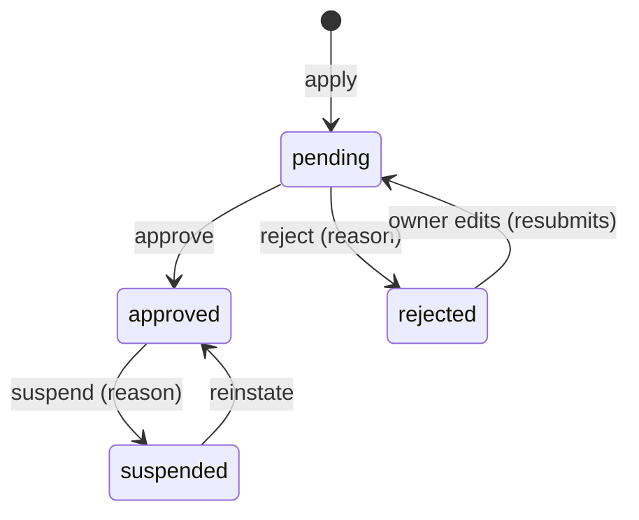

1. **Apply:** `POST /partner/businesses` with name, type (`restaurant`, `hotel`, `activity`, `shop`,
   `tour_operator`, `service`), contact details, address, optional coordinates, GSTIN (15 characters)
   and FSSAI number (14 characters). Lengths are validated; the number formats and the numbers
   themselves are checked by staff, not by the system. A user may own several businesses.
2. **Documents:** the owner uploads proof (GSTIN certificate, FSSAI licence, other) to
   `/partner/businesses/{id}/documents`, as a file of at most 10 MB with a document kind. Files go
   to the **private** folder and are served only to the owner and administrators. Uploads and
   removals are allowed only while the application is `pending` or `rejected`. Note: the file type is
   taken from the upload and not inspected, which is acceptable only because files are never served
   to the public; add content-type checks before documents are ever shown to other users.
3. **Edit:** allowed only while `pending` or `rejected`. Editing a rejected application **resubmits
   it** (back to `pending`, review note cleared). Approved and suspended businesses are locked
   (`business_locked`).
4. **Approve (administrator):** a restaurant needs an FSSAI number or approval is refused
   (`business_cannot_approve`). Approval sets `is_active = true`.
5. **Reject (administrator):** only from `pending`, reason required; the owner sees the reason.
6. **Suspend / reinstate (administrator):** suspension requires a reason and sets
   `is_active = false`. The business's listings disappear from public browsing and nothing new can
   be booked; **existing bookings are untouched** and can still be handled.
7. The database also enforces `is_active ⇒ approved` and "approved restaurant ⇒ FSSAI".

Every decision writes an audit row. A non-owner asking for someone else's business gets
`business_not_found`.

---

## 12. Listings and moderation

A listing is one thing a business offers: `activity`, `stay`, `event`, `service` or `shop`.

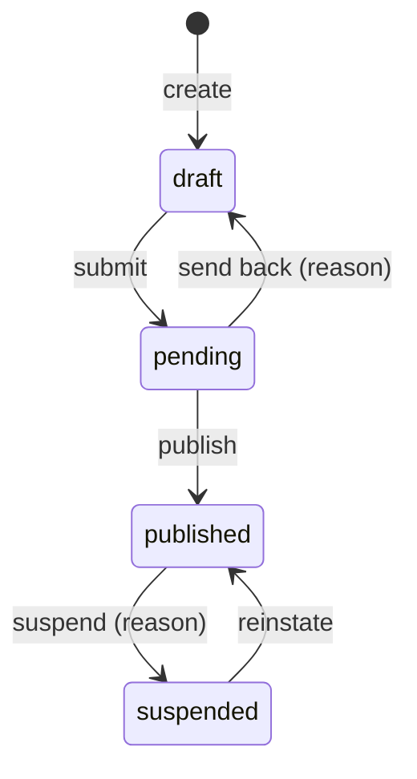

1. **Create/edit (owner):** title, description, base price (0 or more, INR), type, and whether it is
   bookable. Editing is allowed only in `draft` (`listing_locked` otherwise).
2. **Shops are never bookable.** A bookable listing must carry a **cancellation policy**: free
   cancellation hours (0 or more), refund percentage (0–100) and optional notes. Both rules are
   checked in the domain and again by database constraints.
3. **Only an active (approved) business** can create, submit, publish or reinstate listings
   (`listing_business_not_active`).
4. **Submit:** `draft → pending`.
5. **Moderate (administrator):** publish, send back (reason shown to the owner, status returns to
   `draft`), suspend a published listing (reason required), reinstate a suspended one.
6. **Public visibility:** a listing is public only when it is `published` **and** its business is
   active. Public detail and availability return `listing_not_found` otherwise.
7. All edits and transitions carry `version`; stale writes return `listing_changed` (`409`).

---

## 13. Availability slots

Only listings the owner marks bookable use slots; each slot is a dated block with a capacity.

1. **Create:** start, end (end after start) and capacity of at least 1. One slot per
   `(listing, start time)`.
2. **Reserved count:** maintained by the booking engine, never edited by hand. The database
   guarantees `0 ≤ reserved ≤ capacity`.
3. **Change capacity:** cannot go below what is already reserved.
4. **Remove:** refused with `slot_has_reservations` if seats are held **or any booking ever used
   the slot**, even a cancelled one, so booking history keeps its slot. The console shows this as
   "that time has booking history".
5. **Public view:** `GET /listings/{id}/availability?from=` lists upcoming slots with live
   remaining capacity for published, bookable listings.
6. Slots can be managed while the listing is published; only the listing's own content is locked.

---

## 14. Booking lifecycle

### 14.1 States

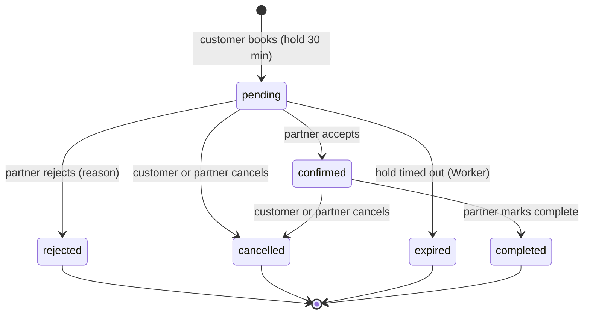

`awaiting_payment`, `failed`, `refund_pending` and `refunded` exist in the schema and domain for
Phase 7 but **cannot be reached today**. Until payments are built every booking is treated as free
or pay-at-venue, and the partner confirms it directly.

### 14.2 Create (`POST /bookings`)

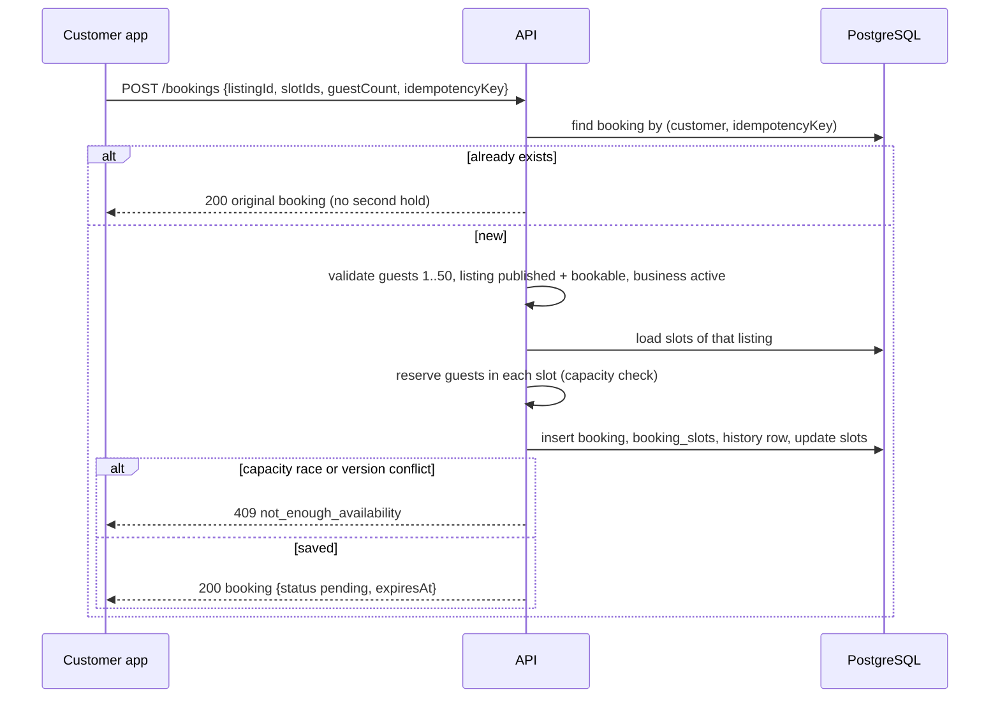

Details:

1. **Idempotency:** the app generates an `idempotencyKey` once per attempt and reuses it on retry.
   A retry, including after a dropped response, returns the **original** booking. If two identical
   requests race, the unique index rejects the second and the first booking is returned. The key is
   scoped per customer.
2. **Validation:** guests 1–50 (`validation_failed`); listing exists (`listing_not_found`);
   listing published, bookable and its business active (`listing_not_bookable`); every slot belongs
   to the listing (`slot_not_found`).
3. **Capacity:** each chosen slot is reserved for `guestCount` seats. If any slot lacks room the
   whole request fails with `not_enough_availability` and nothing is held.
4. **Price snapshot:** `unit price × guests × number of slots`, stored with the booking together
   with a copy of the cancellation policy. Fees, tax and discount are 0 today. Later edits to the
   listing never change an existing booking.
5. **Hold:** status `pending`, `expires_at = now + 30 minutes`. The booking's start and end are the
   earliest start and latest end of its slots. A history row `null → pending` (actor: customer) is written.
6. **Concurrency:** two customers taking the last seats at once cannot both succeed: slot rows use
   `xmin` and a `reserved ≤ capacity` constraint, and the loser receives `not_enough_availability`.

### 14.3 Partner decisions

All partner actions go to `/partner/businesses/{businessId}/bookings/{id}/…`, require the caller to
own that business (otherwise `booking_not_found`), and send the booking `version`.

| Action | From | To | Seats | Notes |
|---|---|---|---|---|
| Accept | `pending` | `confirmed` | stay reserved | Hold expiry cleared. |
| Reject | `pending` | `rejected` | **released** | Reason required (max 500). |
| Cancel | `pending`, `confirmed` | `cancelled` | **released** | Reason optional. |
| Complete | `confirmed` | `completed` | unchanged | Marks the visit as done. |

### 14.4 Customer actions

- `GET /bookings`, `GET /bookings/{id}`: only the customer's own bookings; the detail includes slots,
  price snapshot, cancellation policy and the full status history.
- `POST /bookings/{id}/cancel`: allowed from `pending` or `confirmed`; seats are released and the
  reason is stored. Someone else's booking answers `booking_not_found`.
- **Cancellation policy** (free hours, refund percentage) is **displayed and stored** but no money
  is refunded because nothing is charged yet (Phase 7).

### 14.5 Concurrency and stale screens

Every action sends the `version` the client last saw. If the booking changed since (for example the
customer cancelled while the partner was accepting), the call fails with `booking_changed` (`409`)
and the screen should reload. An action not allowed from the current state returns
`booking_invalid_transition` (`409`).

### 14.6 History and audit

Each change adds a `booking_status_history` row: previous and new status, actor type
(`customer`, `partner`, `admin`, `system`), actor id, reason and time. Rows cannot be updated or
deleted (database trigger), so the history is trustworthy for disputes.

### 14.7 Seat release (fix noted 2026-10-29)

Seats are released whenever a booking moves to `cancelled`, `rejected`, `expired` or `failed`. An
earlier build released seats only for bookings cancelled while still `pending`; cancelling a
**confirmed** booking left its seats reserved. This is fixed and covered by the unit test
`Cancelling_a_confirmed_booking_releases_its_slot_for_either_side`. Slots affected on any
environment that ran the earlier build may show too many reserved seats; compare
`availability_slots.reserved_count` with the sum of `booking_slots.quantity` over bookings in
`pending` or `confirmed` and correct any difference.

---

## 15. Hold expiry (Worker)

Unanswered requests must not block inventory forever.

1. `BookingHoldExpiryJob` runs every minute (and once at start-up).
2. `BookingHoldExpiry` selects up to 100 bookings in `pending`/`awaiting_payment` whose
   `expires_at` has passed, oldest first (using the partial index `ix_bookings_hold_expiry`).
3. For each, `TryExpireAsync` moves it to `expired` (actor: system), releases its seats and writes
   history. Each booking is saved on its own. If another worker instance or a partner's accept got
   there first, the version check fails and that booking is simply skipped.
4. The customer sees "expired" in the app and can book again.

A partner can still accept a request whose 30 minutes have passed until the Worker marks it
expired (at most about a minute later). If the Worker is stopped, holds stay in place until it is
started again, so keep the service running and monitored.

---

## 16. Saved listings

- `POST/DELETE/GET /saved-listings` let a customer bookmark published listings to book later.
- Only a published listing (with an active business) can be saved (`listing_not_available`).
- Unlike saved places, the list returns **only listings that are currently published**: if a saved
  listing is suspended or unpublished it quietly drops out of the list, and returns if the listing
  is reinstated. The bookmark row itself is kept.
- Saved listings are deleted on account deletion (§4).

---

## 17. Module flags and minimum app version

Lets the team switch features on without an app release.

1. `GET /config` (public, cached for 60 s) returns each module's status (`available`,
   `coming_soon`, `hidden`) and the minimum supported app version.
2. The app loads it at start-up and keeps it fresh; screens for modules that are not `available`
   show "coming soon" or are hidden. The module keys are `food`, `rides`, `stays`, `activities`,
   `tripPlanner`, `notifications` and `support`; tourism content is always on.
3. Administrators change a module with `PUT /admin/config/modules/{key}` and the minimum version
   with `PUT /admin/config/min-app-version`. Both are audited.
4. An app older than the minimum version is told to update before continuing.
5. Server-side checks also respect the flags (for example the AI planner refuses when its flag is
   not `available`), so a stale app cannot bypass them.

---

## 18. Audit trail

- `AuditTrail` records who did what to which entity (actor, action, entity type and id, JSON
  details) in the same transaction as the change, so an action and its record succeed or fail
  together.
- Covered: place lifecycle and media, module flags, minimum version, staff changes, business
  decisions, listing creation/update/moderation.
- The table is append-only, enforced by database triggers, including `TRUNCATE`.
- Administrators browse it at `GET /admin/audit` (filters: entity type, entity id, action prefix,
  actor; paged) and in the console's Audit screen. Booking changes are recorded separately in `booking_status_history` (§14.6).

---

## 19. End-to-end journey

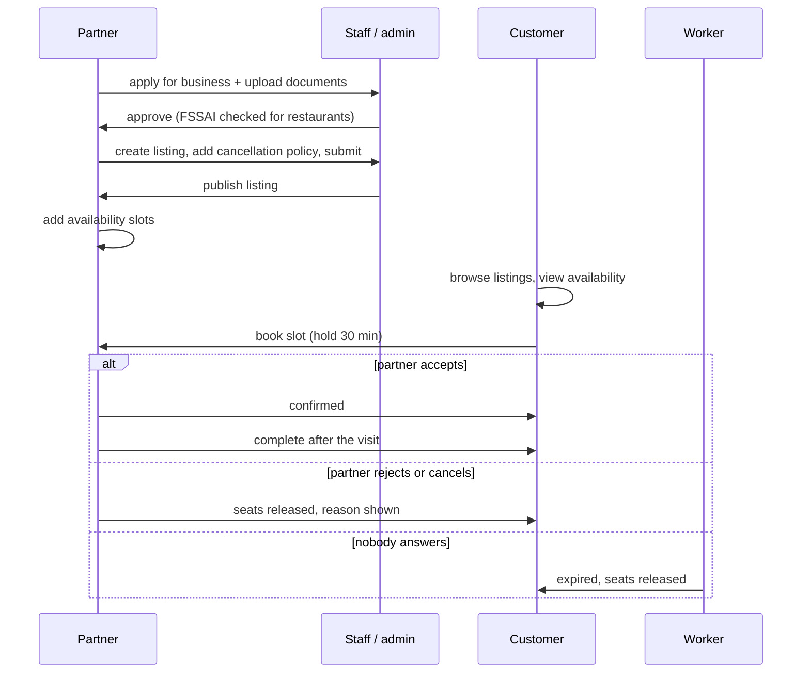

---

## 20. Not built (Phase 7+)

| Area | Status |
|---|---|
| Online payment, `awaiting_payment`, `failed`, `refund_pending`, `refunded`, refund rules from the cancellation policy | Modelled in domain/schema; blocked on gateway choice (D3) and legal/tax review. |
| Push notifications (booking updates, reminders) | Blocked on provider choice (D7). |
| SMS / e-mail provider for real code delivery | Open decision D19; **launch blocker**. |
| Reviews and ratings, food ordering, rides | Later phases. |
| Admin view of all bookings; listing photos | Known gaps. |
| PostGIS-based nearby search | Deferred; in-memory distance sort for now. |
